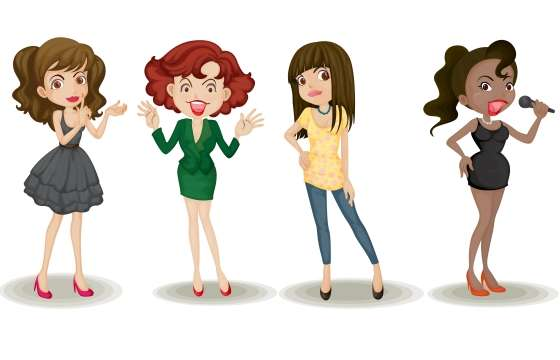

# Хүүхдийн зөрүүд занг хэрхэн засах вэ?

Өсвөр насны хүүхдүүд, томчууд бидний бодлоор илт бодлогогүй, осолтой, найдваргүй зүйл хийхийг хүсч өөрийнхөөрөө зүтгэх, мөн жижиг сажиг зүйл дээр ч зөрүүдлэх байдал гаргаж байдаг. Үүнийг засах, хүүхдийн зан аашийг уян хатан, учир ойлгодог болгохын тулд, та, -“Хүсээд буй зүйл чинь чамд ямар ашиг тус авчирах вэ?, Зайлшгүй хийх ямар учир шалтгаан байгаа вэ?” гэсэн асуулт тавьж, өөрөөр нь тайлбарлуулах, нотлуулахыг оролдохоос эхлэх хэрэгтэй байдаг байна.

Та, өөрөө, хүслийг нь үгүйсгэсэн нотолгоонуудыг гаргаж тавьснаар, хүүхэд дотроо эсэргүүцэн, сонсохыг ч хүсэхгүй байдал гаргаж асуудал улам хүндэрч байдаг. Харин таны, -“Намайг үүндээ итгүүлээд өгөөч” гэсэн хүсэлт тань, хүүхдийг, шийдвэрийнхээ хариуцлагыг өөрөө үүрнэ гэдгээ, тайлбарлаж нотлох үедээ мэдэх, ухамсарлах байдалд оруулж, мөн, хүсэл төрүүлсэн зүйлийнхээ шалтгааныг ойлгох, хүсч буй зүйл нь, бусдад болоод өөрт нь хир итгэл төрүүлж буйг харьцуулах, дүгнэхэд сургадаг. Энэ асуулт хүүхдэд шинжлэх, дүгнэх сэдлийг төрүүлдэг. Хүүхдийнхээ нотолгоог сонсоод, та өөрөө эхний шийдвэрээ өөрчлөхгүй үлднэ гэж тооцож хэрхэвч болохгүй. Магадгүй, хүүхдийн нотолгоон дунд таны санаагүй, анзаараагүй зүйл ч байхыг үгүйсгэхийн аргагүй юм. Тиймээс, үг яриа, нотолж буй зүйлсийг нь сонсоод, та, өөрийнхөө шийдвэрийг өөрчлөх нь, хүүхдийнхээ өмнө нэр хүндээ унагадаг гэсэн алдаатай бодлоос салах хэрэгтэй. Учир нь, эрх мэдэл, баримт нотолгоо ашиглан өөрийнхөөрөө зүтгэх энэ байдлаараа та, хүүхдээ улам холдуулах байдалд оруулдаг. Харин, таны, хүүхдийнхээ санаа сэтгэлийг тооцсон, учир шалтгааныг хамтдаа олсоны үндсэн дээр, бодлоо өөрчлөх үйлдэл тань, хүүхдийн зан чанарыг уян хатан болгоход үлгэр үзүүлдэг бөгөөд, танд илүү итгэдэг болж, итгэлийг тань үнэлдэг болсноор ухаалаг хандлагатай болж зөрүүдлэхээ больдог. Энэ бол, хүүхдийг дуулгавартай байлгахыг эрмэлздэг оролдлогуудаас хавьгүй илүү итгэлцэл дээр тогтох, хүүхдийн хүмүүжлийн шилдэг арга юм.
