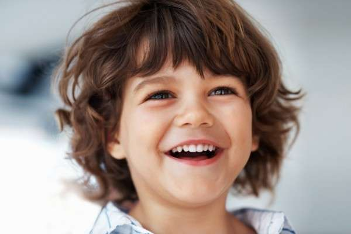
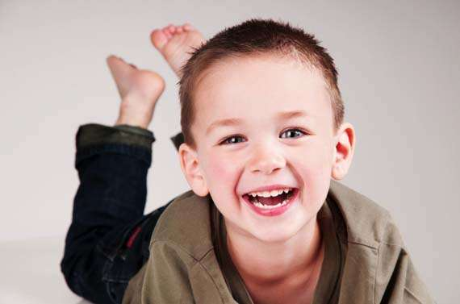

# Хүүхдийнхээ өөртөө итгэх чанарыг хэрхэн устгахгүй байх вэ

Бүх эцэг эхчүүд, хүүхдээ амжилттай, аз жаргалтай амьдраасай гэж хүсдэг. Гэхдээ зарим хүмүүжлийн зарчмуудыг мэддэггүйгээс, өөрсдөө ч мэдэхгүй, хүүхдийн цаашид биеэ даан амьдрах, ертөнцийг таних, шинийг хүлээн авах, урагшлах эрмэлзлийн гол үндэс өөртөө итгэх чанарыг нь үгүй хийж байдаг байна.

-Хэт их хорио тавих. Энэ нь бидний ”болохгүй” гэдэг үгнээс болдог. Хүүхэд тодорхой хэмжээнд алдаж, түүнийгээ засах боломж өгдөггүй. Алдаагаа засах үйлдлийг нь магтаж сайшаах шиг хүүхдийн сэтгэлд хүрдэг, хоногшдог зүйл байдаггүй.\
- Хүүхдийнхээ өмнөөс аливааг шийдвэрлэх, сонгох. Үүгээрээ та , хүүхдээ бусдын үзэл бодолд найдахад сургадаг. Гэтэл хүүхэд багаасаа өөрөө сонгож сурах хамгийн чухал байдаг. \
-Хүүхдээ бусад хүүхдүүдтэй харьцуулах. Аливааг харьцуулах асуудал зөвхөн амьгүй бараа бүтээгдэхүүн дээр л байж болдог зүйл гэдгийг та яс махандаа хүртэл ойлгох хэрэгтэй. Хүүхэд, тэр бүү хэл том хүн ч тэр, өөр өөрийн онцлог давтагдашгүй зан чанартай. Хэрэв таныг хэн нэг найзтай чинь адил байлгах гээд шаардаад байвал танд таатай байх уу? Харьцуулалт, хүүхдийг өөрийгөө бусдаас “муу” гэж ойлгох маш муу үр дагавар дагуулах уршигтай. \
-Шүүмжлэх, загинах. Загинах үед хүн хэзээ ч сайн үг хэлдэггүй. Загинаж зандрахын оронд ойлгож, тайлбарлаж туслахыг хичээ. Үүгээрээ та, өөрийн хайр халамжийг мэдрүүлээд зогсохгүй, нэр хүндээ өсгөдөг. Мөн бүх зүйл засагддаг, зөвөөр шийдэх гарц байдаг гэсэн хүсэл зоригийг төрүүлж өгнө. \
-Хүүхдийг зодож цохих. Энэ бол өвдөлт, доромжлол. Хүүхдэд, хамгийн аймшигтай нь “хүчтэй нь хүчгүйгээ дийлдэг” гэсэн үзэл бодол төлөвшүүлдэг. Тэднийг амьтан тамлан зовоох, бусад сул дорой хүүхдүүдийг дээрэлхэх зэрэгт хөтөлнө. Тэд зодуулахгүйн тулд худлаа ярьж эхэлдэг. Мөн “Намайг зодож байгаа нь намайг хайрладаггүй, би муу, эдэнд хэрэггүй юм байна” гэсэн бодол суулгадаг байна. \
-Уучлал гуйхыг шаардах. Ямар нэг алдаа хийсэн тохиолдолд, заавал уучлалт гуйхыг шаардах нь хүүхдэд, өөрийгөө буруутайд тооцох мэдрэмжийг суулгадаг. Үүний оронд алдаагаа засахад нь тусладаг байснаар, тэр өөрөө бодит амьдрал дээр бүхнийг ойлгох чадвартай болдог.
