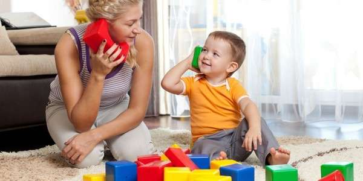
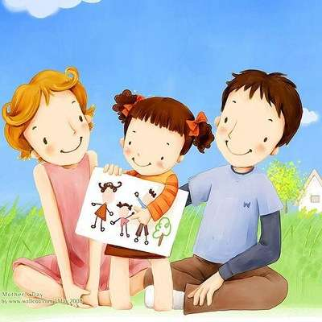

# Хүүхэд байнга сонсож байх ёстой үгс

Дараах үгсийг цөөхөн хүүхдүүд хүүхэд насандаа сонсч байдаг гэнэ.

Зүгээр дээ, бүү санаа зов

Чи ямар ч байсан надад таалагддаг шүү

Чи миний хамгийн хайртай хүн

Миний амьдралын хамгийн чухал хүн чи

Би чамайг сонсож байна

Чи намайг аз жаргалтай болгох албагүй

Бүх хүнд, сэтгэл хөдлөлдөө автагдах үе байдаг

Би тоглож байгааг чинь харах дуртай

Хамт тогломоор байна

Хажууд чинь жоохон хэвтье

Чи намайг инээлгэхэд их сайхан байдаг

Би чамд итгэдэг

Чи үүнийг хийж чадна

Чи төгс биш, би ч мөн төгс биш. Харин бидний хайр төгс

Баярлалаа

Би чамаар бахархдаг

Би чамайг байгаад чинь үргэлж баярлаж байдаг

Чамайг надад өгсөн Бурханд баярладаг

Алдаа гаргах бол байдаг зүйл

Бүү яар

Чи хүчтэй

Бид чиний ээж аав байгаадаа баярладаг

Чи зоригтой

Чамайг уучилалгүй дээ

Чиний тухай үргэлж боддог шүү

Чи бодлоо өөрчилөх нь байдаг зүйл шүү

Тусламж гуйх, хүсэх нь хэвийн зүйл

Уучилаарай

Чи амьдралыг маань сайхан болгодог

Чи авъяастай шүү

Чи нэр төртэй, эрх бүхий хүн

Чи миний хувьд хамгийн чухал

Би чамд хайртай

