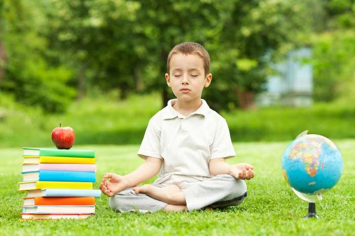
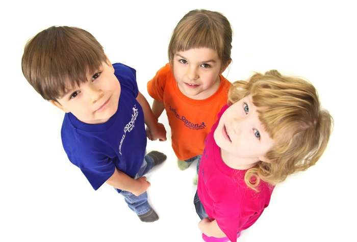

# Хүүхэд хүмүүжүүлэх түвд үзэл

Хүүхдийг эцэг эх, өвөг дээдсээ хүндэлдэг, биеэ даасан жинхэнэ хүн болгон хүмүүжүүлэхэд тустай мэргэн аргыг танилцуулъя. Энэхүү үзлээр, хүүхдийг дорд үзэх, доромжлох, зодож цохихыг бүр мөсөн хориглодог.

**5 нас хүртэлх хүмүүжил.** Энэ үед хүүхдээ, хаан мэт харьцаж байх хэрэгтэй гэнэ. Юуг ч хориглож болохгүй, хорих шаардлагатай бол мартагнуулах, сатааруулах маягаар шийдэх хэрэгтэй ба хэрэв аюултай зүйл оролдож байвал айсан дүр гарган, айсан дуугаар хашгирах зэргээр аргалдаг. Хүүхэд иймэрхүү харьцаанд дуртай байдаг гэнэ. Мөн энэ үед хүүхдэд, амьдралыг тайлах сонирхол, идэвхи, сониуч зангийнх нь эхлэл тавигддаг. Ямар нэг зүйлийн утга учирыг сайн ойлгож эхлээгүй байдгаас, үнэтэй ваар хагалчихаад шийтгүүлэхийг, энэ зүйлийг авахын төлөө ажиллаж мөнгө хурааж байж авдаг гэх мэтийг ойлгодгүйгээс, том хүн хүчтэй учраас дийлж шийтгэж байна гэж хүлээж авдаг. Ингэснээр, ваар хагалахгүй байхад сургах биш, харин хүчинд автагдах таагүй мэдрэмжийг хүүхэддээ өгдөг.\
**5-10 нас.** Энэ үед хүүхэдтэйгээ боол мэт харьцах ёстой байдаг байна. Үүрэг даалгавар өгч, биелүүлэхийг шаардна. Биелүүлээгүй тохиолдолд шийтгэж болно. Гэхдээ хэрхэвч зодож цохиж болохгүй. Энэ үед хүүхдийн оюун ухаан эрчимтэй хөгждөг бөгөөд хүүхэд, өөрийнх нь хийсэн үйлдэлд хүмүүс ямар хариу үйлдэл хийхийг таамаглах, аятайхан харьцааг татах, сөрөг зүйлсээс зайлсхийх зэрэгт суралцдаг. Мэдлэг олгох ачаалал өгөхөөс бүү айгаарай.\
**10-15 нас.** Энэ үед нь, хүүхэдтэй эрх тэгш харьцах хэрэгтэй байдаг. Эн тэнцүү биш, харин ижил нэг түвшний хүн мэт харьцна. Бүх чухал асуудлуудаа зөвлөлдөж, биеэ даасан байдлыг олгох, биеэ даасан байдлыг нь урамшуулахад чиглүүлдэг. Та, өөрийнхөө хүсэл зоригоо хэзээ ч тулгаж болохгүй. Зөвхөн, хэлэлцэх, “будаа идүүлэх”, зөвлөх маягаар тусладаг. Заримдаа, хүүхдээс таалагдахгүй бодол сэтгэлгээ, үйлдэл гаргах байдал анзаарагдаж байвал, шууд хорьж үгүйсгэхгүйгээр, тэр зүйлээс гарах таагүй үр дагаврыг нь сайн ойлгуулж тайлбарлах маягаар шийдэж байх хэрэгтэй.Энэ үед, хүүхдийн бие даасан тусгаар байдал төлөвшиж байдаг.\
**15 нас.** Энэ үед түүнтэй хүндэтгэлтэй харьцах хэрэгтэй байдаг. Хүмүүжүүлэх арга барил хэрэглэх нь оройтсон байдаг учраас, танд, хүүхдээ хүмүүжүүлэхэд зарцуулсан хөдөлмөрийн үрээ харах, хүлээж авах л үлдсэн байдаг байна.\
**Эдгээр дүрмүүдийг мөрдөөгүйгээс дараах үр дүн гардаг:** -5 нас хүртэлх хүүхдийг хэт дарах, хориглох хүмүүжлийн арга хэрэглэснээр хүүхдийн амьдралын идэвхи, сонирхол, оюун ухааныг дарж, өөрөөсөө хүчтэй, хэн нэгэн илүү хүчтэйд үйлчлэх дадалтай болгодог ба бүх төрлийн таагүй зүйлсийн золиос болох магадлалд хүргэнэ.\
-5 наснаас дээш насны хүүхдийг үүрэг хариуцлагад сургаагүйгээс, ажил хөдөлмөрт бэлтгэгдээгүй сэтгэлийн тэнхээгүй хүн болгодог.\
-10 наснаас дээш хүүхдийг, бага жаахан хүүхэд мэт авч үзсэнээс, хүүхэд өөртөө итгэлгүй, өөр бусад илүү биеэ даасан хүмүүжилтэй тэр болгон сайн нөлөө үзүүлэх эсэх нь тодорхойгүй найз нөхдөөсөө хамаарамтгай хүн болно.\
-15-с дээш насны хүүхэдтэйгээ зохих хэмжээний хүндэтгэл хайр үзүүлэхгүй харьцах нь, хүүхдийг холдож тусгаарлах сэтгэлтэй хүн болгон өсгөнө
