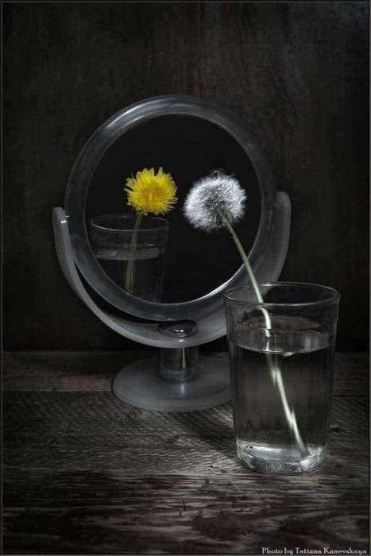

# Хүүхэд мэт жаргалтай бай

Аав минь өөд болсоны дараа ээж минь манайд ирсэн юм. Белорус дах жижигхэн байшиндаа, 100 орчим долларын тэтгэвэрээр яаж ч амьдрах билээ дээ. Тэр тусмаа бүх зүйлс нь аавыг санагдуулах тийм орчинд яаж ганцааранг нь байлгах билээ. Ингээд би, амьдран суугаа Стокгольм хот руугаа урьснаар, зөвшөөрөл нь гарч ээж минь ирлээ. Ирсэнээс нь хойш гурван сарын дараа, энэ улс түүнд амьдрах байр өглөө. Учир нь энэ улсад, ээж минь настай хүн учираас, тэтгэвэр өгдөг, үнэгүй эмчилгээ, үнэгүй цахилгаан, үнэгүй такси, үнэгүй нийтийн тээврээр хангадаг улсын хангамжаас өөр, хэн нэгнээс хамааралгүй байх ёстой аж. Дараа нь бүр ч гайхалтай, -“Хэрэв та гадаадынханд зориулсан швед хэлний хичээлд сууж хэлний мэдлэгээ дээшлүүлэхийг хүсвэл, тийм өдрүүдэд эхэлнэ, тавтай морилно уу”, гэсэн агуулгатай нэгэн албан бичиг ирлээ. Ээж минь: “Хүү минь, би чинь 73 настай, ичмээр байлгүй” гэхэд нь, би “Үгүй ээ ээжээ, та онц сурдаг байсан шүү дээ, та энэ сургуульд бас л онц сурах болно” гэлээ. Ээж маань сургуульдаа явлаа. Тэнд нь түүнтэй адил, эмгэд өвгөд, зарим нь 10–д ах, зарим нь арай залуу жараад настай хүмүүс, жар гарсанууд нь ангийнхан дундаа бага, бараг хүүхэд шахууд тооцогдно. Ингээд анги бүрдлээ. Яг л сургуульд явдаг байсан шиг нь, анги хамт олон, дурлал хайр, зурвас, бялуу хувааж хөгжилдсөн төрсөн өдөр, аялал, зугаалга бүгд байх бөгөөд нэг өөр зүйл нь мөнгө нэхэгддэг бүхэн нь улсаас даадаг үнэ төлбөргүй, бусад нь дунд сургууль шиг л үүх түүхтэй, сургуулийн амьдрал бүхий сурагчидын анги шүү.

Энэхүү өөрчилөлтөөр дүүрэн идэвхитэй амьдралаар амьдарч байгаад, миний ээж 97 наслаад мөнх бусыг үзүүлэв. Түүний нэг найз нь эмч нарын буруутай үйлдлээс болж цагаасаа өмнө 99 настайдаа, өөр нэг найз нь 103-тайдаа нас барсан. Тэд сүүлийнхээ хэдэн жилд хамтарч ном бичиж хэвлүүлж, Испани, Англи, Израйль аялцгааж өгүүлшгүй өндөр сэтгэгдэлтэй ирцгээдэг байсан. Харин хамгийн сонин нь, энэ ангийнханы сурагчидын ¾-нь амьд сэрүүн идэвхитэй амьдарч байгаа нь гайхалтай юм шүү. Энэхүү нүдэн дээр минь өрнөсөн ээжийн минь амьдрал, гайхалтай өөрчилөлтүүд надад дараах зүйлийг бодогдуулахад хүргэсэн гэх үү дээ.

Нас явж, өтлөх амьдралын тодорхой нэг хэсэг үед хүн, амьдрал дуусч байна, урд минь зөвхөн өвчин, найдваргүй байдал, үхэл л байгаа, миний оюун санаа, үзэл бодол, дуртай шүлэг найраг, хөгжим хэнд ч хэрэггүй, би бүхнээс орхигдсон, зүгээр л хэсэг амьд явах юм даа гэсэн бодолд хүлэгдэн хүлцэнгүй болж, бараг хүлээлтийн байдалд ордог. Энэ үедээ, хүн сургуульд явж, суралцаж, алдаатай бичиж, засч, цээжилж, аливааг сурахыг хичээснээр, “Амьдралд минь бас өөр зүйлс байна. Би энэ харь хэлийг, авсандаа авч орохын тулд биш, харин энэ хэлээр ярилцаж, харилцахын тулд шүү дээ” гэсэн бодолтой болж, хүсэл зорилгоор дүүрдэг ажээ. Хүн бол бие мах бодь гэхээсээ илүүтэй сэтгэлийн амьтан. Бие мах бодио ажиглаж, бие мах бодийн өөрчлөлтүүдээ хэт анзаарах байдал давамгайлах үед хүнд, амьд явах л үлднэ. Харин сэтгэл нь хүчирхэг, бие мах бодийн өөрчлөлтөө эерэгээр хүлээн авах байдал давуу байвал, -“Нас хэд нь хамаагүй, биеэ өхөөрдөж, энхрийлээд л болоо”. Тиймээс, хүмүүсийн хувьд нас бол тоо гэдэг үнэн, гадаад хэл сурах нь юу ч биш, бүр дурлаж, /80 насандаа зав залуухан 65-тай хүнд шүү/, жинхэнэ дурлахыг үзэх гэж, гэсэн бодлууд нь тархийг өөрчилж, хөгшрөлт зогсдог аж. Тиймээс, зоригтой, өвөрмөц, оргилуун, сониуч бай. Шүлэг чангаар уншаад үз. Гэнэт өөрийгөө нээх ч юм билүү. Гэнэт бүхий л хандлагууд тань өөрчилөгдөж, жүжигчиний хоолойгоор гайхалтай ярьж, бүжиж хараймаар санагдах ч юм билүү. Урд нь огт очиж байгаагүй газруудаар гайхширан алх. Тойроод огт өөр ертөнц байгаа гэж төсөөл. Өөртөө 20,15,10, бүр 5-ч байсан яадаг юм аз жаргалтай он жилүүдийг ав. Идэвхитэй амьдар, өвдөхгүй. Нас тань хэр өндөр байна төдийчинээ өөрийгөө хайрла. Түүртсэн хөдөлгөөнөө анзаарвал шоглож, тоглоод инээ. Гайхаж шагширах сэтгэлийн хөдөлгөөнөө бүү гээ. Хөгширөлт бол гайхах чадвараа гээсний хэрээр явагддаг. Сэтгэл зүрхэнд тань тэжээл болох сонгодог хөгжим сонсож бай. Утгагүй санагдаж байна уу? Бид үүнийг мэддэггүйдээ алддаг. Агуу зохиолчидын гайхалтай, сод хөгжимүүдийг ойлгоод эхлэвэл нас тань автоматаар уртсах болно. Учир нь энэхүү гайхамшигт аялгуугаар, “Үүрд мөнхийн ертөнцийн” дохионууд ирж байдаг гэдэгт итгээрэй. Харин бидний боловсроогүй, бүрэн хөгжөөгүй бодол сэтгэл, бие мах бодид маань дарангуйлагдаж мөнх байж чаддаггүй ажээ.

Михаил Казник

