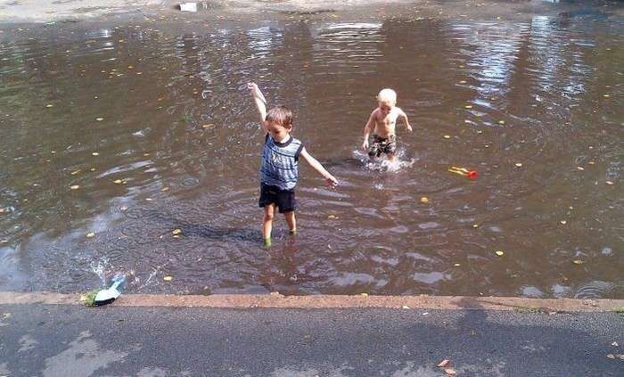
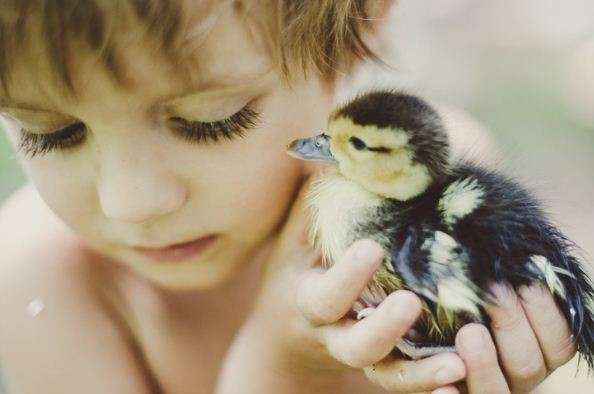

# Хүүхэд насаа бүү март

Өглөө, шөл идэж байгаад цагаан цамцан дээрээ дусаачихаад, би, -“Ямар балай юм бэ!” гэж өөртөө уурсав. Тэгснээ, шууд л өөрийгөө өршөөж байна. /Хүн ер нь, өөрийн янз бүрийн алдаагаа үргэлж өршөөж байдаг/ Тэгтэл, хүү маань, шөлөө ширээн дээр цалгиулчих юм. Би ч, -“Аятайхан идээ ч!” гээд өөрийн эрхгүй эвгүйгээр зандрав. Тэгсэн ээ, би өөрөө асгахад намайг хэн ч зандраагүй, би өөрийгөө дуугүйхэн өршөөчихсөн шүү дээ гэсэн бодол орж ирэн, ер нь, өнөөдөр өөрийгөө, томчууд бид, хүүхдүүдийнхээ хийгээгүй орхигдуулсан эсвэл санамсаргүй гаргасан алдаанууд дээр загинаж ундууцаж байдаг шиг, зандарч загинаж өнгөрүүлье гэж шийдлээ.

Ажилдаа гарахаар, үүдэнд гутлаа өмсөв. Энэ үедээ, би, -“Гутлын зуузай баллачихав, гутал өмсөгч ашигла, хаана байгаа юм бэ? Яахаараа мэддэггүй юм? Замбараатай байгаач” гэж хүүхдүүддээ хэлдэгээ санасан ч, зүгээр хуруугаараа татаад өмсчихсөн зогсох юм. Сэтгэл эвгүй болж байна. “Хүчил шиг идэмхий” сургамж хэдийнээс уламжилсан юм бол? Гараад явлаа, гадаа хачин сайхан байна, сэтгэл санаа сэргэж, нэг л сэргэлэн, хөлний минь урд хэвтэх бөөрөнхий мөсийг өшиглөмөөр санагдаад өшиглөтөл өнхрөөд л сайхан ч юм шиг. –“Гутлынхаа хоншоор халцалчихлаа, Гутлыг чинь авч өгч дийлэхгүй юм байна” гэж өөртөө, ууртай хэлэх гэсэн боловч, болохгүй хүчлэн байж хэлэв. Гэртээ орой нь ирээд, угаалтуур доторх аяга тавгийг хараад, -“Дор нь угаачихаж болсонгүй юу?” гэсэн миний үг чихэнд минь жингэнэв. Үргэлжлээд, “Арчаатай байгаа ч, чи хүн шиг байгаа ч... олигтой хүн болохгүй нь л дээ!” хүчил ээ, хүчил... Оройн хоолоо бэлдэхээр, дээд тавиураас сав авахдаа хаалгыг нь хаахаа мартсанаа, духаараа тас хийтэл мөргөчихөөд, өвдөж байна гэж жигтэйхэн, нулимс гарах нь ээ. Дотроос минь чихэнд, -“Би хэлдэг биз дээ. Хаалгыг нь марталгүй хааж бай гэж хичнээн удаа хэлэх юм. Өөрөө мөргөчихөөд битгий янгуучил” гэж сонсогдож байна. Гомдож байна гэж жигтэйхэн, шууд суугаад гуниг төрөх юм. Тэгтэл үргэлжилээд, миний дуу, -“Аан, яасан? Яагаад суучихав? Гэрийн ажил хэцүү байна уу? Энийг чинь хийсээр ирсэн нь хэн билээ?”. Аймаар муухай, нулимс гармаар болж байна. Учир нь ийм дуу хоолой сонсч амьдрах утгагүй санагдаж байна. Амьдрах, бүр энэ дуу хоолой нь ээжийн дуу хоолой шүү!\
Ийнхүү ганцаараа, өөрийгөө загинаж өнгөрүүлсэн энэ өдрөөс хойш би, хүүтэйгээ гадаа хэвтэх бөөрөнхий зүйлийг хамт өшиглөчихөөд инээлдэж хөөцөлддөг болсон, инээд хөөр гутлаас үнэтэй болохыг мэдэрсэн, үгийн гашуунаар хүүхдийнхээ сэтгэлийг өвтгөхөө больж, хүүхэд насаа мартахгүйг хичээдэг болсон юм. Хүү минь дуу муутай байвал би, үг дуугүй түүнийгээ тэвэрдэг. Тэврэлт бол ямар ч үгнээс хүчтэй байдаг юм билээ. Сэтгэгдлээ загинаж зандран илэрхийлэх, өөрийгөө хүүхэд байснаа мартсан ааш аяг гаргахаа больсон. Хүүхэд насных нь дурсамжаас, гутлын халцарсан хоншоор, амтлаг идээ ундааны толбо, гэнэдэж мартсан алдаа дутагдалыг нь үндсэндээ салгаж, оронд нь инээд хөөр, өөртөө итгэх итгэлийг л үлдээхээр шийдсэндээ баяртай байдаг шүү.
