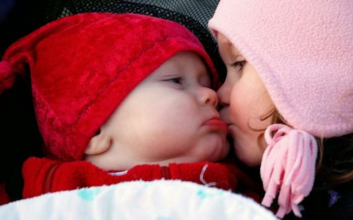

# Хүүхэд тань, өдөр бүр сонсож байх ёстой 7 үг

Бид үр хүүхдээ өсгөж хүмүүжүүлэхдээ, хүүхэддээ тэр болгон хайртай гэдгээ илэрхийлээд байдаггүй. Түүнээс биш бид, хүүхэддээ хичнээн хайртай билээ. Ээж, аав нар минь! Хүүхдээ хайрладаг, үгээр илэрхийлэхийн аргагүй хайраа илэрхийлж байцгаая!

1. Би хүүдээ, /охиндоо/ хайртай шүү\
2. Би чамаараа бахархдаг\
3. Бүх зүйл чинь болно, чи чадна\
4. Намайг, /ээжийгээ, аавыгаа/ уучлаарай\
5. Би чамайг уучилж байна\
6. Бүх зүйлс сайхан болно\
7. Чи, бол миний жинхэнэ давтагдашгүй гайхамшиг

Хүүхэд тань бүр 30 настай ч байсан энэ үгсийг хэлж байгаарай
