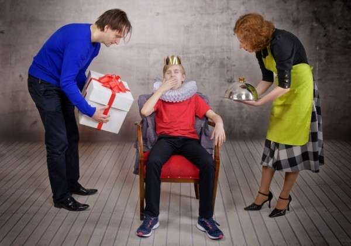

# Хүүхэддээ аминч үзэл төлөвшүүлдэг, эх эцгийн алдаанууд

Аминч үзэлтэй, хувиа бодсон хүн хэзээ ч жаргалтай байдаггүй. Бусдаас таагүй харьцаа авч, өөртөө итгэлгүй болж, үл ойлголцол, гомдол, шаналалтай ганцаардмал амьдралаар амьдардаг. Үр хүүхдээ аминч үзэлгүй, биеэ даасан, нийгэмшсэн иргэн болгохын тулд дараах зүйлийг уншин хэрэгжүүлээрэй. Хүүхдүүдийн маань ирээдүй бидний гарт байдаг гэдгийг бүү мартагтун.

1. Хүүхдээ хэтрүүлэн дүгнэх. Шалтгаангүйгээр хэтрүүлэн магтах, үнэлэх нь хүүхдэд, өөрийгөө өргөмжлөх сэдэл төрүүлж, бусдыг ойшоохоо больж тусгаарлагддаг.\
2. Өөрсдийнхөөрөө байлгах гэсэн шаардлага хүсэл тань, хүүхдийн биеэ даах боломжийг үгүй хийдэг. Мөн идэвхи сонирхолыг нь дардаг\
3. Хүүхдийнхээ өмнөөс бүхнийг хийх, шийдэх. Энэ бол нийтлэг алдаа бөгөөд хүүхдийн санаачлага гаргах, аливааг эрэл хайгуул хийх бодол санааг устгадаг\
4. Эцэг эхийн, өөрсдийнх нь амиа бодсон зан суртахуун, хүүхдийн хувьд жинхэнэ үлгэр жишээ болж өгдөг учраас, эцэг эхчүүд өөрсөд дээрээ ажиллах хэрэгтэй\
5. Хүүхдийн үйл хөдлөл, үйлдлүүдийг мөнгөөр үнэлэх. Нэг талаас мөнгөний үнэ цэнийг мэдрүүлдэг гэдэг боловч, хүүхдийг, өөрийнхөө үйлдлийг биш мөнгийг үнэлдэг болгодог гэж үздэг. Мөн, мөнгөний төлөө аливааг хийх нь, урам зориг, бүтээлч сэдэл, чадварыг бууруулдаг\
6. Хүүхдийнхээ хүмүүжилд хэт анхаарах, шаардлага тавьж мөрдүүлэх нь хүүхдийн сэтгэхүйд дарамт үүсгэн сэтгэл зүйн өсөлтийг нь зогсоох аюултай байдаг

#### Хэрэв хүүхдийн зан чанарт аминч үзлийн шинж чанар илрээд байгаа бол яах вэ?

-Хүүхэддээ тавьдаг, зарим анхаарал халамжуудаа зогсоо. /унтаж хоцроохгүй тулд сэрээдэг, хийх ёстой зүйлүүдийг нь байнга сануулдаг, хичээлээ хий үед нь хамт хийлцдэг, хоол, цайгаа уух үед нь үйлчлэх зэрэг/ \
-Хүүхдээ, хийсэн үйлдэл эсвэл залхуурсан, мартсаных нь төлөөх хариуцлагыг таагүй ч байсан хүлээлгэж сурга. Энэ нь туршлага суух сайхан нөхцөл болдог. Өөрөө бие даан сонгох, шийдвэр гаргах нөхцөл боломжийг олгож бай. Энэ нь, хүүхдийн хувьд таны сонгож бэлэн болгосон шийдвэрээс хамаагүй үнэтэй ирээдүйд нь хэрэг болох сайн туршлага болж өгдөг\
-Зөвхөн өөртөө үйлчлэхэд бус, гэрийнхэндээ үйлчлэх тусалдаг байхад сурга\
-Хүүхдийнхээ амжилтыг сонирхох үедээ, найз нөхдийнх нь амжилтын талаар асууж, ярилцан сэтгэгдлийг нь яриулж бай. Найз нөхдийнхөө амжилтыг магтсан яриаг нь дэмжиж урамшуулж байгаарай.\
-Хүүхдийн бусадтай харилцах харилцааны орчинг тэлж, амьдралыг танихад нь тусалж бай

Аминч үзлээс салгах хамгийн найдвартай, үр дүнтэй арга бол, бусдыг ойлгох буюу өөрийг нь хэн нэгний оронд тавьж, тэрхүү байр байдлыг ойлгодог болгоход сургах арга юм. Үүнийг хүүхэдтэйгээ нэг түвшинд ярилцаж, шударга, энэрэнгүй, бусдад туслах сэтгэлийг нь өдөөж өгөхөөс эхэлдэг. Энэ үедээ, өөрийнх нь байдал давуу байгаа талаар харьцуулж, дүгнэсэн үгс бүү хэлээрэй. Энэ нь та, өөрийгөө л магтаж байна гэсэн үг аж. Хүүхэд тань, нээлттэй, нийтэч, бусдын төлөө сэтгэлтэй болж өсөх нь, өөрт нь амьдрахад хөнгөн, таны хувьд ч тэр, хүүхдийнхээ ирээдүйд сэтгэл хангалуун, итгэлтэй байх сайхан нөхцөлийг бүрдүүлж өгдөг.
