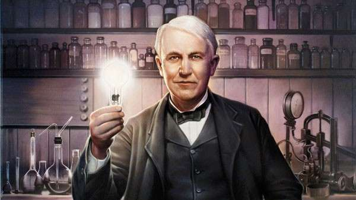
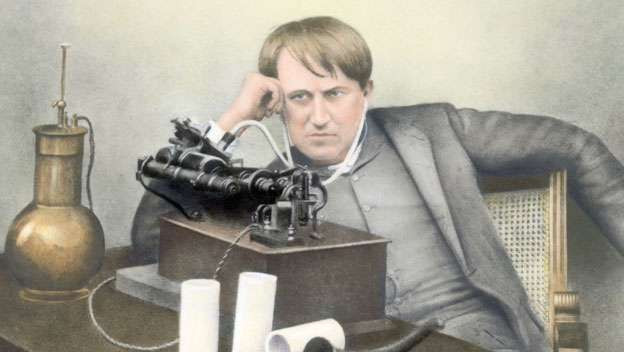

# Хүүхэддээ эцсээ хүртэл, итгэ

Нэг удаа, нэгэн хүү, хичээлээсээ тарж ирээд ээждээ багшийнхаа өгсөн захидлыг өгчээ. Тэгээд ээж нь уг захиаг уншиж уйлснаа, хүүдээ чангаар уншиж өгчээ. Тэрээр, уг захиаг, “Таны хүү хэт ухаантай сод хүүхэд тул, таны хүүд манай сургууль багадаж байна. Таны хүүд зааж сургах хэмжээний авъяаслаг багш манайд байхгүй. Тиймээс сургах асуудлыг та өөр дээрээ авахыг зөвлөж байна” гэж уншжээ. Үүнээс хойш, олон жил өнгөрч, ээж нь өөд болсны дараа өнөөх хүү, гэртээ хуучин зургийн цомгуудаа үзэж байгаад, нөгөө захиаг олжээ. Тэр түүнийг унштал, уг захианд, “Таны хүү оюуны хомсдолтой юм. Тиймээс бид бусад хүүхдүүдтэй хамт сургаж болохгүй. Тиймээс та өөрөө түүнийг бие дааж сургахыг зөвлөж байна” гэсэн байжээ. Энэ хүүг Томас Эдисон гэдэг ба энэ захиаг унших үедээ тэр, дэлхийн хэмжээний, эрин зууны алдартай зохион бүтээгч болчихсон байлаа. Захиаг уншсаны дараа, тэр хэдэн цагийн турш уйлснаа, тэмдэглэлийн дэвтэртээ, дараах зүйлийг бичжээ. “Томас Эдисон бол оюуны хомсдолтой хүүхэд байжээ, гэвч, өөрийн баатарлаг ээжийнхээ хүчээр, тэр эрин зууныхаа агуу сод ухаантнуудын нэг болсон юм байна, эхийгээ үнэл, зөвхөн тэд л биднийг байгаагаар маань хайрлаж, юу ч болж байсан бидэнд итгэж чаддаг” гэж бичжээ. Томас Эдисон, амьдралыг хамгийн их хялбарчлах нээлтүүдийг хийж, мянга гаран зохиогчийн эрх эзэмшдэг зохион бүтээгч бизнесмен байсан бөгөөд цахилгаан гэрэл, нүүрс төрөгчийн эсэргүүцэлтэй харилцуур утас, дуу бичлэгийн машин, фонограф, кинофотограф зэргийг бүтээж, дэлхийд нэртэй “Женерал Электроникс” компанийн суурийг тавьсан гарамгай зохион бүтээгч байжээ.
