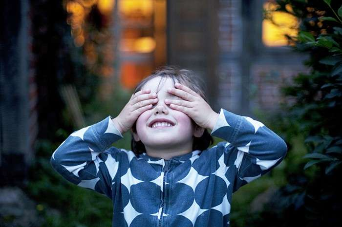
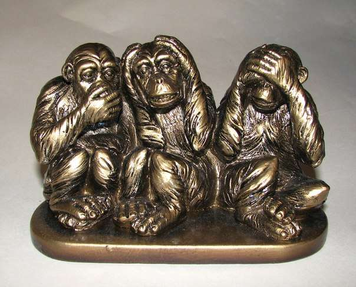

# Хүүхэддээ мууг бүү харуул

Мод ургаж байх үед саад хийхгүй бол, тэгш сайхан зөв хэлбэртэй мод ургадаг гэдгийг бүгд мэднэ. Хүн ч мөн үүнтэй адил өсөх үед нь саад өгөхгүй, өөрөөр нь байлгаснаар эрүүл зөв хүн болдог байна.

Энэхүү саад гэдэгт, сайн муу нөлөөний аль аль нь орох бөгөөд, хэрэв бага хүүхэд муу зүйл харж дуурайн, мөн муу нөлөөгөөр буруу зүйл хийснээр, бид, сайн нөлөө үзүүлэхийн тулд, аливааг хааж хориглож сайн зорилготой ч муу саад хийж эхэлдэг байна. Хэрэв, хүүхдэд, муу зүйл, муу нөлөөг харуулахгүй, тэр, түүнийг огт мэдэхгүй өсөх боломж байсан бол, шинжлэх ухааны салбар болтлоо хөгжсөн сурган хүмүүжүүлэх ухаан, сэтгэл зүйн шинжлэх ухаан огт хэрэггүй, бид ч хүүхдийн хүмүүжил гэж хөөрцөглөхгүй амгалан тайван байх байсан. Бага хүүхдүүдийг хар даа, тэд хичнээн аз жаргалтай вэ? Тэд, “саад”-тай учраагүй, өөрийнхөө тухай сайхан бодолтой, өөрийн “Би”-г өндөрт тавьж, өөртөө эерэг хандлагатай байдаг. Дараа нь, тэд өсч эхлэн, нийгмийн харилцаанд орох бөгөөд эхний үед, ойр дотныхонтойгоо харьцах харьцаа эерэг, харилцааны хүрээ нь өргөссөнөөр, мөн танил, найз нөхөдтэй харьцах харьцаа мөн эерэг, тоглох үйлдэлд хандах харьцаа мөн эерэг байдаг. Үүнийг, тэр чигт нь хадгалж чадсан хүн жаргалтай байдаг. Харин, эдгээр харилцааны аль нэг нь, орчины нөлөө, “саад”-с болж доголдоод эхлэхэд, мэдрэлийн эмгэг бүхий хувь хүн төлөвшиж эхэлдэг. Мэдрэлийн эмгэгийн гол шинж нь, өнөөдрийг өчигдөр шиг байлгах, маргаашийг өнөөдөр шиг байлгах хүслээр илэрч байдаг бөгөөд ийм хүний сэтгэхүйн өсөлт зогсдог. Гэтэл, хүний мөн чанар нь, байнгын өсөлт, дэвшилт, амьдралынхаа туршид олох ололтуудаар дүүрэн бүтээлч амьдралаар амьдрахад оршдог билээ. Муу зүйлийг бүү хар, бүү сонс, бүү үнэрт, бүү амтал, бүү хүрт, бүү бод. Эртний сургаал юутай үнэн...
