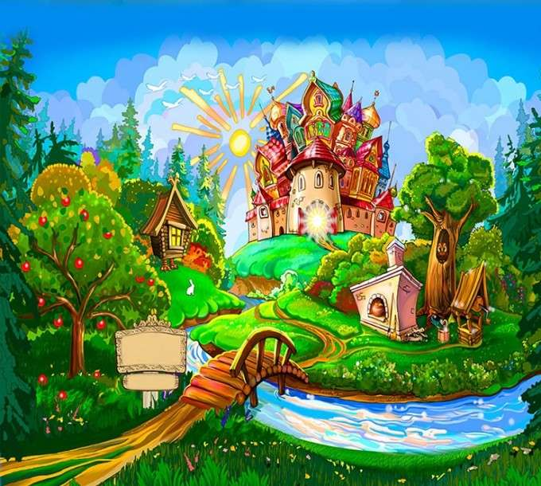

# Хүүхэддээ уншиж өгөөрэй

Үргэлж биднийг дуудаж, зүүдэндээ хүртэл уулзаж байдаг миний хөөрхөн найз аа! Бид, үлгэрийн хаант улсын ханхүү, гүнж хоёр байна. Чамаас тусламж гуйхаар хандаж буйг маань хүлээн авна уу.

Манай хаант улс, уул нь сайхан, гэгээлэг, өнгө өнгөөр алагласан гоё улс л даа. Манай улсад бүх үлгэрийн баатрууд амьдардаг. Чиний мэддэг бүх үлгэрийн баатрууд энд байдаг. Энд, үлгэр дээр гардаг бүх муу гол баатрууд, сайн үлгэрийн баатрууд бүгд эвтэй найртай амьдарч бие биенээ гомдоодоггүй. Сүүлийн үед, харин манай улсад нэгэн зовлон тохиолдож, оршин суугчид маань болох үлгэрийн баатрууд маань нэг нэгээрээ алга болоод эхэлсэн. Учир нь, хүүхдүүд үлгэрийн номоо уншихаа больсон. Бид номон дотор байдаг, номоор дамжуулан та нартай уулздаг болохоор та нар л, бидэнд тусалж чадах юм. Бидний тухай бага унших тусам бид хүчгүй болж, бүр устаж үгүй болоход хүрээд байна. Найз минь, үлгэрийн номоо уншаач, гуйя, үлгэргүй болвол уйтгартай биз дээ. Бид чинь ид шидтэй, та нар үлгэрээ уншихад бид баярлан хамтдаа байдаг юм. Хамгийн сүүлд хэзээ үлгэр уншсанаа сана даа, найз минь. Өдөр бүр нэг үлгэр уншиж бидэндээ туслаач. Өдөр бүр үлгэр, ном уншиж бидний алга болсон найзуудыг, хайртай үлгэрийн баатруудаа эргэн ирэхэд туслаач. Дэлхийгээ, ид шидийн ертөнц, үлгэргүй болохоос авраач. Хайртай үлгэрийн баатруудынхаа нэрсийг бичээрэй. Хайртай шүү! Үлгэрийн номон дотроо удахгүй уулзна гэж хүлээе. Та нартаа хайртай, үлгэрийн ханхүү, гүнж хоёр чинь.
