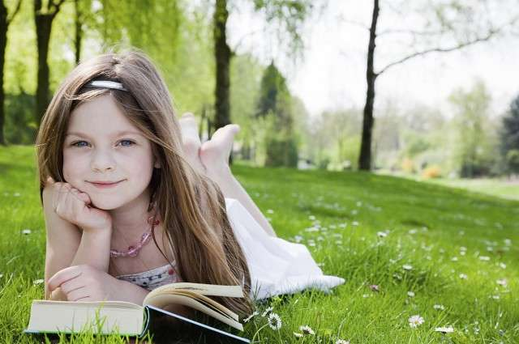

# Хүүхэддээ захиа бичих нь...

Бид, үр хүүхэддээ, ямар ч нөхцөл байдалд, ямар ч үед, ямар ч байдлаар, хэлэхийг хүссэн зүйлсээ, хүссэн үедээ хэлцгээж байдаг бөгөөд бид, тэднийгээ харах бүрийд хайрыг маань хүргэдэг зүрхэнд маань байдаг тэрхүү хайрын хүчийг харуулахсан, тэд ч, үүнийг мэдээсэй гэж туйлаас хүсдэг маань нууцгүй атал тэр бүр хайраа ойлгуулах гээд байхгүй хүүхэд насыг нь үддэг. Тэгвэл дурсамж дүүрэн, дараа нь уяран суух, мөн хайрыг маань хадгалах, харуулах хөөрхөн арга байдаг. Тэр нь, хүүхэддээ захидал бичих.

Бид, хүүхдүүдээ бага байна, ойлгохгүй, уншиж ч чадахгүй шүү дээ гэж боддог. Гэтэл энэхүү захиаг маань, өсч том болоод уншиг. Учирыг нь ойлгоод зогсохгүй, удамд маань дамжих захиас болно. Нэг ээж, хүүгээ төрснөөс нь эхлэн, хүүдээ захиа бичсээр, хүүгээ том болж, өөрөө аав болоход нь өгсөн гэдэг. Хүүгийн хувьд, өөрийнх нь өссөн бүхэл бүтэн түүх шахуу, хоорондын ойлголцол, зөрчил, хамтын баяр баясгалан, хайр, дурсамжит тохиолдлууд бүхий тэр захидал юугаар ч сольшгүй, хэдээр ч үнэлшгүй хамгийн том бэлэг болсон нь хэн бүхэнд ойлгомжтой. Түүнд, хичнээн их тустай вэ? Та, бодоорой. Мөн, баярлаж бахархах үедээ, эсвэл хайр хүрч, өхөөрдөн, эгдүүрхэж бялуурах бүртээ захиагаа бичиж, бүр, үл ойлголцол, зөрчил гарах үеийг ч сэтгэл хөдлөлөөр шийдэхийн оронд, бодлоо захианд буулган халаасанд нь шургуулчихвал асуудал шийдэх аятайхан боломж болох юм. Захиа бичих цаг зав олдохгүй эсвэл бичих боломж бүрдэхгүй бол, бяцхан зурвас бичиж халаас, цүнхэнд нь хийгээрэй. Хүүхэд тань, “Миний хүү /охин/, өчигдөрийн чинь дүн намайг их баярлуулсан, хайртай шүү”, “Хөөрхөнөө, чи, багтаа ёстой сайн тоглосон. Чамаараа бахархаж байна”, “Чиний зөв байсан шүү, уучлаарай”, “Хайртай шүү, амжилт!” гэх мэт зурвасуудыг олж унших үеийг нь та, төсөөлдөө. Гайхалтай сайхан мэдрэмжийг хүүхэд тань амсах болно. Эдгээр үгийг бид, хүүхэддээ хэлж байдаг. Гэхдээ, захиа, зурвас нь хүүхдийн сэтгэлд огт өөрөөр тусдаг, тэр дундаа, түүнийг олох, олоод унших нь тэдний хувьд бяцхан адал явдал болдог бөгөөд уран сэтгэмжид урин, ухааныг нь хөгжүүлэх, сэдэл төрүүлэх уран арга болдог байна.
