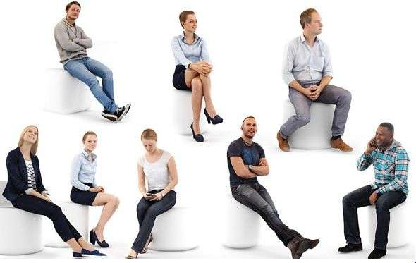

# Хөлөө зөрүүлэн суух юуг илэрхийлдэг вэ?

Гараа энгэртээ зөрүүлэн барьсан хүнийг хараад тэр хүн хаагдмал, бусадтай харьцахыг хүсэхгүй буйг бид мэднэ. Энэ нь мөн цээж, зүрх хавиа хамгаалж буйн илрэл. Харин хөлөө солбих нь юуг илэрхийлдэг вэ?

Гараа солбих нь хөл солбихоос илүү сөрөг хандлагыг харуулна. Ер нь хөлний байрлалаар харилцан ярилцаж буй хүнийхээ сэтгэл санааны байдлын талаар дүгнэлт хийж болно. Хөлөө солбин ачиж суух нь хоёр үндсэн байрлалтай: “стандарт”, “цоожилсон” гэж ангилдаг.

#### Стандарт байрлал

Нэг хөлөө нөгөө дээр ачиж суухыг стандарт хувилбар гэдэг, голдуу баруун хөлөө зүүн дээр тавьдаг. Ийм байрлалаар голдуу Европ, Австрали, Шинэ Зеландынхан суудаг. Үүнийг сэтгэл санаа тогтворгүй байгаа, мөн хамгаалалтын буюу биеэ барьсан байна гэж тодорхойлж болно. Гэхдээ энэ байрлал өөр утгатай байж болох юм. Энэ байдлыг бусад дохио зангаатай хамтатган авч үзэх шаардлагатай. Жишээлбэл: Хүмүүс лекцийн үеэр эсвэл тавгүй сандал дээр удаан байх хэрэг гарвал, бас даарсан хүн зөнгөөрөө ийм байрлал эзэлдэг. Хөлөө ачихын зэрэгцээ гараа мөн солбисон бол тэр ярианаас зайлсхийхийг хүсчээ. Худалдааны агент ингэж хөл гараа солбиж суусан хүнээс шийдвэрээ гарга гэж гуйх нь тэнэг хэрэг. Түүний оронд ямар нэг асуулт тавьж, сөрөг хандлагын учрыг лавла. Ер нь ийм байрлал дэлхийн ихэнх улсын эмэгтэйчүүдийн дунд тархжээ.Тэд ингэж өөрөө зөвшөөрөөгүй, дургүй байгааг эр нөхөр, танилууддаа харуулдаг.

#### Хамгаалалтын байрлал уу, эсвэл зүгээр л даарав уу?

Зарим хүн өөртөө итгэлгүйдээ бус харин даарснаас хөл гараа зөрүүлэн ингэж суудаг гэдэг. Ихэнхдээ энэ нь үнэнтэй нийцдэггүй. Биеэ хамгаалсан буюу даарсан хүний байрлалын хооронд ялгаа бий. Нэгдүгээрт: хэрэв хүн гараа дулаацуулахыг хүсвэл сугандаа хийхээс биш хамгаалалтанд байгаа мэт энгэртээ зөрүүлэхгүй шүү дээ. Хоёрдугаарт: даарсан хүн голдуу өөрийгөө гараараа тэвэрдэг. Хөлөө солбиулан, шулуун байлгаж, чангалан хооронд нь наалдуулдаг. Арай сул чөлөөтэй байдал нь тухайн хүнийг өөрийгөө хамгаалсан шинжтэйг харуулна.

#### Америкийн байрлал-“Цоож”

Хэрэв хүн хөлөө иймэрхүү байдлаар солбиж суусан бол (нэг хөл нь шалан дээр нөгөө нь хагас нугалж ачсан бол), тэр тэмцэхэд бэлэн, сөрөг хандаж буйн илрэл. Ийм байрлал АНУ-д ялангуяа өрсөлдөх дуртай эрчүүдийн дунд ихэд тархсан. Чухам ингэж хөлөө ачиж суусан Америк эрчүүдийн сэтгэлийн байдлыг тодорхойлох хэцүү байдаг бол харин Англи эрийнх эсрэгээр тун ойлгомжтой. Америк байрлалаар голдуу эмэгтэйчүүд өмд, жинс өмссөн үедээ суудаг. Хэрэв бараа борлуулдаг бол худалдан авагч иймэрхүү байдлаар сууж байгаа үед захиалга хийх тухай ам нээгээд дэмий. Харин өөрөө тактикаа өөрчилж, илүү нээлттэй болох хэрэгтэй.

#### Хөлөө ачиж, гараар давхар тэврэн суух

Тодорхой үзэл бодолтой, түүнээ яриа хэлэлцээний үед өөрчлөх дургүй хүмүүс хөлөө ачиж суухдаа нэг буюу хоёр гараараа тэвэрсэн байдаг. Энэ байрлал зөрүүд занг илтгэдэг. Ийм хүний эсэргүүцлийг дарахад стандарт бус хандлага, нилээд их цаг хугацаа шаардагдах байх.

#### Хөлөө солбин зогсох

Та хурал цуглаан дээр очихдоо гар хөлөө солбиулан зогсоо хүмүүсийг анзаар. Тэд бусдыг бодвол хүмүүсээс нилээд зайтай зогсч байгааг анзаарсан биз. Мөн тэд пиджак, костюмийнхаа хамаг товчийг товчилдог. Хэрэв та тэдэнтэй яриа өрнүүлбэл тэдний ихэнх нь эсвэл бүгд анх удаа ийм хамт олны дунд орж ирсийг мэднэ. Тэгэхээр сайн танихгүй хамт олны дунд орсон хүмүүс ингэж зогсдог байх нь. Одоо та цээжиндээ гараа зөрүүлээгүй, гарын алгаа тэнийлгэн, пиджакны энгэрээ задгай тавьсан буюу их чөлөөтэй байгаа хүмүүсийг анхаар. Тэд бие бие рүүгээ жаахан тонгойж, ярилцагч нартаа хэт ойртож, мөн тэднийг ч өөр рүүгээ ойртохыг зөвшөөрдөг. Тэдэнтэй ойртож танилцсаны дараа та тэднийг эртний танилууд буюу бүр найзууд гэдгийг мэдэж авна. Зарим хүн хөл гараа зөрүүлэн цээжээ эвхэн зогссон ч хэнэггүй царайлан, хүчилсэн шинжгүй яриа өрнүүлдэг. Гэвч тэдний байрлал сэтгэлдээ тэд тайван бус, өөртөө илгэлгүйг харуулж байна.

#### Тайвшрах байдал

Хүмүүс шинэ хамт олны дунд орсны дараа арай тайвширч, нөгөө хэдийгээ сайн таньж мэдэхийн хэрээр аажмаар хамгаалалтын байдлаас тайван, нээлттэй байдалд шилжин биеэ чөлөөтэй авч явдаг болно. Өөрөөр хэлбэл гараа зөрүүлж тэврэх, хөлөө ачиж суухаа больдог. Судалгааны дүнгээс үзэхэд улс орон бүрт энэ ажиглагддаг.
