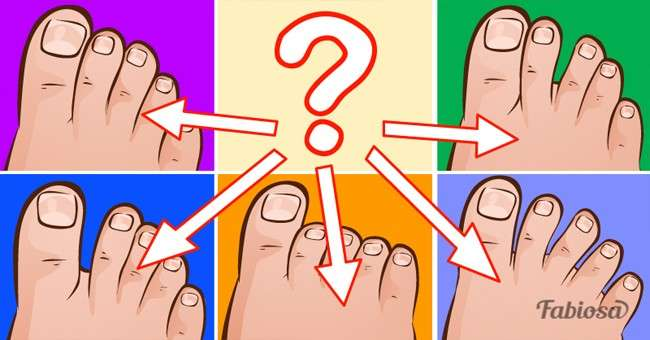
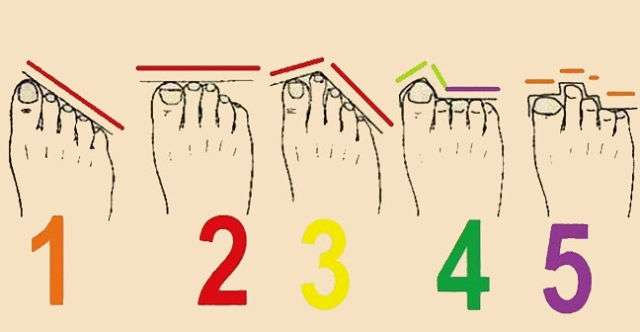

# Хөлийн хуруугаар зан чанарыг шинжих нь

Бидний хөлний хуруунууд, бидний тухай сонирхолтой мэдээлэл болох зан чанарыг тодорхойлоод зогсохгүй, хувь тавиланг урьдчилан хэлэх чадвартай байдаг гэнэ.

---

1. Ийм хуруутай хүмүүс, бүтээлч, ухаалаг, ямарч асуудлыг хурдан шуурхай шийдвэрлэх чадвартай байдаг. Харин зарим тохиолдолд, өөртөө итгэх итгэл нь сулаас болж эхэлсэн зүйлээ дутуу орхих нь бий\
2. Эрч хүчтэй, шинийг эрэлхийлэгчид. Үзэл бодолдоо үнэнч байдаг\
3. Манлайлах чадвараар дүүрэн хүмүүс. Ийм хүмүүс, дуртай зүйлс, дуртай эрхэлсэн ажил дээрээ гаргуун амжилт гаргадаг. Тэднийг, ганцхан, хэт төгс төгөлдөрийг эрэлхийдэг байдал нь голрилоос нь гаргах эрсдэлтэй. Мөн нэгэн сонрхолтой баримт байдаг нь, эртний энэтхэгт, ийм хөлийн хуруутай эмэгтэйчүүдтэй, хүүгээ суулгахгүй гэдэг байсан нь эзэрхэг зан чанартай байдаг гэж үздэг байсантай холбоотой гэнэ\
4. Ийм хуруутай хүмүүсийн хувьд, гэр бүл найз нөхөд нь амьдралынх нь зорилго болж байдаг. Тэд, бусдыг сонсох чадвартай, мөн өөрийгөө бусдын оронд тавьж үзэх, ойлгох чадвартай, гайхалтай хүмүүс. Заримдаа, аливааг хэт хүндээр тусгаж авах, энэ нь таагүй байдалд хүргэх байдалд орох нь бий\
5. Амбицтай, өөртөө хариуцлага авах, үүрэх хүслээр хомс. Ийм хүмүүс зугаатай, дур татам зан чанартай, ихэвчилэн хүүхдэрхүү гэнэн байдаг
