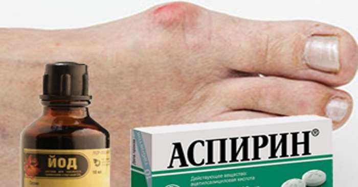
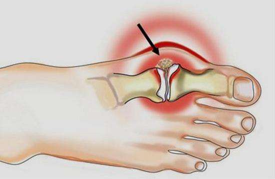

# Хөлний том хурууны уганд ихэвчлэн ургадаг ясыг, арилгах орос арга

Энэ эмгэг, хүнд, их хүндрэлтэй, ялангуяа өсгийтэй гутал өмсдөг хүмүүст бүр ч хэцүү байдаг. Ер нь, удам дамждаг, мөн илүүдэл жингээс, эсвэл, ихэвчлэн бариу, нарийн хэвтэй гутал өмссөнөөс үүддэг гэдэг.

#### Арга 1:

Йод – 10гр\
Нимбэгний шүүс – 20гр\
Ердийн аспирин – 2 ширхэг\
Холиод компресс маягаар, яс ургасан хэсэгтээ тавьж, гялгар уут дээр нь тавьж ноосон оймс өмснө. 3 өдөр дараалуулан тавиад, 7 хоног амраагаад тавихад удалгүй арилдаг.

#### Арга 2:

Шээс хөөх үйлчилгээтэй ургамлын хандууды,г дотуур хэрэглэхэд арилдаг. Үүнийг хамгийн найдвартай арга гэж үздэг. Эдгээр ургамалд, хусны нахиа, алирс, толокнянка ордог.\
Толокнянкын навч – 1 хоолны халбагыг, сайтар буталж, 1 стакан буцламгай ус хийж, уг савтай нь, буцалж буй арай том саванд савтай нь дүрж 15 минут байлгаад, хөргөж шүүгээд, 50 мл-р өдөрт 3 удаа, хоолны дараа хэрэглэнэ.

Энэ асуудлыг хойш тавилгүй анхаарах хэрэгтэй. Яс ургаж томрох тусам явах асуудал хүндэрдэг гэдгийг мартаж болохгүй.
