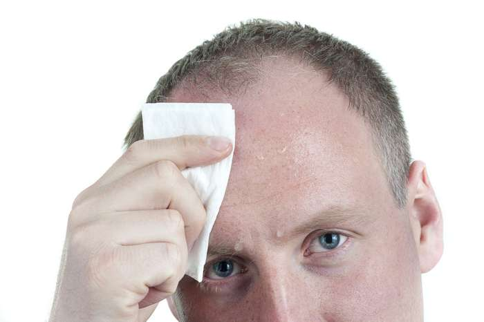
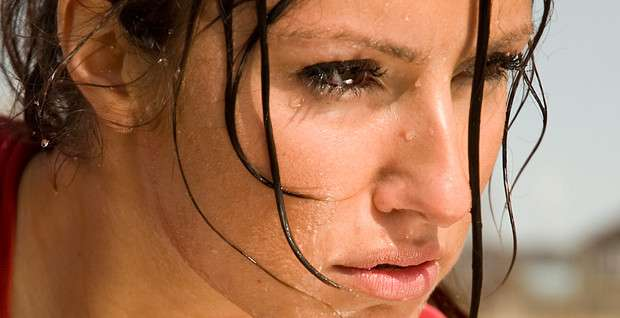

# Хөлрөхөд учир бий

Хүн сайн хөлөрснөөр жингээ хасах боломжтой. Хүний биед хоёр сая орчим хөлсний булчирхай байх агаад тэдгээр нь сэтгэцийн үйл ажиллагаагаар зохицуулагдан хөлс ялгаруулдаг. Үүний дүнд хүний арьс зохих хэмжээний шимт бодисоор тэжээгдэн чийглэг зөөлөн, уян хатан чанартай болдог. Хүний биеийн онцлог, эрүүл мэндийн төвшин, цаг агаарын байдал зэргээс шалтгаалж хөлс ялгарах нь их, бага янз бүр байна. Огт хөлөрдөгггүй хүн байх боловч энэ нь тун ховор.

Эртний Грекчүүд хүн хөлөрч байвал эрүүлийн шинж гэж үздэг бөгөөд хөлрөмтгий хүн урт насалдаг хэмээн үзсээр иржээ. Иймд тэд мэндлэхдээ сайн байна уу гэхийн оронд та хэр хөлөрч байна хэмээдэг заншилтай.\
Зарим өвчний үед хөлрөх нь бий. Тухайлбал арьсны сүрьеэгийн, сэтгэхүйн зарим өвчин, бөөрний архаг үрэвсэлийн үед хөлсний булчирхай идэвхитэй ажилладгаас хөлрөх нь ихэсчээ. \
Иймээс эрүүл мэндээ байнга анхаарч хэрхэн юуны учир хөлөрч буйгаа мэдэж байхад илүүдэхгүй.
