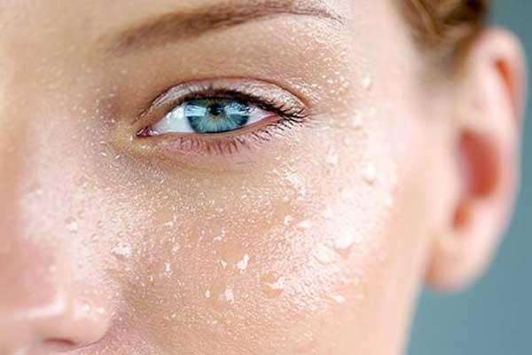
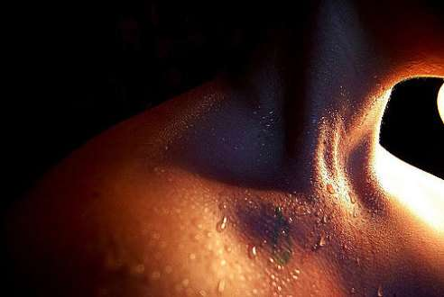

# Хөлрөхөөс хэрхэн салах вэ?

Хөлөрдөг хүмүүсийн хувьд, халуун дулааны улирал тун хэцүү өнгөрдөг. Хөлрөх процесс, уг нь ердийн, бие организмд явагдаж байх ёстой зүйл бөгөөд хөлсөөр дамжин биеэс хор, бусад бодисын солилцооны үед үүсдэг хортой нэгдлүүд гадагшилж, арьсны нүх сүв цэвэрлэгдэж, арьсны уян хатан чанарт сайнаар нөлөөлж байдаг байна. Харин хэт хөлөрдөг байхыг, удамшил, дааврын өөрчлөлт, буруу хооллолт, хүний зан чанартай холбоотой сэтгэл хөдлөл, мэдрэлийн ядаргаа, таргалалт, дотор эрхтэний өөрчлөлтүүдтэй холбон үздэг.

Халуун, бүгчим үед организм халалтаас өөрийгөө хамгаалан ихээр хөлс ялгаруулдаг. Хэрэв, 30 градусын халуунаас доош халуунд ихээр хөлөрдөг бол хэвийн биш гэж үзнэ. Мөн сэтгэл санааны байдал буюу олон хүнтэй орчин эсвэл бусдын өмнө гарч үг хэлэх, танил бус орчинд сэтгэл догдлолоос болж хөлөрдөг хүмүүсийн хөлрөлт, нервтэй нь холбоотой байдаг. Энэ тохиолдолд, тайвшруулах зориулалттай ургамлын гаралтай эм дуслаар хэрэглэх, йог, бясалгал, биеийн тамирын дасгал сургуулилалт хийхийг зөвлөдөг. Ер нь ихээр хөлөрдөг хүмүүс, давс, халуун ногоо, хуурсан, шарсан хоолны хэрэглээгээ багасгах, уух шингэний хэрэглээг тааруулах хэрэгтэй байдаг аж.\
-ваннтай усанд 2 хоолны халбага хүнсний сода хийж усанд орох\
-нарсны шилмүүстэй ваннд орох\
-халуун хүйтэн сэлгэсэн контраст душэнд орох\
-оройд, хусны давирхайн саван, шилмүүсний саван хэрэглэн душэнд орох\
-хөлөрдөг хэсгүүддээ зүсэм нимбэг эсвэл алимны цуу түрхэх\
-нүүр хөлөрдөг бол өглөө, оройд хүйтэн цайны ханд эсвэл хөөрүүлээгүй сүүнд\
дүрсэн гоо сайхны хөвөнгөөр нүүрээ арчин өөрөөр нь хатаах\
-ногоон цайгаар нүүрээ угаах\
-хүйтэн усанд норгосон алчуураар жин 5-10 минут тавих, дараа нь нүүрэндээ хөнгөн товшсон массаж хийх хэрэгтэй байдаг\
-оройд өргөст хэмх нүүрэндээ түрхэх\
-алга хөлөрдөг бол, хусны давирхайн савангаар ердийн саванг орлуулах, 3 хоолны халбага цагаан цуу, 1 цайны халбага давсыг 1 литр усанд найруулж, 5 минут гараа дүрэх\
-хөл хөлрөхөд, марганцтай усанд хөлөө дүрэх,халгай хандлан хөлөө дүрэх\
-биеэ халуунд дасгахын тулд, саунд тогтмол орох\
-стресс, хөлсийг ихээр ялгаруулахад нөлөөлдөг. Тайвшруулах үйлчилгээтэй ургамлын хандууд, валериан, пион, пустырникийн хандууд хэрэглэх\
-антипреспирант хэрэглэх
