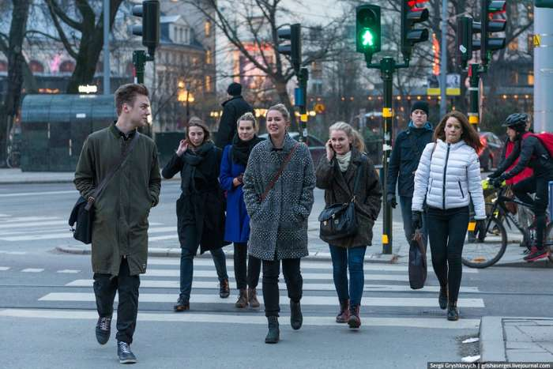

# Хүмүүс хичнээн их аз жаргалтай байна төдий чинээ энгийн хувцасладаг

Хүмүүс хичнээн их аз жаргалтай байна төдий чинээ энгийн хувцасладаг гэнэ. Үүнийг 2011 оноос эхлэн, НҮБ-ээс жил бүр гаргах болсон, иргэдийнх нь аз жаргалын түвшингээр улс орнуудыг жагсаасан тайлангаас харж болох юм. Энэ жагсаалтыг эрдэмтэд, тухайн улсын ард иргэдийн амьдралын элбэг хангалуун байдлын түвшин болон олныг хамруулсан асуулга дээр үндэслэсэн нарийвчилсан судалгааны технологоор гаргадаг байна. 2017 оны аз жаргалтай улсуудаар шалгарсан эхний 10 улсуудыг жагсаавал:

1. Норвеги\
2. Дани \
3. Исланд\
4. Швейцар\
5. Финлянд\
6. Нидерланд\
7. Канада\
8. Шинэ Зеланд\
9. Австрали\
10. Швед\
Эдгээр улсууд, өнгөрсөн жилүүдэд ч, урд хойноо орсноос өөр өөрчилөлтгүй эхний аравтаа багтсаар байгаа аж. Энэ улсуудад, нийгмийн үйлчилгээ, стандарт, амьжиргааны түвшин хамгийн өндөр байдаг. Гэтэл эдгээр улсуудын иргэд, хувцаслалтдаа хамгийн энгийн хандаж, ганган дэгжинг эрхэмлэдэггүй нь сонирхол татдаг. Харин, дэлхийн загварын ертөнцийн чиглэл хандлагыг тогтоож байдгаараа гайхагддаг, гудамжаар хөлхөх хүмүүсийнхээ дундаас загварын фото зурагчид нь, шинэ, чамин загвар дүр төрхийг алхам тутамдаа олж байдаг, оюутан бүсгүйчүүд нь загварын сэтгүүлийн зураг шиг хувцасладаг улс орнууд харин аз жаргалын рейтингээр 30-с доогуур байр эзэлдэг нь хачирхмаар. Жагсаалтын 32-т Франц, Испани 37-д бичигддэг бөгөөд бараг төрснөөсөө өмдөө яаж нугалж өмсөхөө мэддэг ганган хээнцэр Италичууд бүр 50-д ордог. Судалгаанд хамрагддаг 157 орноос, бүхэл бүтэн 49 улсын иргэд италичуудаас илүү аз жаргалтай амьдардаг гээд бод доо. Харин аз жаргалтай улс орнуудын иргэд, сүүлийн үеийн тренд, загвар болон өмдөө хэр урттай өмсөх вэ, юу өмсөх вэ, яаж загварлаг хувцаслах вэ гэх мэтэд огт санаа зовдоггүй. Загвар бус, зөвхөн биед эвтэй талаас авч үздэг бөгөөд ихэвчилэн, жийнс, майк, футболка, хүрэм өмсдөг. Дани, Голланд зэрэг улсуудад залуу хосуудынх нь аль нь эрэгтэй, аль нь эмэгтэйг нь ялгахааргүй хувцаслах нь олонтаа таардаг гэнэ. Манайхны эрчүүд бол, “Харах ч юм алга”, “Энэ чинь эмэгтэй юм уу?” гэхээр хувцасладаг аж. Тэгтэл тэр эмэгтэйчүүд, үсээ сүүлийн загвараар засуулж, бүрэн нүүр будалт хийж, бариу банзал өмсч, 10 санжийн өндөр өсгийт өмсдөггүйгээ аз жаргалгүйд тооцдоггүй. Эрчүүд нь ч тэр, эмэгтэйчүүдээ, загварын сэтгүүлийн хавтсан дээрх дэгжин бүсгүйчүүд шиг харагддаггүйн улмаас аз жаргалгүй болдоггүй. Тиймээс, аз жаргалтай байхад, заавал сүүлийн үеийн загвар трендэд таарсан хувцас хунар хөөцөлдөх албагүй, нэр төр, зиндаагаа батлахын тулд хэнд ч юм, юуг ч юм нотлох гэж зовоод байх хэрэггүй, харин энгийн, биед эвтэйхэн хувцас өмсөж, амьдралын жинхэнэ амтыг мэдрэх л чухал байдаг болохыг эдгээр улсуудын иргэдийн хувцаслалт, биеэ авч явах байдал харуулж байгаа юм.
