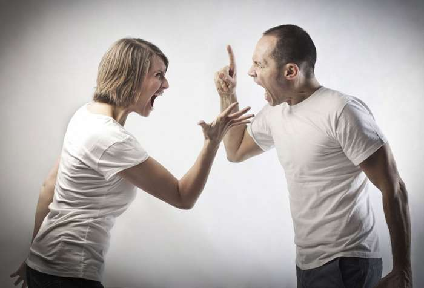

# Хүмүүс маргалдах үедээ яагаад хашгирдаг вэ?

Нэг удаа багш нь сурагчидаасаа:

-Хүмүүс маргах үедээ яагаад хашгиралддаг вэ? Гэж асуув. Хүүхдүүд: -Тэд тайван байдлаа алдаж, хашгиралддаг байх -Тэгвэл яагаад тэд, маш ойрхон зэргэлдээ байгаа атал хашгиралддаг юм? хүүхдүүд, мөрөө хавчицгаан хариулж чадсангүй. Багш : -хүмүүс маргалдах хэрэлдэх үед, бие биедээ дургүйлхэн зүрх нь хоорондоо холдож эхлэх бөгөөд үүнтэй зэрэгцэн мөн сэтгэл нь холдсоноор бие биеэ сонсохын тулд, хоолойгоо өндөрсгөдөг. Хичнээн их бие биеэ гомдоох, уурлуулах үг хэлнэ төдийчинээ тэдний зүрх сэтгэл холддог. Харин хайрлаж дурласан үедээ, хүмүүс маш аяархан аядуу ярилцдаг нь, тэдний зүрх бараг хамт, ямар ч зайгүй болсон байдгаас юм. Айл, гэр бүл, хамт олны дунд хайр ноёрхож байгаа цагт, тэдний яриа зөөлөн бараг харцаараа бие биесээ ойлгож байдаг. Гэтэл, хэрүүл маргаан хүмүүсийг холдуулж, бүр, чангаар хашгирах нь энэхүү зайг хэд дахин нэмдэг, мөн байнгын хэрүүл маргаан зүрх сэтгэлийн зайг холдуулсаар буцаж ойртох замгүй болгодог гэдгийг санаж явах хэрэгтэй хэмээн сургажээ.
