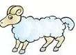
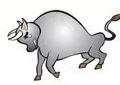
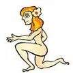
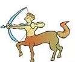
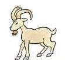

# Хүмүүсийг аливааг хийх, бүтээх хүсэлд түлхэх сэдлүүд. /ордуураар/

Хөдлөх, үйл хөдлөл хийх, бүтээх, аливааг урагшлуулах, хурдан шийдвэр гаргах зэрэг бүх үйлдлүүдийн өмнө сэдэл хэмээх оюуны үйлдэл зайлшгүй явж байдаг. Энэхүү сэдлүүд хүн бүрийн хувьд адилгүй, хувь хүний зан чанар, хүмүүжил, орчин нөхцөлөөс шалтгаалдаг бөгөөд харин төрсөн ордын од гаригсын нөлөөлөл дор ордуудаар ангилагдаж болдог байна. Оддын зурхай нь, хүмүүст, чухам юу сэтгэл санаанд нь нөлөөлж, тэднийг юу хөдөлгөж, ямархуу аяс байдал тэдэнд сэдэл төрүүлж, үйлдэлд түлхэж байдгийг өгүүлдэг. Сэдэл төрүүлэх, үйлдэлд түлхэх зүйлсээ болон орчин нөхцөлөө мэдээд авахад илүүдэхгүй бөгөөд амжилтад хүрэх зам тань нэг алмаар урагшлах юм.

---

Хонь\
Аливааг хийх шийдвэр гаргахад эдгээр хүмүүст сүртэй их түлхэц хэрэггүй. Хэрэв, тэд ямар нэг зорилго тавибал түүнийхээ төлөө сүүлийн амьсгаагаа тасартал явах хүмүүс. Сэдэл нь, хүссэн зүйлдээ хүрэх, түүнийгээ олж авах. Зөвхөн хүсэх л хангалттай. Тэднийг зогсооход бэрх.

---

Үхэр Тэднийг сэдэлд хүргэх, аливааг шинээр эхлэхэд хүргэхийн тулд далайцтай шалтгаан хэрэгтэй. Тэд үнэхээр өөрсдөд нь хэрэгтэй гэсэн зүйлээ л хийж байдаг бөгөөд тухайн зүйлийг эхлэх үедээ гаргасан хүчин зүтгэлээ тооцдогоос, эрхэлсэн зүйлдээ удаанаар, тухайн замаасаа хазайхгүй зүтгэдэг.

---

Ихэр\
Өөрийгөө болгоод явчихдаг эдгээр хүмүүс, угаасаа амьдралын хамаг чухал асуудлуудаа төлөвлөчихсөн байдаг. Сэдэл нь, ердөө л өөрийнхөө үүргийг ухамсарладагтай нь холбоотой байдаг. Өөр бусад сэдлүүдээ дараа нь ашиглахаас хойш, илүү хөдөлгөөнөөр яахав гэж бодоцгоодог.

---

Мэлхий\
Тэдний жинхэнэ сэдэл бол, өөрсдийнх нь итгэл үнэмшил, тогтоосон дүрэм журам нь юм. Өөрсдөө түүнийгээ зохиож, түүнийгээ өөрийн хүч болгодог. Тэднийг, хөдөлгөдөг гол зүйл нь, гэр бүл, хайртай дотныхныхоо өмнө хүлээсэн үүрэг. Өөр ямар ч зүйл тэднийг галд орох, ус гатлах байдалд оруулахгүй.

---

Арслан\
Эдгээр бардам хүмүүсийн сэдлийн шалтгаан нь, тэдний нууж чаддаггүй сэтгэл хөдлөлд нь оршино. Тэдэнд хэрэггүй санагдвал, юу ч тэднийг хөдөлгөж чадахгүй. Тэд эрүүл саруул ухаандаа найдаж, өөрийнхөө сэтгэл ханамж авах тэрхүү зүйлийнхээ төлөө л хөдөлнө. Өөрөөр бол үгүй.

---

Охин\
Энэ ордынхны хувьд сэдэлд хүрэхэд, орчин тойрныхны сэтгэл санааны дэмжлэг их чухал байдаг. Зөвхөн энэ зүйл л тэднийг үйлдэл, үйл хөдлөлд түлхэж чадна. Цаг тухайд нь дэмжлэг нөлөөлөл үзүүлэхгүй бол, тэд аливаад зорих хүсэлд автахгүй, мөрөөдөл рүүгээ нэг ч алхам хийхгүй. Ойр дотныхны сэтгэл, байр байдал л тэдэнд аливааг хийх, хэрэгтэй зүйлдээ хүрэх сэдэл төрүүлж, түлхэц болж өгөх боломжтой.

---

Жинлүүр\
Тэд тодорхой зорилготой бол, түүнийхээ төлөө бүхнийг умартан сэдэлтэй сэдэлгүй зүтгэнэ. Гэхдээ зорилго гэхээсээ илүүтэй, түүнд найдаж амьдардаг хүмүүсийнхээ өмнө үүрдэг үүрэг хариуцлага болох, байнгын дадал болсон зүйлс нь тэднийг хөдөлгөж байдаг. Өөр бусад тохиолдолд, сэтгэл санааны таашаал өгдөг, таатай зүйлээ л хийж байдаг.

---

Хилэнц Энэ ордынхон, зөв хөдлөхтэй холбоотой олон асуудлуудтай тулгарч байдаг. Амьдралын арга барилуудаа сайтар тунгааж бодох хэрэгтэй болдог. Ингэж болохгүй бол, зорилгынхоо явц бүрийг бичиж тэмдэглэж, хугацаа заах хэрэгтэй. Энэ арга хүссэн зүйлдээ хурдан түргэн, үр дүнтэй хүрэхэд туслах магадлалтай

---

Нум\
Эдгээр хүмүүс бүх зүйлд хүйтэн, эрүүл ухаанаар ханддаг. Тэд, ашиг дагуулахгүй зүйлд хөдлөхгүй. Учир нь тооцож мэдсэн байдаг. Тэднийг ашгийн сонирхолтой гэж хэлж бас болохгүй. Эерэг сайн үр дүн авчирах зүйлс, мөн бүтээлч ажиллагааны бодит үр дүн нь таалагдвал, баталгаатай шагнал урамшуулал ч замаас нь хазайлгаж чадахааргүй зүтгэх улс.

---

Матар\
Тэдний сэдэл нь, тэдний үүрэг хариуцлага, өндөр дээд зорилгод нь оршдог. Тэдний баялаг дотоод ертөнц нь, амар хялбар замыг эрж хайдаггүйгээс, бодит байдал дээр хүрэх өндөрлөгийнхөө хязгаарыг тогтоочихсон байдаг. Ердийн нэг зүйлийг хийхдээ ч, хорвоо ертөнцөд ирсэн зориулалтдаа хөглөгдөн, өөрсдийгөө өдөөж, сэдлээ болгон хөдөлж, биелүүлж байдаг хөдөлмөрч хүмүүс.

---

Хумх\
Ямар ч үнэ цэнээр хамаагүй амжилтад хүрнэ гэсэн бодол нь тэдний сэдэл болдог. Гэхдээ хууль бус гэж үзсэн зүйлдээ хэзээ ч хөдлөхгүй. Тэдний хөдөлгөөн, үйлдэлд нь саад болдог гол зүйл нь, ялалт ялагчийн амтыг мэдэхгүйд нь оршдог.

---

Загас Тэд хэзээ ч хөдөлгөөнөө зогсоохгүй. Учир нь ердөө л, эргэн тойрныхондоо сэтгэгдэл төрүүлэхийн тулд. Сэдэл нь тэдний хувьд, ердөө л бусдаас ирэх урам. Тэдний, амжилттай үр дүнгээ төсөөлсөн бяцхан бодол нь хүртэл гайхалтай сэдэл нь болж, улам илүү хурдтай, өгөөжтэй ажиллах нөхцөл нь болж байдаг.
