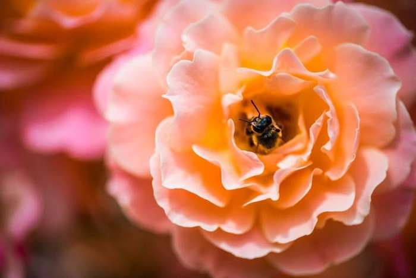
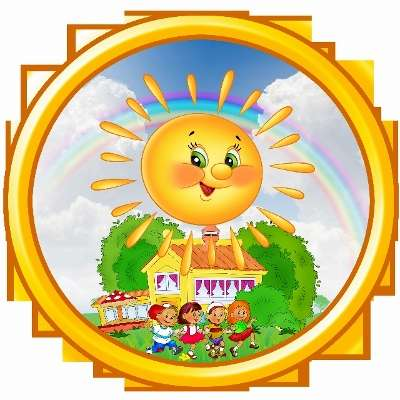

# Хүмүүсийн хуваагддаг хоёр ангилал

Орчиноо янз бүрээр хүлээн авдгаас хүмүүсийн амьдрал өөр өөр байдгийг харуулах бяцхан сургамжит түүхийг хүргэе. Хүн юунд илүү анхаарч, ухаанаа төвлөрүүлэхээ өөрөө шийддэг. Зарим хүмүүс, бүх зүйл муу, хорвоо муу хүмүүсээр дүүрсэн учираас ихэд зовж байна хэмээн ярих дуртай байдаг. Мөн, нөгөө хэсэг хүмүүс нь, гэгээлэг эргэн тойрноо сайхнаар харж, орчин тойрныхондоо баяр баясгалан, өөдрөг сэтгэлийг түгээж байдаг.

Нэгэн мэргэн ухаантан дээр хэсэг хүмүүс ирж, хүмүүсийн тухай, тэдний үйлдлийн талаар муугаар нотлон ярьж эхлэв. Өвгөн сонсож суунаа, -Би өөрийн амьдралын туршлага дээр, хүмүүс хоёр ангилалд хуваагддагийг мэдсэн. Гуравдах ангилал гэж байдаггүй. Эхний ангиллын хүмүүс хар ялаатай адилхан. Ялаа зөвхөн бохир заваан зүйл дээр сууна. Жишээ нь, цэцэрлэг дүүрэн анхилуун цэцэгсийн нэг дээр нь ч суулгүйгээр ниссээр, хамгийн алсын мухарт байх бохир заваан зүйлийг олж очин сууж ухаж эхэлдэг. Хэрэв тэр ярьдаг байгаад, түүнээс, -цэцэрлэгийн хаана нь сарнай ургадаг бол? гэж асуувал, тэр, -сарнай гэж юу болохыг мэдэхгүй, тэгээд ч хорвоо дээр сарнай гэж зүйл байхгүй гэж хариулах юм. Иймэрхүү, ялаатай адилхан хүмүүс, бүх зүйлийг муугаар хүлээн авч, бохир мууг л харж, хамаг сайхан зүйлсийг үгүйсгэн амьдардаг.\
Харин нөгөө ангиллын хүмүүс зөгийтэй адилхан. Зөгийнүүд хамгийн сайхан, амтлаг цэцэгс дээр суудаг онцлогтой. Бохир заваан газарт ваартай цэцэг тавихад, хаана ч суухгүй ниссээр, тэрхүү цэцгийг л олж, түүн дээр сууна. Хэрэв түүнийг барьж аваад, хог, бохир хаана байна гэж асуувал, хэрэв тэр хариулдагсан бол, -тэр муухай зүйлсийг анзаараагүй, харин тэр буланд сарнай байсан, жоохон цаахна нь хайтан, бас лиш цэцэг байсан гэж тоочихсон. Тэр хамгийн сайхан зүйлсийн мэдлэгтэн. Хүмүүс нэг бол ялаа, эсвэл зөгийний ангилалд багтдаг. Хүмүүс над дээр ирж бусдыг буруутгаж эхэлмэгц, би энэ зүйлийг ярьж өгөөд аль ангилалд баймаар байгаагаа сонгохыг хүсдэг. Алийг нь сонгох нь ойлгомжтой биз дээ, гэснээр яриагаа дуусгасан аж. Үнэхээр сонголт нь илэрхий... хэн бохир завааныг хүсэх билээ. “Зөгий”-нүүддээ аз жаргал хүсье!
