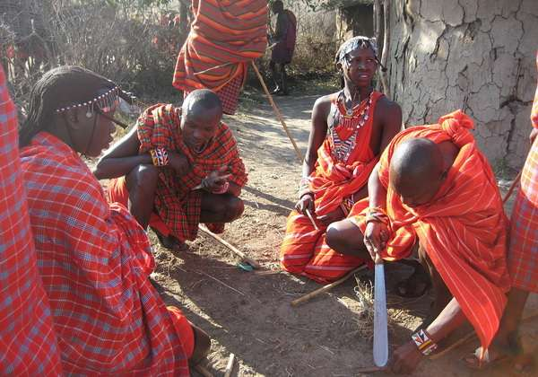

# Хүмүүжлийн мартагдсан арга

Өмнөд африкийн нэгэн омгийнхон, хэн нэгэн нь буруу, муу зүйл хийвэл, суурингийнхаа төв хэсэгт орших талбайд суулгаж, хоёр өдрийн турш, түүний хэзээ ч юм хийсэн сайн зүйлийг нь хэлүүлж, тоолуулдаг байна. Энэ омгийнхон, ямар ч хүн, энэ хорвоод ирэхдээ сайн хүн байхаар, зөвхөн аюулгүй байдал, хайр, аз жаргалын төлөө ирдэг. Харин заримдаа, эдгээрийг хэт хөөцөлдсөнөөс алдаа гаргадаг. Энэ алдаануудыг, энэ омгийнхон, тухайн хүний тусламж хүссэн дуудлага гэж хүлээж авдаг. Тиймээс, тухайн буруу зүйл хийсэн хүнийг засах, хийсэн буруу үйлдэл нь төрөлх чанараа алдаж буйг харуулдаг гэж үздэг тул, байгал дэлхийгээс тасарсан холбоог нь сэргээх, түүнийг хэн бэ гэдгээ мэдрэх, “Би сайн хүн” гэдэг үнэнийг нь ойлгуулж ухамсарт нь суулгахын тулд, ийнхүү арга хэмжээ авдаг нь үр дүнтэй байдаг гэнэ. Эртнээс уламжлалтай энэ арга, орчин үеийн сэтгэл зүйн тусламжаас хавьгүй бодит үр дүнтэй байдаг нь, тухайн омгийнхон дунд явуулсан судалгаагаар батлагддаг аж.

Энэ зүйл монголчуудын хувьд танил хүмүүжлийн арга юм. Монголчууд, нүүдэлчин соёл ахуйн улмаас, хэдийгээр суурингийн төвд суулгаж арга хэмжээ авахгүй ч, амьтан ах дүүгээрээ хэлж ярьж засаж залруулж ирсэн байдаг. Энэ хүмүүжлийн арга үр дүнтэй байсныг, урьд өмнө хүүхэд, залуусын хүмүүжил, одооныхоос өөр, илүү зөв байснаар харагддаг гэдэгтэй маргахгүй буйз аа.
