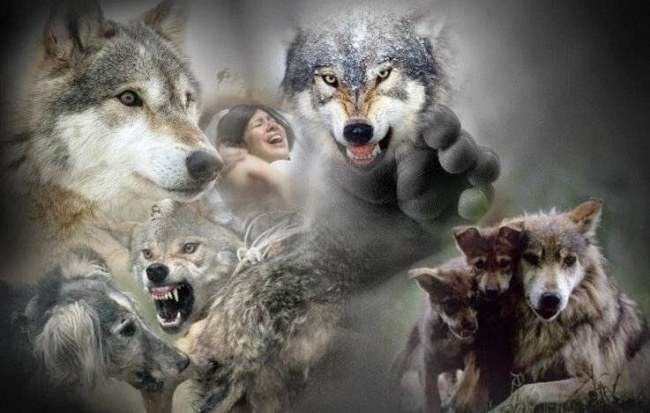
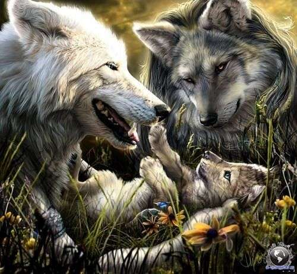

# Хүн ба араатан

Тэр харайлгасаар байлаа... түүн рүү хүмүүс буудна. Сарвуу нь цас хуйлруулан холбирон унахдаа, чоно, аврал байхгүй болсоныг бүрэн мэдэж байлаа. Араатнаас аймшигтай хүн...!!! Энэ үед, нэгэн хотод, нэгэн цааз, үхлийн ял явагдаж байна. Бүсгүйн хэвлий дэх үрд аборт хийж эхлэв. Үр нь орилох ч түүнийг хэн ч үл сонсно... -“Ээж минь болиоч. Надад танд хэрэгтэй байх боломж өгөөч!!! Намайг амьдруулаач!!! Би чинь амьд шүү дээ!!!” хэмээн тусламж гуйн орилох аж... Харин энэ үед чоно бөгсөө чирэн мөлхөж, тойрон ноцсон нохдын шүд хэрхэн хоолойд нь орохыг, согтуу хөлчүү хүмүүсийн орилолдон дөхөж ирэхийг толгой нь өлсхийн унахдаа харав... Хүний үр, нулимсандаа хутгалдан хашгирахч хэн ч сонсохгүй... Тэр ТӨРӨЛГҮЙ ҮХЭХ-ээс айн, хэрчин, зүсэх төмрөөс бултаж зайлах гээд чадахгүй орилон, ээжийнхээ харцыг, нүдийг олж харахыг мөрөөдөвч, хэрхэн олж харах билээ... Харин ээжид нь, ганцхан түүнээс салах хүсэл байгааг тэр яаж ч ойлгох билээ дээ...! Харин амь нь тасарч буй араатан чоно, өөрийн өлөгчин, мөн бэлтрэгнүүдээс, ЗЭРЛЭГ АРААТНУУД-ыг холдуулан зугтаж өөртөө үхлийн ял аван үхэж байлаа. Ноход түүнийг барьж урчин тасдах ч, түүний сүнсийг тасчиж чадахгүй... Хөөрхий сүнс нь, ҮР ХҮҮХДҮҮДИЙНХЭЭ ТӨЛӨӨ ҮХЛЭЭ БИ, хэмээн жаргалтайгаар тэнгэрт хальжээ. Араатан амьтан ч хүнээс дээр байхын ганц жишээ энэ буюу. Араатан амьтад хүнээс илүү хүнлэг байна бус уу? Хүмүүс, араатнаас илүү аймшигтай хүн болцгооно бус уу??? Эрин зуун минь, хүн төрөлхтөн минь юу болно вэ???
