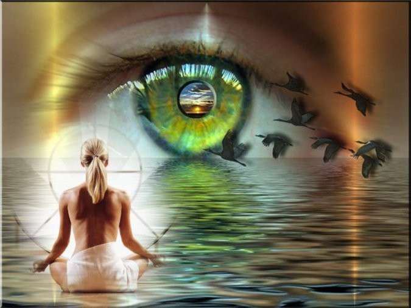

# Хүн бодол санаа, зан байдлаа өөрчилөхөд,  бие мах бодод нь гүнзгий өөрчилөлт гардаг

Хүн, өөрийгөө хандлөнгөөс харж, өөртөө “Би яг хэн бэ?”, “Амьдрал минь яагаад сайн биш байна?”, “Хүссэн зүйл, байр байдал минь яагаад санасанаар болохгүй байна?”, “Би яагаад хүссэнээрээ амьдарч чадахгүй байна?”, “Би өөртөө юуг өөрчилөх хэрэгтэй вэ?”, “Надад юу саад болж байна?”, “Би юунаас салах хэрэгтэй вэ?” гэх мэт асуултуудыг тавьж, түүндээ ул суурьтай хариулахыг оролдож, бодож тунгааж, үүнээс улбаатай энэ үйлдэлүүдэд дургүй байх, эсвэл зайлсхиймээр санагдах, мөн урд нь хийдэг зүйлээ өөрөөр хийхийг оролдож эхлэх зэрэг байдал анзаарагдаж эхлэх нь хүний “ухамсар”-аар дамжсан, ухамсрыг сэрээх үйлдлүүд явагдаж байгааг харуулдаг байна. Үүнийг дотоод хувьсал гэж нэрлэх бөгөөд энэ үед, хүний ухамсарт үсрэлт явагдаж хувь хүн өөрчилөгдөж эхэлдэг. Тиймээс, шинэ хувь хүнд, шинэ бие хэрэг болж, тухайн хүний бие организмд эдгэрэлт, илааршилт явагдаж эхэлснээр, шинэ ухамсар бүхий шинэ биед өвчин, өвчилөл байх боломжгүй болж биеийн бүх биохими өөрчилөгддөг. Бидний оюун санаагаа өөрчилөх үеийн процессод оролцдог химийн элементүүд багцаараа өөрчилөгдөж, дотоод орчин маань өвчин, өвчилөлд хортой, түүнийг дарах орчин болон хувирдгаас хүний өвчин, өвчилөл эдгэрдэг гэнэ. Учир нь, шинэ бодол санаа шинэ сонголтод хүргэж, шинэ сонголт шинэ зан байдалтай болгож, шинэ зан байдал нь шинэ туршлагыг бий болгож, шинэ туршлага нь шинэ сэтгэлийн хөдөлгөөн, шинэ сэтгэлгээнд хүргэдэг бөгөөд эдгээр үйл явцуудыг даган өөрчилөгдөж буй орчины шинэ мэдээллүүд нь хамтдаа таны генийг дахин өөрчилдөг гэсэн үг аж. “Би өвчтэй”, “Би сул”, “Би азгүй” гэсэн өөрийн хувь хүнээ дарангуйлсан бодол тээж явах нь, болдог бол өөрийгөө шүүхэд өгөх чинээний хор уршигтай зүйл юм. Өөр хэн нэгнийг ингэж хэлдэг тохиолдолд хүн лавтайяа шийтгүүлэх юм. Тиймээс, хүсээгүй, хүсэшгүй ямар ч байдал, өвчин, өвчилөл нь хүн дотоод сэтгэхүй, бодол санаагаа өөрчилснөөр дарж болох зүйл гэж шинжлэх ухааны үндэслэлтэй нотолсоор байгаа юм. Хүний дотоод нөөц бололцоо нь хязгааргүй, гэхдээ тухайн хүний төсөөлөл, уран сэтгэмжээр л хязгаарлагдаж байдаг зүйл гэж үздэг байна.

