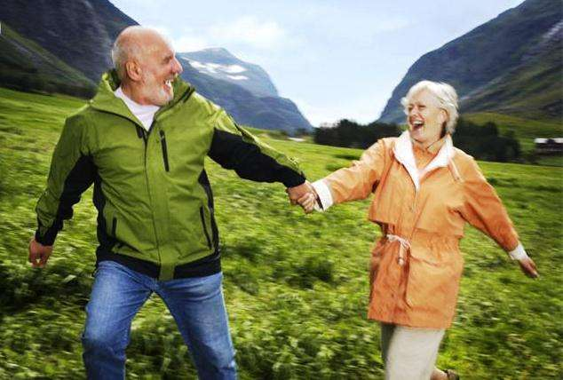

# Хүн, хэр их явган алхна, төдийчинээ урт наслана

Оросын “21-р зууны эрүүл мэнд” эмчилгээ судалгааны төвийн захэрал, доктор А. Шишонин, “Эмгүй амьдрал” тусгай хөтөлбөрийн хүрээнд судалгаа явуулснаар, хөдөлгөөний дутагдал наслалтад хэрхэн нөлөөлдөг талаар ул суурьтай дүгнэлт гаргасан бөгөөд дельфин судлаач эрдэмтэн В.М.Латкогийн дельфины амьдралыг судалсан судалгаан дээр тулгуурлан, хүмүүс дээр харьцуулсан туршилт хийснээр үнэн зөв нь зайлшгүй батлагдсан үр дүн гарсан гэж үзжээ. Дельфин нь, сүүн тэжээлтэн, баримжаалалтай, хөгжсөн тархи сэтгэхүйтэй гэх мэт олон чанаруудаараа хүнтэй төстэй байдаг. Тэжээвэр буюу усан санд хүмүүсийн гаршуулсан дельфин, ердөө л 6-8 жил насалдаг бол, харин далайд эрх дураараа амьдардаг дельфинүүд 60 жил насалдаг байна. Энэ нь, гаршуулсан тэжээвэр дельфинүүдийн огцом хурд авах үүрэгтэй булчингууд ажиллагаагүй болж, үгүй болдогтой холбоотой гэнэ. Уг булчин нь байхгүйгээс болж, тэднийг хэрэв далайд буцаан тавибал амьдрах чадваргүй үхдэг аж. Далай тэнгисийн дельфинүүд, өдөрт 240 километр сэлж байдаг бөгөөд, усан санд ийм боломж байдаггүйгээс тэдний нас нь богиносдог гэсэн дүгнэлт гарсан байна. Тэднийг буцааж далайд тавих болсон тохиолдолд, тэнгисийн буланд тор татаж, том талбайд сэлүүлж сургаж байж тавьдаг гэнэ. Үүнийг, хөдөлгөөний дутагдлын үр нөлөөг харуулсан шилдэг жишээ гэж авч үзжээ. Тэр, хөдөлгөөний дутагдлын хор уршгийн талаар хүн бүр мэддэг мөн хангалттай ярилцацгаадаг ч, тэр бүр үүнд ач холбогдол өгдөггүй нь харамсалтай, орчин үеийн хүмүүсийн амьдралын хэв маягийн эрчимтэй өөрчилөлт, цаг хугацааны давчуу байдал, техник технологийн хөгжил, өөрийгөө ялан дийлэх чанарын сул байдал зэргээс улбаатай, олон ашигт төрмөл чанаруудаа хүмүүс гээж байна. Хүн өдөрт 30-50 километр явган алхах, туулах чадвартай, энэ нь хөдөлгөөний идэвхит байдлыг хэвийн хангах үзүүлэлт гэвэл орчин үеийн нэг ч хүн итгэхгүй, үгүйсгэх биз ээ. Үүнд зарцуулагдах ёстой энерги хаачих вэ? Хуран цугларсаар илүүдэл жин болно, өөх болж чадаагүй нь, бие организмын биохимийн үйлчилэлийг сүйтгэж эхэлнэ. Үүний дүнд, чөлөөт радикалууд бий болж, хүний хөгшрөлт хурдасдаг гэдэг нь нотлогдлоо гээд, -“Хэрэв танд, настай төрөл төрөгсөд байдаг бол, тэдэндээ, үргэлж хөдөлж байхыг зөвлө, мөн өөрөө үлгэр жишээ үзүүлж алхаж бай. Хэр их хөдөлгөөнтэй байна төдийчинээ урт насална. 45-с дээш насны хүмүүс өдөрт дор хаяж 10 000 алхаж байхыг хичээ. 30 000 алхам бол бүр сайн. Гэхдээ энэ нь 20 километр орчим болно. Боломжоороо явган алхахыг зөвлөе. Би өөрөө их алхдаг болсон. Энэ талаар бодоод байх тусам, илүү их алхдаг болно” гэж уриалсан байна.

