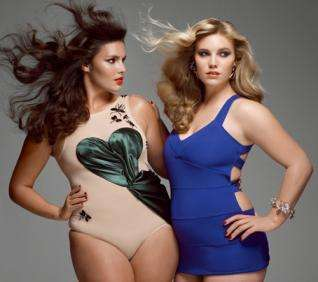

# Хүн өөрийн биеийн жингээс болж санаа зовох шаардлага байхгүй

Хүн төрөхөөсөө тус тусын бие мах бод, сэтгэл санаа, зан ааш, ёс суртахууны давтагдашгүй хувийн онцлогуудтай байдаг гэдэгтэй маргах хүн гарахгүй биз ээ. Хүний бие галбир олон нийтийн хүлээн зөвшөөрсөн хэлбэр хэмжээнд таарах ёстой гэж хэн тогтоосон юм? Хүний төгс галбир гэж юу юм? Хүмүүс бүгд адил 90:60:90 байх ёстой юу? Энэ бол, орчин үеийн ялангуяа 90-д оноос хойш олон нийтийн хэвлэл мэдээллийн хэрэгслээр хүмүүсийн тархийг угааж, цэвэр бизнесийн зорилготой явагдаж ирсэн жинхэнэ гэмт хэрэг, бүр солиорол юм.

Хүн бол тусгаар, өөр өөрийн төрхтэй давтагдашгүй зүйл бөгөөд энэхүү ондоо чанараа устгахыг эрмэлзүүлсэн нийгмийн золиос болж буйгаа мэдэх хэрэгтэй. Хамгийн гол нь, хүн өөртэйгээ, өөрийн дотоод ертөнцтэйгээ зохиролд амьдрах нь хамгийн чухал бөгөөд энэхүү зохирол гэдэг нь, өөрийгөө байгаагаар нь хүлээн авах, үнэлэх, түүнчилэн ашгийн сонирхолтой нийгмээс тогтоодог, бие галбирын хэлбэр хэмжээ болон ёс суртахуунтай адилсахын тулд зовохгүй, өөрөөрөө байж чадахыг хэлдэг. Хувь хүний сэтгэл санаа, биеийн галбир хэмжээнд хүртэл халддаг энэ нийгмийн золиос болж байгаагаа сайтар ойлгох хэрэгтэй. Хэвлэл мэдээллийн хэрэгслээр улиг болтол явуулдаг, туранхай бүсгүйчүүдийг гоо сайхны билэгдэл болгон, тэд нараар сурталчилуулдаг хувцас, эдлэл, түүнийг дагаад махлаг эмэгтэйчүүдийг тураах зорилготой бүтээгдэхүүний үйлдвэрлэл, тураах үйлчилгээ үзүүлдэг газрууд гэх мэт тоо томшгүй олон бизнес явагдаж байдаг. Бурханаас өгсөн заяа, эх эцгээс төрсөн бие мах бодоо голж, бусдын тогтоосон үлгэр загвараар амьдрах нь нүгэл юм. Харин, унаган төрхөө эвдэхгүй, гээхгүй байхад анхаармаар. Моод загвар, олны жишиг нь, ихэд өөрчлөгдөмтгий бөгөөд хүний нийгмийн түүхийн явцад, махлаг булбарай эмэгтэйчүүд нийгмийнхээ нүүр царай болж, гоо үзэсгэлэнг нь шагширч байсан үеүд уран зохиол, уран зурагт тодорхой дүрслэгдэн үлдсэн байдаг. Гэхдээ, идэш ууш, идэвхигүй байдлаас болдог тарга, илүүдэл жинг өөгшүүлэх санаа агуулж бичсэнгүй. Өөрийн унаган төрх, давтагдашгүй чанараа хайрлаж байхыг сануулан бичлээ. Хүн бүрт, тус тусын голдог зүйл заавал байдаг. Төгс зүйл гэж байдаггүй. Харин, дөрвөн мөч бүрэн бүтэн, эрүүл саруул оюун ухаантай төрсөндөө, эцэг эх, Бурхан, ер нь бүх зүйлд баярлаж талархан амьдар. Заяа тань баярладаг гэдэг шүү.

---

---

