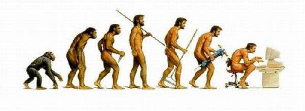

# Хүн төрөлхтөний тухай сонирхолтой баримтууд

-Хүмүүс сүүлийн 100 жилд, биеийн жин нь 50%-р нэмэгдэж, 10 см өндөр болсон байна\
-Колумб анх, америк тивийг нээхэд, уг газар нутагт 90 сая орчим уугуул иргэд буюу тухайн үеийн дэлхийн хүн амын 1/3 хэмжээний хүмүүс амьдарч байжээ\
-Боолын худалдаа, мөн европыг тойроогүй бөгөөд сая гаран европчууд, 1530-1780 оны хооронд хойд африк руу худалдагдсан байдаг\
-Ацтекууд, хүн амынхаа 1% буюу 250 000 хүнээр жил бүр тахил өргөдөг байсан гэнэ\
-1891 онд, Огайо мужид анхны автомашины осол болж тэмдэглэгдэн үлджээ\
-Одоо бидний амьдарч буй энэ үеийг, хүн төрөлхтөний түүхийн, хамгийн тайван үе гэж үздэг\
-Дэлхийн түүхэнд хамгийн их дуу чимээг 1883 онд, Каракатау галт уул дэлбэрэх үедээ гаргажээ. 4800 км-н зайд сонсогдож байсан гэдэг\
-Хамгийн анхны, тамхитай тэмцэх кампанит ажиллагааг Гитлер зохион явуулж байжээ\
-Америкийн төрийн далбааны 13 хөндлөн судал, хөх дэвсгэр дээрхи 50 ширхэг таван хошуунаас бүрдсэн дизайныг, 17 настай сурагч Роберт Хефт зохиосон бөгөөд үүнийхээ төлөө -4 дүн авч байсан ба төрийн далбаагаар сонгогдсоных нь дараа дүнгий нь засч 5 болгож байжээ\
-Манай гариг дээр, хүн төрөлхтөн 200 мянган жил амьдарч ирсэн ч, хүн төрөлхтөний түүх 6 000 жилийн өмнөөс бичигдэж эхэлсэн гэж үзэхэд түүхийн 97%-г бид мэддэггүй\
-Римийн Пап Григорий IX, муурыг харын хүчний муу амьтан гэж зарласнаар, европ даяар муур устгал явагджээ. Үүний улмаас, хулганаа дийлэхээ байж, халдварт өвчинүүдээр 100 сая хүнээ алдаж байжээ\
-Хүн төрөлхтөн оршин тогтносон 3,5 сая жилийн туршид 230 жил л дайнгүй байжээ
