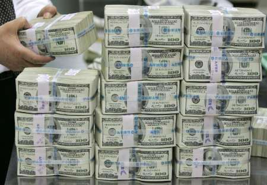

# Хүнд мөнгө, хичнээн хэрэгтэй байдаг бол?

Хүмүүсийн хэрэгцээ, сэтгэхүй янз бүр байдгаас, зарим хүний хувьд 500 мянган төгрөг сардаа хүрчихдэг, зарим нь, 2 сая төгрөгийн орлогогүй бол амьдралаа төсөөлж ч чадахгүй, бас өөр нэгэн хүн, карманы зарлагад зориулсан хэтэвчин дэх 80 сая төгрөгөө чамлангуй тоолдог байдал амьдралд танил зүйл билээ. Үүнтэй холбоотой бяцхан туршилт явуулъя:

Дурын нэг том худалдааны төвд орж, бараа бүтээгдэхүүн сонирхох гээд үз. Танд, сарын эцэс хүртэл зарцуулахад шаардлагатай мөнгө үлдсэнийг та, мэдэж байгаа бол, дэлгүүрийн бүх барааны дэргэдүүр зүгээр л автоматаар яваад өнгөрдөг гэнэ. Ядахдаа, гарсан шинэ загваруудыг ч харж сонирхдоггүй. Учир нь, “Яах юм бэ? Тэртэй тэргүй авахгүйгээс хойш, сэтгэлээр унахын нэмэр“ гэж бодно. Мөн ажлын зараар ажил хайх боллоо. Мөн л дассан сурсан, хэмжээний цалинтай ажлаа хайж, энэ үедээ, илүү өндөр цалинтай ажилыг анзаарах боловч, “би чадахгүй байх, туршлага дутах биз, энэ ч арын хаалга танил талаар орох ажил биз, ийм өндөр цалингийн төлөө даргын боол болох биз, эсвэл авилгач болох байх” гэсэн өөрийгөө хязгаарласан бодлуудаар, хүн, өөрийгөө хүлчихдэг. Илүү зүйлд хүрэх, хүртэх хамаг боломжуудаа, дээрх бодлууд, мөн 100 төгрөгний хямд зүйлийг эрэх, авч хэрэглэх бодлуудаараа хааж, өөрийн хязгаар дотор хөөрхийлөлтэй эргэлдэж байдаг амьдралыг сонгодог. Харин одоо, танд хичнээн мөнгө хэрэгтэйг тогтоох туршилт хийе. Өөртөө, өнөөдрийн дотор үрэх 50 мянган төгрөг байна гээд бод. Заавал өнөөдөр зарцуулж дуусгах ёстой ба маргааш энэ мөнгөний тоо хоёр дахин үржигдэж орж ирэх тул, үрж чадах хэмжээгээ тооцож мөнгөний хэмжээгээ тогтоох хэрэгтэй. Энэ мөнгөндөө авах, зарцуулах зүйлсээ үнийн хамт бичнэ. Асар олон зүйлийн үнийг мэдэхгүй байгаа даа бүү гутраарай. Мэддэг болох, мэддэг байх хэрэгтэй гэдгээ та, мэдэж авлаа. Үргэлжлүүлэн бичээрэй. Маргааш боллоо. Танд 100 мянган төгрөг байгаа, үүнийгээ энэ өдрөө үрж дуусгах ёстой. Бэлэг сэлт авах, тоглоом зугаа, ресторанд зарцуулах мөнгөн дүнгүүдээ бичнэ. Нэг ч төгрөг үлдээгүй байх ёстой. Энэ үед ямар мэдрэмж төрж байна? Гуравдах өдөр боллоо. Үрэх мөнгө тань 200 мянга буюу хоёр дахин их болж, дараа дараагийн өдрүүдэд 400, 800 мянга, 1600 000 гэх мэт өснө. Эдгээр мөнгөнүүдийг нэг ч төгрөг үлдэхгүй байхаар тухайн өдөрт нь зарцуулах ёстойг мартаагүй биз? Мөн зөвхөн хүссэн зүйлдээ зарцуулах ёстой ба энэ мөнгийг хадгаламжид хийх, удаан хугацааны хөрөнгө оруулалт хийх, буяны хандив өргөх, дараагийн өдөр үрэхээр үлдээх зэргийг хориглоно. Та үргэлжлүүлэн бичсээр байна уу? Зогсох болж байна уу? Одоо, таны мөрөөдлийн мөнгө үрэлт хэдэн төгрөгөн дээр зогсов? Хэд дэх өдрөө зогсов? Таны материаллаг хэрэгцээ шийдэгдэж үү? Энэхүү, бичсэн төсөөллийн мөнгө зарцуулалт тань, таны мөнгө юунд зориулагддаг, мөнгө яагаад амьдралд тань хэрэгтэй байдгийг харуулж өгдөг. Мөн энэ дасгал, юуны төлөө, ажиллах, суралцах, санхүүгийн орлогоо нэмэгдүүлэх ёстой вэ гэдгийг харуулахаас гадна мөн мөнгөний үнэлэмж, мөнгөнд хандах хандлагыг зөв болгодог ажээ. Та битгий залхуураарай. Энэ туршилт, зарлагаа тэмдэглэх сайн зуршлын гараа, хэрэгцээ шаардлагатай зүйлээ зөв тооцох, бодит хэрэгцээгээ тодорхойлох дасгал болдог. Таны сэтгэхүй хэдэн төгрөгөнд багтан эргэлдэж буйг мэдчих нь сонин биш үү? Магадгүй, сэтгэлгээний хил хязгаараа тэлэх шаардлага гарч ирсэн юм биш биз? Мэргэн ухаанд тань даатгая...
