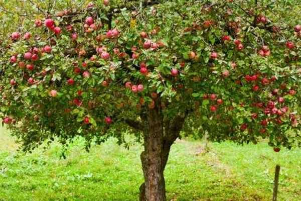

# Хүнд, юу их байна түүнийгээ хуваалцдаг

Нэг хүн шинэ сайхан байшин барьж амьдарчээ. Зэргэлдээх хуучин байшинд, атаархуу хүн амьдрах бөгөөд шинэ байшинтай эрийн сэтгэл санааг эвдэхийн тулд байнга, эсэн бусын муу зүйлс сэдэн, хашааны үүдэнд нь хог асгана, ер нь олон бүтэхгүй зүйл хийдэг байсан ч шинэ байшингийн эзэн ойшоодоггүй байжээ. Нэг өглөө, шинэ байшингийн эзэн босоод гадаа гартал, довжоон дээр нь угаадастай хувин байгааг харж, угаадсыг нь асгаад, хувинг гялалзтал арчиж зүлгээд дотор нь алимныхаа модноос хамгийн том, болц нь гүйцсэн амттай алимнууд түүж дүүргээд, атаархуу хөршийнхөө гадаа ирж хаалгыг нь тогшив. Үүнийг сонссон, атаархуу хөрш, -“Одоо л нэг тэвчээр нь барагдаж хэрэлдэхээр ирлээ” гэж баярлан бодоод, хэрэлдэх бэлтгэлтэй хаалгаа онгойлготол, шинэ хөрш нь, -“Хүнд юу их байна түүнийгээ хуваалцдаг” гэж хэлээд, хувин дүүрэн алимаа өгчээ.
