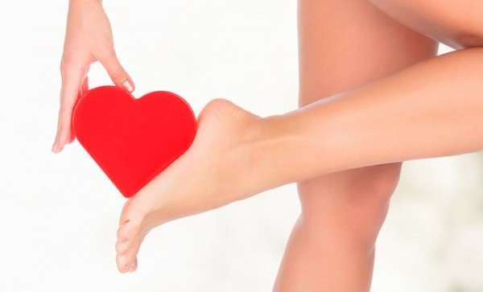
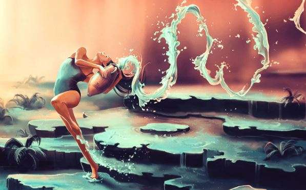

# Хүний биеийн дөрвөн хэсэг, мөнгөтэй холбоотой асуудлуудыг харуулах чадвартай

Хүний бие эрхтэний байдал мөнгөний асуудлуудыг харуулах боломжтой гэнэ. Биед, мөнгөтэй холбоотой дөрвөн хэсэг байдаг. Эдгээр нь мөнгө олох, үрэх, хураах, мөнгийг арвижуулах чадавхийг илэрхийлдэг аж:

Нэг. Мөнгө олох асуудал хүзүүтэй холбоотой. Хүзүүний байдал ямар байгааг анзаарах хэрэгтэй бөгөөд толгойгоо эргүүлэх үед чөлөөтэй, нуржигнах байдал мэдрэгдэхгүй байгаа бол мөнгө олох олон арга саам сүвэгчилж чадвар хангалттай байна гэсэн үг. Хүзүүг сонголт боломжуудын хэсэг гэж үздэг ба хөдөлгөөний хязгаарлалтгүй, эрүүл, чөлөөтэй хөдөлгөөнтэй хүзүү аливаа зүйлийг олон талаас нь харах, олон хувилбаруудыг хэрэгжүүлэх чадвар, өөрийгөө болон бусдыг хүлээн зөвшөөрсөн эрүүл хандлага, бодол санаагаа илэрхийлэх чадвар, хариу үйлдлийн хурдтай чанарыг харуулдаг байна. Хөшингө хүзүү зөвхөн урдахаа харах чадвар, зөвхөн үүрэг гүйцэтгэгчийн чанарыг харуулахаас гадна зөрүүд, бусдад итгэх чадвар султай, зөвхөн өөрийнхөөрөө зүтгэдгээс олон боломжуудаа алддаг болохыг заадаг гэнэ.\
Хоёр. Мөнгө зарцуулах хэсэг бол мэдээж хэрэг гар. Тиймээс ч “Хуруун завсраар мөнгө гоожих”, “Гар султай” гэх мэт хэлц үгнүүд байдаг аж.\
-Хэн нэгэн танд мөнгө өгч байна гэж бодоод гараа сунган авч буйгаар төсөөлөөд үзээрэй. Тэгээд яаж авахаа, авах үеийн мэдрэмжээ анзаар. Гар чинь аль хэсэгтээ чангарч байна? Хэрэв сарвуу орчимд мэдрэгдэж байвал, мөнгийг хэн, яаж, ямар үг хэлж өгч буйд их ач холбогдол өгдөг. Өгч байгаа байдал таалагдахгүй бол татгалзах чадалтай бардам хүн. Ийм байх шаардлага байна уу?\
-Гарын шуу, бугуйн хэсэгт чангарах мэдрэмж төрж байвал, мөнгөтэй холбоотой асуудлыг шийдвэрлэхдээ тааруу. Нааш ч үгүй цааш ч үгүй, өгөх, авах аль алинд нь хэцүү, шийд гаргахын тулд арав хорь дахин бодсоор ихэнхидээ хожигдож алдаж байдаг байдлыг харуулдаг. “Эрсдэлээс айдаг хүн оргилуун дарс уухгүй” гэдэг үгийг хааяа санаж бай. Мөнгө гарт чинь урсан орж ирнэ.\
-Мөрний хэсгээр чангарч байвал, амьдралдаа мөнгийг оруулж ирж чаддаггүй. Орж ирлээ гэхэд сэтгэлдээ зовчихдог. Далд ухамсраараа мөнгөнөөс зай бариад байдаг гэсэн үг. Мөнгө таны босгон дээр байж байдаг ч оруулах чадваргүй. Мөнгөнд хандах хандлагаа өөрчилж хүндлэлтэй хандах хэрэгтэй.\
Гурав. Мөнгө хураах асуудал гэдэс, ташаа хэсэгтэй холбоотой гэнэ. Баян хүнийг, бүдүүн гэдэстэй тарган хүнээр илэрхийлдэг нь үүнтэй холбоотой байдаг аж. Гэхдээ бүдүүн тарган гэдэс нь, уг хүн их айдсууд тээж явдагийг харуулдаг ба энэ нь мөнгөө зарцуулах, мөнгө эд хөрөнгөө алдахаас айдаг айдас нь шунал болж таргалуулдаг гэж үзэх нь ч бий. Зөөлөн, их тарган биш чанга гэдэс, ташааны чөлөөтэй хөдөлгөөн бүхий дорнын бүжигчин мэт эрхэмсэг алхаатай хүн, амьдралдаа сэтгэл хангалуун, хором бүрээс таашаал авч, баярлан хөөрч чаддаг, бие сэтгэлийн жаргалаар дүүрэн, мөнгө өсгөх асуудалдаа зовдоггүй хүмүүс байдаг гэнэ. Дорнын бүсгүйчүүдийн тааз ташааны идэвхитэй хөдөлгөөнтэй бүжгийг хийгээд байх гэмгүй сайн гэнэ шүү.\
Дөрөв. Мөнгө эд баялгийг өсгөхтэй холбоотой хэсэг бол хөл. Хөл хэр их бахим чанга, тогтвортой байна төдий чинээ мөнгө хөрөнгөө өсгөх нь амархан. Байр байшин, тогтвортой бизнес, байнгын орлого, тансаг хэрэглээ зэрэг баян чинээлэг байдлыг харуулах бүх зүйлс хөл эрүүл, бат тогтвортой байхаас шалтгаалдаг гэнэ. Тиймээс “Хөл дээрээ бат зогссон хүн” гэж амжилттай чинээлэг хүмүүсийг илэрхийлдэг бөгөөд эд баялгийг тогтоохын тулд хөлдөө анхаарах ёстой байдаг байна. Хөлтэй холбоотой төрөл бүрийн өвчилөлүүд нь, мөнгө санхүүгийн тогтворгүй байдал болон үүнтэй холбоотой айдас эргэлзээ тээж явдагийг харуулдаг гэнэ. Хөл дээрээ бат зогсож сур. Ялагчийн алхаагаар алхаж сур. Хөлийн улаараа бүрэн гишгэж, өвдгөөрөө хөнгөхөн түлхэн биеийнхээ жинг тулж буй хөлдөө шилжүүлэн хөнгөн сайхан алхаж сур. Хөлөөрөө бат гишгэж чөлөөтэй алхаж чадаж буйгаа мэдэртлээ, мөн суртлаа өндөр өсгийтээс татгалзсан нь дээр. Зун аль болох хөл нүцгэн зүлгэн дээгүүр алх. Хөлөө арчилж, эрүүл байлгаж, зөв алхаж, газар дэлхийгээс тасарсан холбоог нь сэргээ гэдэг байна. Хөл дээрээ бат зогсож сур.
