# Хүний эрүүл мэнд, эд зүйлээс дор байх ёсгүй

Хүмүүс, унаж байгаа машинаа анзаарч, гамнаж хайрлан, эвдэрч гэмтэхээс нь өмнө эд ангиудад нь, цаг тухайд нь засвар үйлчилгээ хийлгэсээр байдаг. Бие организм, эд эрхтэнээ цаг тухайд нь мөн анзаарч арга хэмжээ авч байх хэрэгтэй бус уу? Бид, аль болох урт удаан амьдарч, амьдралын сүүлчийн өдөр хүртлээ өвдөж зовохгүй амьдрахыг хүсдэг. Эрүүл мэндээ яаж хамгаалах вэ...? Авто машиныг яаж удаан эдлэх вэ? гэж, дурын авто засварчинаас асуувал, -“хамгийн гол нь, цаг тухайн техник үйлчилгээ” гэж хэлэх нь дамжиггүй. Үүний адил, бидний бие эрхтэнд мөн байнгын “засвар үйлчилгээ” хэрэгтэй байдаг бөгөөд өнөөдрөөс эхлэн өөртөө санаа тавьж эхлээрэй.

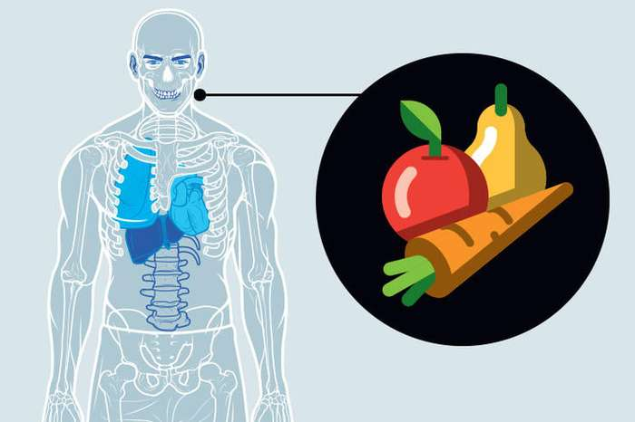

1. Шүдээ өвчлүүлэхгүй байхын тулд, өдөр бүр шүдээ цэвэрлэх, шүд цэвэрлэдэг утас ашиглах, мөн тамхи татахаас зайлсхий. Лууван, лийр, алим байнга хэрэглэх нь, итгэл дүүрэн инээмсэглэх боломжийг мөнхөд олгоно. Мөн эслэг ихтэй хоол хүнс нь шүд, буйлыг өвчилөхөөс хамгаалдаг болохыг эрдэмтэд нотолжээ.

---

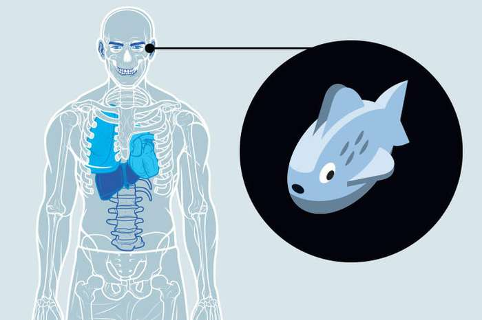

2. Нүдний эрүүл мэндийг хамгаалах. Тамхи татахгүй бол бие эрхтэний бүх системүүд, тэр дундаа нүд тань гэмтэхгүй. Нүдний эрүүл байдлыг хадгалахад, омега-3 тосны хүчлийн агууламжтай цэнгэг усны загас хэрэглэх нь нэн тустай бөгөөд чихрийн шижнээс үүдэлтэй нүдний судасны өөрчилөлт, нарийсалтаас сэргийлдэг. Омега-3 байнга хэрэглэхийг зөвлөдөг

---

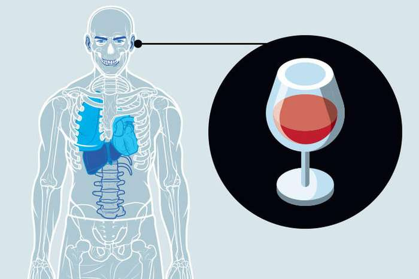

3. Сонсголоо хамгаалахад: чанга дуу чимээ, хөгжимөөс зайлсхий. Дуу чимээний өндөр децибилл нь, насжих үед сонсголгүй болгох аюултай. Дуу чимээнээс сонсголоо хамгаалахад улаан дарс хэрэглэх нь үр дүнтэй бөгөөд тогтмол хэрэглэх нь, сонсгол муудахаас хамгаалдаг

---

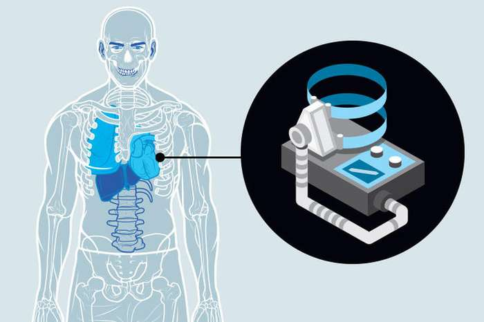

4. Зүрхээ хамгаалах. Ойр тойрныхноосоо, шөнө унтах үедээ хурхирдаг эсэхээ асууж мэд. Хурхирч, үе үе тасалдсан амьсгаа гаргах нь, цусанд орох хүчил төрөгчийг бууруулж, уушигны судсуудыг нарийсуулж, зүрх өөрчлөлтөд орж буйн шинж. Жингээ хасахад анхаарах хэрэгтэй.

---

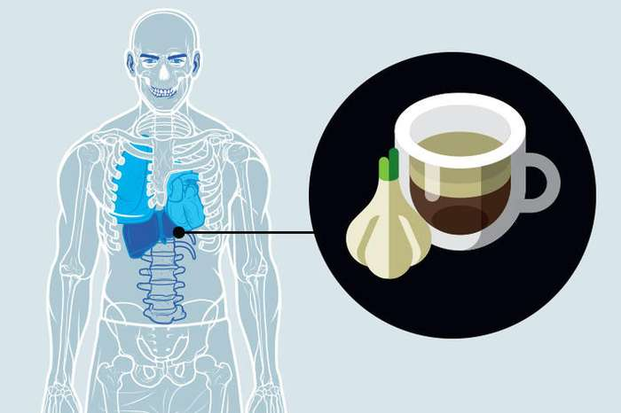

5. Элгээ хамгаалах. Архи, спиртлэг зүйлээс зайлсхий. 2 ба түүнээс дээш төрлийн архи, дарс нэг дор хэрэглэхэд элэгний эд эс үхэж эхэлдэг гэж, Кливлендийн эмнэлгийн доктор Майкл Розен баримт нотолгоотой баталсан байна

---

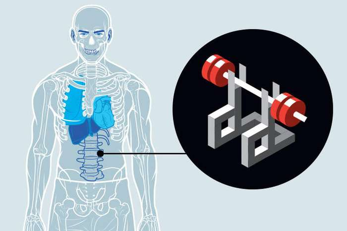

6. Нуруугаа хайрлах. Нурууны булчингууд нуруу нугасыг барьж байдаг. Эдгээр булчингуудыг бэхжүүлэхийн тулд хүчний дасгал хийж байхыг зөвлөдөг. Тохирсон жинтэй зүйлийг өргөж сууж босох дасгал бүрэн хөдөлгөөнийг хангадгаас, нуруу ба нурууны булчин чангарч байдаг. Мөн доошоо харж хэвтээд гар хөлөө өргөж, аль болох удаанаар байх дасгал сайн үр дүнтэй байдаг.

---

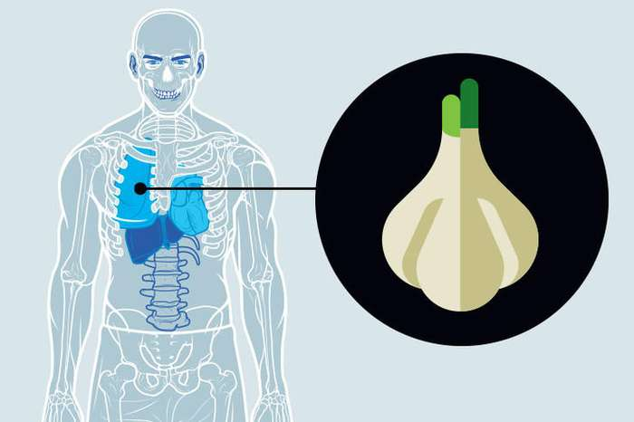

7. Уушиг. Сармис ихээр ид. Түүхий сармис, долоо хоногт 2-с доошгүй удаа иддэг хүмүүс, уушигны хавдараар өвчлөх эрсдэлээ 50% бууруулдаг болохыг эрдэмтэд нотолсон байна. Учир нь, сармисанд аллицин хэмээх ашигт бодис ихээр агуулагддаг.

---

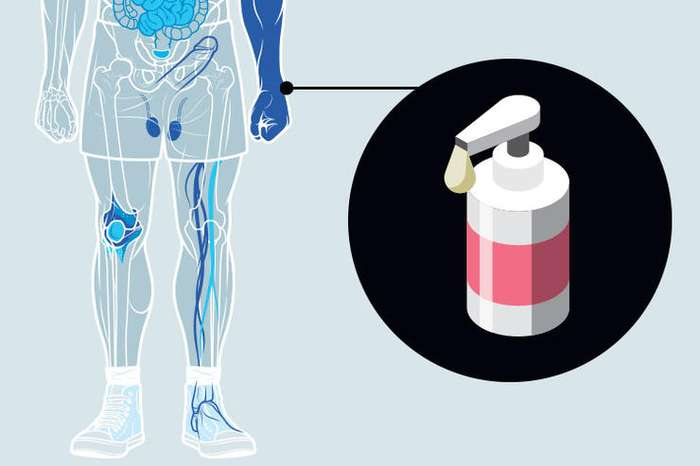

8. Арьсны эрүүл мэнд. Нарнаас хамгаалах тос хэрэглэж занш. 30 наснаас хүний арьс, коллагенаа алдан, нимгэрч үрчлээс үүсч эхэлдэг. С аминдэм энэ процессыг зогсоох чадвартай

---

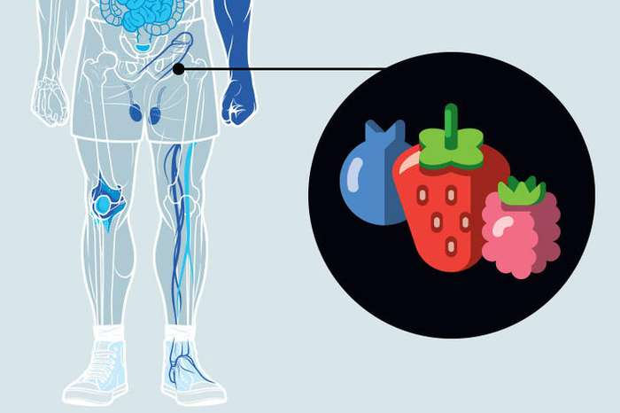

9. Эр бэлэг эрхтэн. Жимс жимсгэнэ, тэр дундаа исгэлэн жимсүүд хэрэглэх нь цусан хангамжийг нь сайжруулдаг

---

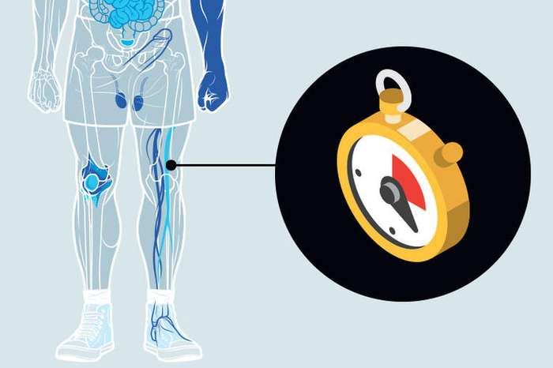

10. Судсаа хамгаалах. Бидний биед, 96560 километр судас байдаг. Эдгээрийг хамгаалахад дасгал, спортоор хичээллэхээс өөр тустай зүйл үгүй. Дасгалын үед артери өргөсөж, агшиж байдаг.

---

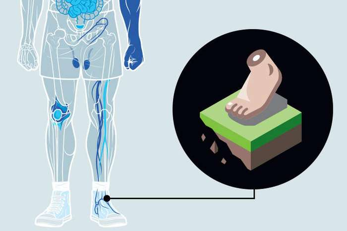

11. Хөлийн шагайгаа хамгаалах. Тогтворгүй гадаргуу дээр алхах, дасгал хийхийг зөвлөдөг. Нимгэн ултай гутал өмсөх, хөл нүцгэн явах нь шагайг бэхжүүлдэг.

---

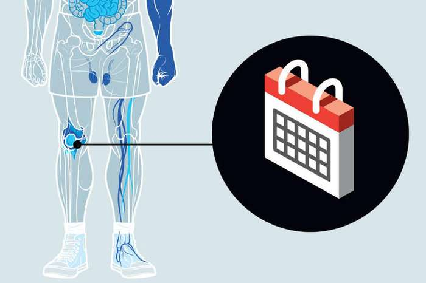

12. Өвдөг. Өвдөгний үе,мөгөөрсийг хамгаалахыг тулд, долоо хоногт 3-с доошгүй удаа спортоор хичээллэх хэрэгтэй байдаг. Өвдөгний үе, хөдөлгөөн дутагдах үед шингэнээ ялгаруулж чадахгүй болдог. Энэхүү шингэн нь хөлийн хөдөлгөөн, өвдөгний булчин, мөгөөрс агших, сулрах үед ялгардаг бөгөөд суух босох дасгалыг байнга хийх хэрэгтэй

---

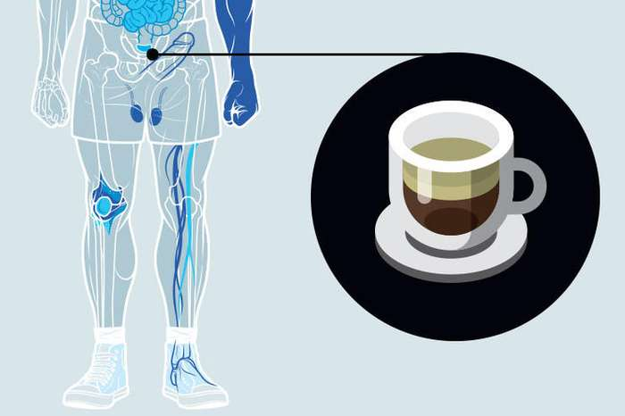

13. Түрүү булчирхай. Японы эрдэмтэдийн судалгаагаар, хар кофе уудаг хүмүүс түрүү булчирхайн хавдараар өвчилөх эрсдэл маш бага байдгийг илрүүлжээ. Хамгийн тохиромжтой хэмжээ нь, өдөрт 4 аяга байдаг байна

---

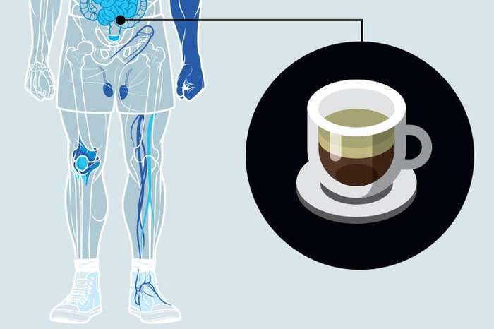

14. Ходоод гэдэсний эрүүл мэнд. Тараг, йогурт, исгэлэн сүүн бүтээгдэхүүнүүд пробиотикоор баялаг байдгаас, ашигт бактеруудыг организмд бий болгож байдаг. Мөн, дарсан байцаа, кимчи хэрэглэх сайн. Хоол хүнсний нэр төрөл олон байх тусам, ашигт бактеруудыг нөхөж байдаг гэж үздэг байна.
