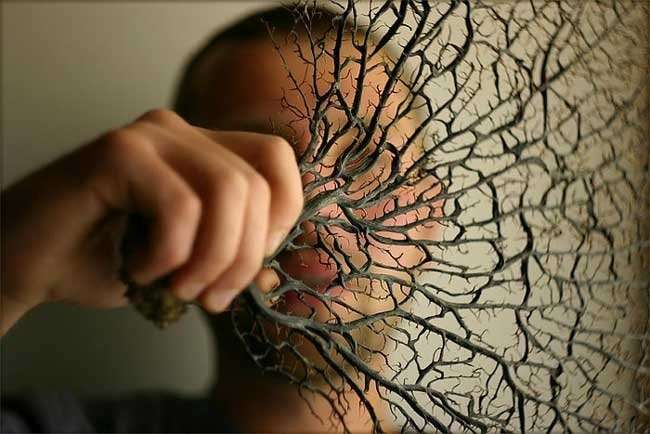

# Хүний сул талуудын цаана

Хүний сул тал, муу зуршилууд ихэвчилэн сайн эерэг хандлагууд дээр нь үндэслэсэн байдаг гэсэн сонирхолтой судалгаа гарчээ.

Хүний таагүй зан араншин, сул тал, муу зуршилууд нь олдмол, харин цаад зан чанар, ёс суртахуун нь үргэлж эерэг байдаг, тухайн зан чанараа гаргах бололцоо бүрэлдэхгүй нөхцөл, мөн төрөлхөөс заяасан сайн талаа харуулах хүсэл нь биелэх боломжгүй байдал зэргээс муу зуршил, зан араншинтай болдог гэнэ. Өөрөөр хэлвэл, анхны төрөлх сайхан чанарууд нь, тухайн орчин болон материаллаг ертөнцийн нөлөөгөөр өөрчилөгдөж сөрөг муу тал болон хувирдаг байна. Энэ процессыг хэзээ ч буцааж өөрчилж болох сайн талтай байдаг. Үүнийг ойлгосноор өөрийгөө болон ойр дотныхныхоо зан чанар, хандлагуудыг дүгнэх, сул тал, муу зуршил, зан араншингийн цаад учирыг олж харах, эерэг чанаруудаа илрүүлж, сэргээх, хөгжүүлэх боломжтой болдог. Голын усыг буцааж урсгаж болдоггүй харин, урсгалыг нь өөрчилж болдогтой үүнийг дүйцүүлэн ойлгож, нэгэнт тогтсон зан чанартай тэмцэх биш, харин хүлээн зөвшөөрч, өөр голдиролруу оруулахыг хичээх хэрэгтэй болдог. Та, дараах, хүний далд хандлага, зан чанарын талаар уншаад, өөрийн тухай болон бусдын тухай өөр ойлголттой болж, өөр өнцөгөөс харах ухаалаг чадвартай болох юм.\
Архи уух зуршилтай хүн, мэргэн ухаан, гүн ухааныг эрж хайж, аливаа зүйлийн учирыг олох, асуудлын гүнд орж ойлгох, шийдвэрлэх сонирхолтой хүн байдаг. Ямар ч хүн согтолтын үедээ, харьцааг эрэлхийлж байдаг нь, үүнтэй холбоотой байдаг гэнэ. Тэд ихэвчилэн, хайртай дотныхноосоо хайр хүндлэлийг нь авч чадаагүйдээ харамссан сэтгэлтэй, хүндлүүлж магтуулах дуртай хүмүүс байдаг бөгөөд эдгээр хүмүүсийг зөв чиглүүлж өгвөл, гайхалтай ухаантан, бүр гүн ухааны өндөрлөгт хүрэх чадвартай байдаг байна. \
Тамхичид, шударга ёсыг эрхэмлэдэг, өөрийнхөө үйл хөдлөлийн зөв эсэхийг хянах дуртай хүмүүс байдаг. Бясалгал болон сэтгэл заслаар энэ зуршил нь засагддаг ба зан чанараа зөв чиглүүлсэн тохиолдолд, сэтгэл зүй, аливааг танин мэдэх гойд чадвартай, бясалгалын мэргэжилтэн гэмээр, мөн ертөнцийн бүх нууцыг тайлах чадвартай хүчтэй сэтгэхүйгээ дарамталж явсанаа мэддэг. \
Хувиа хичээсэн зан. Тэд бол төрлөхийн багш, сургагч, мөн бусдыг дагуулах эрмэлзэлтэй. Тэд өөрийгөө бусдаас ялгаатай гэж боддог. Аль болох нийтэч, илэн далангүй хүмүүстэй харьцаж, хувиа хичээсэн зангаа давснаар гайхалтай өвөрмөц сэтгэхүйтэй, бүх талын өгөөжтэй нэгэн болдог. \
Атаархал. Багш, ахмад хүмүүсийн заасныг үргэлжлүүлэгч, төгс сурагч байх далд хүсэлтэй хүмүүс атаархуу байдаг. Бусдын хувьд хүлцэшгүй муу зан. Энэ зангаасаа болж ганцаардмал, зожиг болж муу нэртэй болдог. Бодол сэтгэлээ сайн хянаж сурсанаар амьдрал нь хөнгөрдөг. \
Шунал. Сурах мэдэх хүсэл, хор шар аажимдаа материаллаг эд зүйлсэд шунах шунал болох нь бий. Оюун ухааны баялаг, эд материалын баялаг хоёрыг харьцуулан шинжилснээр засарна. \
Онгироо зан. Өөрийнхөө хүрсэнд, бусдыг хүргэх сэдэл төрүүлэхийг хичээдэг нэг талаас сайн чанар. Энэ зангаа зөв ашиглавал, удирдагч, урмаар тэжээгч, оюун санааны итгэл үнэмшилийг түгээгч болдог. \
Залхуу зангийн цаана тэвчээртэй чанар нуугдаж байдаг. Тэд илүү хөдөлгөөн хийхгүйн тулд, гайхалтай хялбар аргуудыг сүвэгчилэх чадвартай. Мөн, ямар нэг зүйл барьж авбал, таагүй зүйлсийг ч үл ажран хүссэндээ хүрэх чадвартай байдаг.
