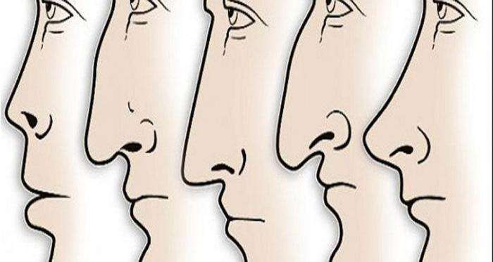

# Хүнийг хамрын хэлбэрээр нь шинжих тест

Хүний хамрын хэлбэрээр, хүнийг шинжиж болдог байна

#### Шулуун хамар

Ийм хамартай хүн, онгод, зөн совинтой, гүйцэтгэх, зохион байгуулах гайхмаар туршлага авъяастай байдаг гэнэ. Хямралын үед хамгийн хэрэгтэй хүмүүс

#### Өргөн самсаатай хамар

Ийм хамартай хүмүүс жинхэнэ манлайлагчид байдаг бөгөөд маш хүчирхэг зан чанартай, мөн тайван байдаг

#### Махлаг өргөн хамар

Уг нь нарийн, нийтдээ өргөн шантгар хамар Маш хурдан сэтгэж хурдан шийдвэр гаргадаг хүмүүс ийм хамартай байдаг. тэд мөн ухаантай.

#### Шантгар хамар

Өөдрөг үзэлтэй, сайн хүммүс ийм хамартай байх нь олонтаа. Халамжтай, хайр энэрлийг өгч чаддаг мөн авч чаддаг. Аливаа зүйлсийг турших дуртай, урам зоригтой хүмүүс

#### Монхор хамар

Ийм хүмүүс, өөрийн амьдралыг өөрсдөө, ямар ч туслалцаагүй босгох чадвартай. Олонд хүлээн зөвшөөрөгдсөн ямар ч лидер байсан, түүнийг дагахгүй. Хэний ч дэмжлэг туслалцаа авахгүй, мөн атаархмаар зөрүүд байдаг.
