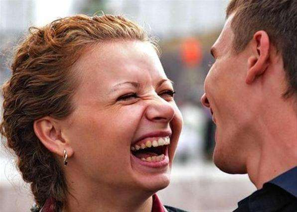

# Хүнийг, хэрхэн инээдгээр нь таньж болно

Хүмүүс хоорондоо харилцах үедээ, ярилцах хөөрөлдөхийн зэрэгцээ, дохио зангаа, биеийн хөдөлгөөнүүдийг хэргэлж байдаг бөгөөд эдгээр нь хүний зан төрхийг илэрхийлж байдаг гэж үздэг. Мөн хэрхэн инээж буйгаар нь хүнийг шинжиж, тухайн хүний талаар олон зүйлийг мэдэж авч болдог гэнэ. Хэрэв амаа гараараа таглаж инээж байвал, хөдөлгөөнтэй, сэтгэл хөдлөлтэй, бусдыг сонсохоосоо илүү өөрөө ярих дуртай хүн. Ингэж инээдэг хүмүүс өөрийгөө багахан хазаарлаж байх нь дээр. Толгойгоо гэдийж инээдэг бол, уужим сэтгэлтэй, итгэмтгий хүн. Сэтгэл хөдлөлдөө автсан сонин үйлдлүүд хийж байдаг. Инээх үедээ хамраа үрчийлгэдэг бол, мэдрэмж болон сэтгэгдэл нь хурдан солигддог, үзэл бодлыг нь амархан өөрчилж болох хүн. Сэтгэлийн хэт их хөдөлгөөнтэй, бааштай, тухайн хормынхоо сэтгэл санааны байдалд автаж хувьсаж байдаг. Нүдээ онийлгож инээдэг бол, өөртөө итгэлтэй, сэтгэлийн хаттай, зүтгэлтэй, тууштай, ухаалаг хүн. Гэхдээ туйлширах байдал гаргадаг. Инээх нь тодорхойлж болохооргүй, янз бүрийн хөдөлгөөн гаргаж инээдэг хүн, өвөрмөц зан төрхтэй. Өөрийнхөөрөө бүхнийг байлгах дуртай, бусдын сэтгэгдлийг сонсох дургүй хүн. Ухаалаг хүчирхэг эмэгтэй нүдээ онийлгож аяархан инээдэг. Илэн далангүй сайхан сэтгэлтэй эмэгтэй амархан инээдэг. Ухаалаг, мэдрэмтгий эмэгтэй салангид, үргэлжлүүлэн инээдэг. Чанга, бусдад халдаасан халдвартай мэт инээдэг эмэгтэй үнэнч, зөөлөн, мөрөөдөлдөө итгэдэг хүн байдаг. Харин инээж байгаагаа нуух мэт, инээдээ барихын тулд гараараа амаа дарж инээдэг бол, өөртөө итгэлгүй , аймхай эмэгтэй. Бүх шүдээ ил гаргаж инээдэг эмэгтэй нь хүчирхэг, сэтгэлийн хөдөлгөөнтэй, гоц зан төрхтэй байдаг. Мөн сэтгэл зүйчид, тухайн эрэгтэйнхээ тухай илүү ихийг мэдье гэвэл, инээдтэй зүйл ярьж хэрхэн инээхийг нь хараарай гэж бүсгүйчүүдэд зөвлөжээ. Амаа ангайлгаж, чангаар шалтгаангүй амархан инээгээд байдаг эр, маш хөдөлгөөнтэй, сэтгэлийн хөөрөлтэй, сэтгэл нь тогтворгүй, үхтлээ инээж байснаа, шалтгаангүй уур хилэнд автагддаг, их ярьж бага сонсдог эр. Сэтгэлийн хаттай, өөртөө итгэлтэй, тууштай, бүтээлч эр, бага зэрэг нүдээ онийлгон, аяархан боловч бусдад “халдаам” инээдэг. Нэг зангаараа, бага зэрэг амиа бодомтгой эр, амаа ангайлгахгүй, тайван аястай инээдэг бөгөөд сайхан яриа өрнүүлж, бусдыг анхааралтай сонсдог, тусархуу байдаг. Тодорхойлж боломгүй төрхтэй инээж байвал, маш өвөрмөц зантай, өөрийн “Би”-г дөвийлгөдөг, бусдын сэтгэгдлийг тоодоггүй хүн байдаг гэнэ.

Инээд нас уртасгана гэдэг. Эерэг сэтгэлийн хөдөлгөөн, баяр баясгалан бол эрүүл мэндийг тань хамгаалж, дэмждэг, анагаах ухаан ч тус болж чадахгүй тохиолдолд туслах чадвартай байдаг гэж үздэг бөгөөд стресс, депрессээс ор мөргүй салгах ид шидийн мэт чадвартай гэж шинжлэх ухааны үндэслэлтэй нотолсоор байгаа билээ. Инээмсэглэл дүүрэн явдаг, инээж хөхөрсөн эмэгтэй дур булаам, эрчүүдийн хайрыг татах чадвартай байдаг аж. Эдгээр жижигхэн тодорхойлолтуудыг ашиглан, багахан ажиглалт хийснээр бусдын тухай олон зүйлийг мэдэж авч болох нь. Мөн өөрийнхөө инээх үеийг ч анзаараад авах нь илүүдэхгүй юм шиг. Үнэн сэтгэлээсээ инээж, амьдралын баяр баясгалантай, дурлал хайр дунд умбан явахын ерөөл дэвшүүлье.

---

