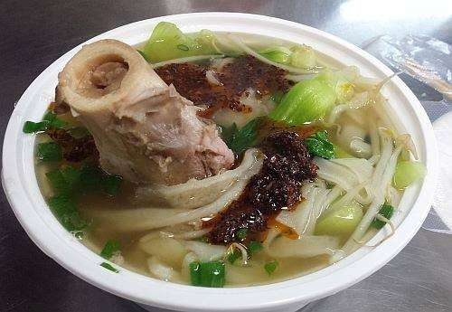

# Хүнсний ашигт хэрэглээ биднээс өмнөх үеийн хэрэглээрүү буцаж байна.

Бие организмд ашигтай хоол хүнсний тухай сэдэв, биднээс өмнөх үеийн хүмүүсийн байгаллаг, хоол хүнсний хэрэглээнд буцахаас аргагүй байдалд оруулж буйг харуулдаг болсоор... Залуу насыг хадгалахад тустай, хөгшрөлт, стресс, таргалалтаас хамгаална гэсэн орчин үеийн лабораторт бүтээгдсэн, олон төрлийн, нэн шинэ гэсэн тодотголтой бүтээгдэхүүнүүд, өнөөдрийн хэвлэл мэдээлэл, олон нийтийн сүлжээгээр тасралтгүй сурталчлагдсаар буй ч, байгалийн гаралтай хүнс болох урдны хүмүүсийн хэрэглэж ирсэн, ашиг тус нь амьдралд нотлогдсон, ердийн анхны хэлбэрээрээ байгаа хүнснүүдийг судалсан судалгаануудын үр дүн, мөн эрүүл зөв хооллолтын дэлхий нийтийн хандлага нь, хоол хүнсний хэрэглээ түүхийн эхэн үе рүү буцаж байгааг харуулж байна. Ургамал, амьтны гаралтай хүнсний ашиг тустай чанарыг, уламжлалт эмчилгээ, орчин үеийн анагаах ухаан, эм зүйн шинжлэх ухааны салбарууд эртнээс хүлээн зөвшөөрч, ихэнхи эмний суурь болгон ашигласаар ирсэн байдаг.

Тухайн улс, үндэстэн бүр, өөрсдийн цаг агаар, уур амьсгалын нөхцөл, ургамал амьтны аймаг, байгалийн нөхцөл, амьдрал ахуйтай нягт холбоотой өөр өөрийн уламжлалт хүнс хэрэглэж ирсэн ба түүхийн явцад эдгээрийн ашиг тусыг мэдэж ашиглаж ирсэн ард түмний баялаг туршлага дээр орчин үеийн анагаах, эм зүйн шинжлэх ухаан тулгуурлан явдаг нь нууцгүй юм. Өвөг дээдсээс уламжлан ирсэн өв соёл, амьдрал ахуй, ёс заншилаа үнэлэн, таслахгүй үргэлжлүүлэхийг түүх биднээс шаардаж байна. Тиймээс, эрүүл амьдрах аж төрөхийн нууц, бидний өөрсдийн ахуй соёл, уламжлалт хүнсний хэрэглээнд оршдог, мөн салшгүй холбоотой болохыг бид ойлгох ёстой болжээ. Зөв хооллолтын төвүүд, үүнд илүүтэй анхаарч, ард олноо гадны ямар нэгэн бүтээгдэхүүн хэрэглэхэд уриалах бус, харин, монгол хоол хүнсний арвин баялаг түүхийг судалж, улирлаас хамааралтай хооллолт, цагаан, улаан уургийн хэрэглээний талаар таниулан ойлгуулж түгээх хэрэгтэй мэт. Ургамлын асар олон төрөл зүйлээр баялаг манай орны ургамал судлаачид, мөн сүү цагаан идээний үйлдвэрлэл эрхлэгчид үүнийг анхаарах хэрэгтэй юм. Яагаад манайд, монгол зөв хооллолтын төв байхгүй байна? Одоогийн зөв хооллолтын төвүүд, таниулж сургаж буй зөв хооллолтын бүтээгдэхүүнээ гадны хэлнээс хөрвүүлэн гайхалтай тайлбарлавч, монгол хоол, хүнсний талаар огт ойлголтгүй байдаг нь харамсалтай. Хөрш зэргэлдээ Орос орны ард түмэн л гэхэд, монгол хонины сүүлийг эрэгтэй хүний “”эр чанар”-т тустайг мэддэг, эрж хайн хэрэглэдэг юм билээ. Монгол хоол гэхээр, хэдхэн төрлийн хоол л байдаг гэж голонгуй ханддаг олон хүн байдаг. Гэтэл бид, асар баялаг уламжлалт хүнсээ зөв төрөлжүүлэн, ашигт чанарыг нь ойлгож хэрэглэж чадахгүй байгаа бөгөөд үүнийг, уламжлалаа үнэлж сураагүй, хэн ч үүнийг таниулж ойлгуулдаггүй, мөн орчин үеийн хэрэгцээ шаардлагад нийцсэн сав баглаа боодолтой болгон нийлүүлдэггүйтэй холбон үзэж болох юм. Гадны, гоё сайхан сав, баглаа боодолтой хоол хүнсийг эрхэмлэн түүнийгээ тансаг хэрэглээ гэж ойлгодог болтлоо доройтсон гэж үү? Монгол орны маань, монгол хоол хүнс, ирээд буцсан гадны хүн эргэж санадаг, эцэг өвгөдөөс маань уламжлан ирсэн туйлын эрхэм зүйл билээ.
