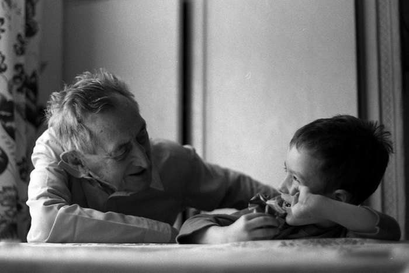

# Хоёр чоно

Нэгэн ухаантай өвөө ач хүүдээ, -Хүн бүрийн дотор, хоёр чоно уралцаж байгаа юм шиг тэмцэл болж байдаг юм. Нэг чоно нь, муу зүйлүүд болох, атаархал, хар сэр, хардалт, харамсал, амиа хичээх зан, харамч нарийн зан, ихэрхэл, худал хуурмагийг төлөөлж, харин нөгөөх нь, сайн үйлс, эв эе, хайр, үнэн мөн, сайхан сэтгэл, өгөөмөр зан, үнэнч чанар, шударга үнэнийг төлөөлдөг юм гэхэд, сонирхож гайхсан ач нь, -Тэгээд хэн нь ялдаг юм бэ? гэж асуув. Өвөө нь, ачийгаа өхөөрдөнгүй харж мушийн инээмсэглэснээ, -Чи алийг нь илүү тэжээнэ, тэр нь ялдаг юм гэж хариулжээ.
