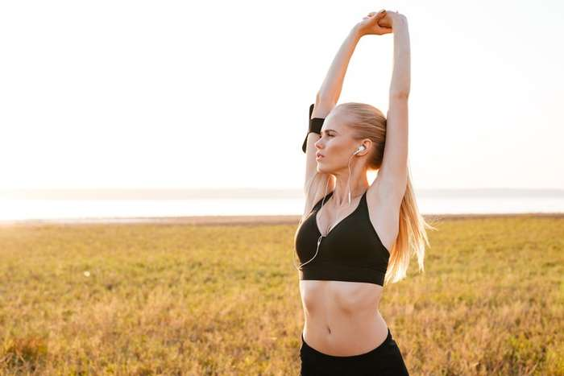
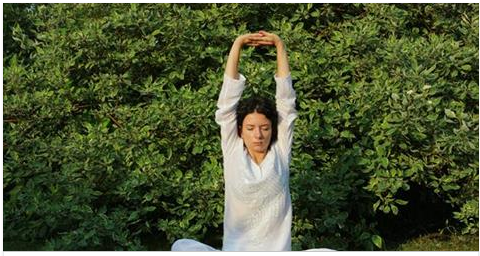

# Хоёр гараа толгой дээрээ өргөдөг байхын 4 тус

Гарыг аль болох байнга дээш өргөх нь: 1. Ходоод гэдэсний нугалаа тэнийж хоол түргэн боловсрох, гадагшлахад тустай. 2. Гарын булчин сулрах, урьс унжихаас сэргийлнэ. Гарын арьс мах унжих нь, нуруу нугасны өөрчилөлтөд хүргэх, остеохондроз үүсэх нөхцөлийг бүрдүүлдэг бөгөөд, гараа өргөх үед нуруу тэгширч, уян хатан байдлыг сайжруулдаг байна. 3. Нас ахих тусам, цээжний хөндий, хэвлийн хөндийн эрхтэнүүд анхны байрлалаа өөрчилж унжиж байдаг. Гараа өргөснөөр дотор эрхтэнүүдээ өргөж өгдөг бөгөөд гэдэсний булчин татагдаж чангарах үр дүнтэй. 4. Юм идэж уусны дараа гараа толгой дээрээ өргөх нь биед илүүдэл шингэн хуралдахаас сэргийлнэ. Гараа өргөх үед ус, гэдэсний хананд наалдсан хэрэгцээгүй зүйлсийг угаан гадагшлуулдаг гэнэ. Хооллохоос 20-30 минутын өмнө 1-1,5 стакан ус ууж хоёр гараа толгой дэрээ өргөж бай. Ялангуяа өтгөн хаталтыг шийддэг.\
Хоёр гараа толгой дээрээ өргөн, алгаа хавсран хооронд нь нийлүүлж чангалах, эсвэл хуруунуудаа зөрүүлэн чангалж суниах мэт булчингаа чангалж алхаж болно.
