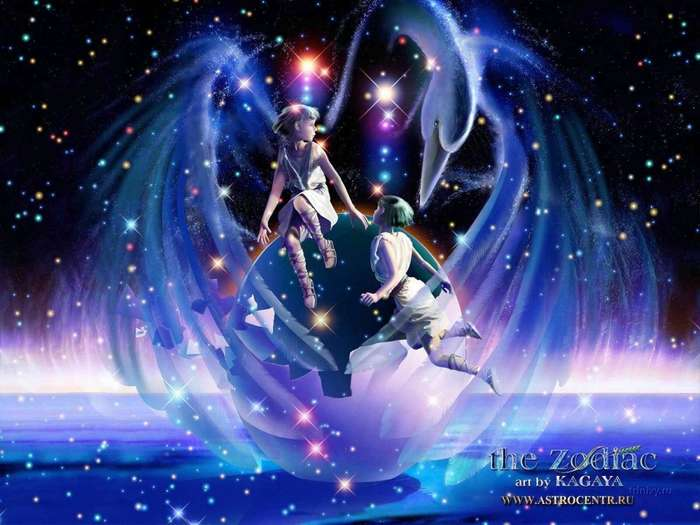
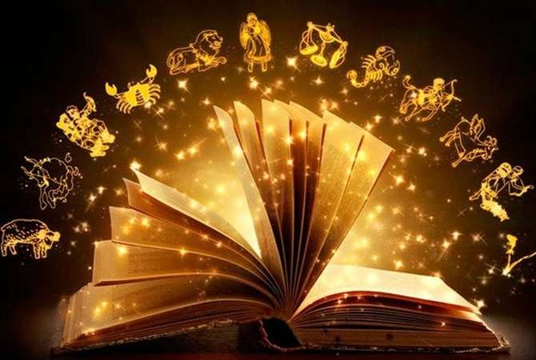

# Хоёр ордууд шилжих зааг дээр төрсөн хүмүүсийн зурхай

#### Матар-Хумх /1 сарын 16-22/

Тогтуун найдвартай Матар, гайхал төрүүлэм Хумх хоёрын энерги нэгдсэнээр, гайхалтай өвөрмөц хүн гарч ирнэ. Энэ хүнтэй байхад хэзээ ч уйдахгүй. Харахад, үрэлгэн, тайван, бүрэг зантай мэт боловч дотор нь сэтгэл хөдлөл нь үргэлж буцалж байдаг. Сэтгэл нь тод өнгөт мөрөөдлүүд, уран сэтгэмжээр дүүрэн. Хэрэв амжилтад хүрье гэвэл урлаг, уран бүтээлийн ажил төрөл эрхлэх хэрэгтэй. Мөн, Матарын хөдөлмөрч зан, өндөр шалгуур нь эдгээр хүмүүсийн эхэлсэн ажилдаа амжилтад хүрэхэд гайхалтай нөлөөлдөг. Тэдний хувьд, хувийн харилцаа бэрхшээлтэй байх нь бий.

#### Хумх-Загас /2 сарын 15-21/

Гайхал төрүүлэм Хумх, мөрөөдөмтгий Загас хоёрын энерги сүлэлдэн маш мэдрэг, эмзэг зан чанарыг гаргадаг. Ийм хүмүүс оюунлаг, уран сайхны мэдрэмжтэй, энх тайванч, эвсэг, нөхөрсөг байдаг. Аливаа зүйл, үзэгдлийн жинхэнэ чанар, алсын хараатай үзэл санаа, мэргэн ухаан зэргийг чухалчилдаг. Өндөр оюун, сэтгэлгээ нь аливаад хийсвэр хандах, биеэ даах байдалд нь таагүй нөлөөлөх магадлалтай. Өдөр тумын ахуй амьдралтай холбоотой ажил төрлөөс илүү оюун сэтгэлгээ, оюуны чадавхи шаардсан гүн ухааны үзэл санаа, сэтгэл, оюун санааг ойлгохыг илүүд тавьдаг. Илүү гүн гүнзгий түвшинд ертөнц, хүмүүс, өөрийгөө таних, өөрчлөх хэмжээний бодол тээдгээс, бодолдоо автан мартамхай, салан, цэгцгүй байх хандлага гаргах нь бий.

#### Загас-Хонь /3 сарын 17-23/

Мэдрэг мөрөөдөмтгий Загас, шийдэмгий, түргэн зантай Хонь буюу гал дөл шиг лугшилт, мөрөөдөл хоёрын гайхалтай хослол нь зөвхөн мөрөөдөөд зогсохгүй энэ амьдралд, энэхүү мөрөөдлөө биелүүлэх боломжид хүргэдэг. Та, аймшиггүй зориг, бусдыг ойлгох чадварыг хослуулсан жинхэнэ манлайлагч. Ийм хүмүүс, зорилго тавьж, түүнийгээ бусдын сэдлийг хөдөлгөн хийлгэж гүйцэтгүүлэх төрлөхийн авъяастай байдаг. Хэрэв, энэ хоёр ордын зан чанарын тэнцвэрийг хангаж чадвал маш өндөр амжилтад хүрэх боломжтой. Яаруу Хонийг Загас тайвшруулж, харин Загасны мөрөөдлийг Хонь бодит болгон биелүүлдэг гэсэн үг.

#### Үхэр-Ихэр /5 сарын17-23/

Оргил эрч хүчийг заадаг. Бие сэтгэл санаа, мах бодийн эрч хүчтэй, тэвчээртэй, ямар ч зүйлтэй дасан зохицох чадвартай, зорилго тавьсан бол түүнийхээ төлөө өөрийгөө золиослон дуустал явдаг хүмүүс. Өөрийгөө хайрлаж сурахыг чухалчилах хэрэгтэй. Хүмүүсийг сайн сонсож, ойлгож сурсанаар амжилтад хүрдэг гэдгээ мэдэх хэрэгтэй.

#### Ихэр-Мэлхий /6 сарын 17-23/

Энэ үед төрсөн хүн, хөгжилтэй, сониуч, халамжтай, үнэнч, мэдрэмжтэй, онгодтой мэт гайхалтай хүмүүс. Хэт сэтгэлийн хөдлөлөөр аливааг шийдэх гээд байх магадлалтай. Бага зэрэг аминч үзэлтэй, сэтгэл санааны хямралд амархан өртдөг. Түүх гүн ухаан сонирхдог, шинэ шинэ зүйлийг турших дуртай, хүүхдэд хайртай, тэдэнтэй тоглох дуртай, хүүхдүүдийн шүтээн байдаг. Тэд хайргүйгээр байж чаддаггүй бөгөөд ааш авиртай, бухимдуу болдог.

#### Мэлхий-Арслан /7 сарын 17-25/

Мэлхийний мэдрэг зан, Арслангийн зоримог зан хоорондоо сөргөлдөж байдаг. Эдгээр хүмүүсийн амьдралд, амжилт, бууралт ээлжилж байдаг. Хор шартай, бүтээлч хөгжилтэй эдгээр хүмүүс тогтвор султай, биеэ барих чадвартаа анхаарах хэрэгтэй байдаг. Аль болох сайн дурын сайн үйлсийн ажиллагаанд оролцох, нийгмийн ажил эрхлэх зэрэг сайн үйлс, харилцааны ажил нь, өөрийнхөө зан суртахууны тэнцвэрийг олох, зөвхөн өөртөө төвлөрөхөө багасгах, өөр бусад зүйлд анхаардаг болоход тусалдаг. Хэрэв, тэд, өөрийнхөө зан чанарт хил хязгаараа тогтоож чадвал, хайр, тогтвортой байдлаар дүүрэн амьдарлаар амьдардаг.

#### Арслан-Охин /8сарын 17-25/

Энэ хоёр орд хоорондоо зөрүүтэй тул, зан чанар нь хоёрдмол байх магадлалтай. Маш хөдөлмөрч, хичээл зүтгэлтэй, нэг ажилдаа нэгмөсөн өөрийгөө зориулдаг. Арслангийн ордны төрөлхийн манлайлагч зан, охины хөдөлмөрч зан хоёр нийлснээр баримжаалал сайтай үнэнч зантай байдаг. Мөн аль ордын зан чанар давуу байгаагаас, арслангийн нэр алдар, анхаарал үгүйлдэг зан, эсвэл охины тайван зүтгэлтэй зан хоёрын тэнцвэрийг хангах, хослуулахад анхаарах хэрэгтэй болдог.

#### Охин-Жинлүүр /9 сарын 19-25/

Энэ үед төрсөн хүний дотоод ертөнц ч тэр, гадаад төрх ч тэр гайхалтай сайхан байдаг. Сэтгэл санааны тэнцвэртэй, тайван, өөрийн сонголтдоо итгэлтэй, бодит, бага зэрэг нарийн, эсрэг хүйснийхэндээ тооцоотой хандах магадлалтай. Гэхдээ гайхалтай романтик, дэврүүн сэтгэлтэй, халамжлуулах, магтуулах, талархуулах дуртай байдаг. Мөн, нийгмийн ямар ч шатны хүмүүстэй хэл амаа ололцдог тул сайн дипломатч болох чадвартай. Ажиллах ёс зүй, задлан шинжлэх ухаан нь хөгжсөн байдаг тул гүн гүнзгий сэтгэх чадвартай байдаг ч залхуу, хүсэл эрмэлзэлгүй зангаасаа болж юуг ч өөрчлөхгүй, мөн, хүссэн өндөрлөгтөө хүрэхгүй байх магадлалтай тул анхаарах хэрэгтэй.

#### Жинлүүр-Хилэнц /10 сарын 19-25/

Хоёр хүчтэй гаригийн шилжилт дээр төрдөг тул, хүсэл тачаалаар дүүрэн, сэтгэл татах увидастай, сайхан өнгө төрхтэй байдаг. Эдгээр хүмүүс дотогшоо, дуу муутай, нээлттэй бус байх магадлалтай тул, аль болох олон нийттэй харилцах ажил мэргэжил эрхлэх хэрэгтэй. Тэдний хувьд, алдарших, өндөр амжилтад хүрэх хялбар байдаг. Энэ нь, хүчтэй хөгжсөн манлайлагч зан, зөрүүд хүчирхэг зантай нь холбоотой байдаг бөгөөд эргэн тойрныхонд нь хэцүү байх нь бий. Их зантай болохоос болгоомжлох хэрэгтэй.

#### Хилэнц-Нум /11 сарын 18-24/

Энэ хүмүүс, хүчирхэг, хөдөлгөгч энергиэр дүүрэн байдаг. Маш зоримог, эрч хүчтэй, хэлэх гэснээ хэлчихдэг, зорьсондоо хүрдэг. Хэрэв энэ бүх энерги, эрч хүчээ зөв чиглүүлж чадвал эхэлсэн зүйл бүртээ амжилтад хүрэх чадвартай байдаг. Тэд, үргэлж завгүй байхыг чухалчилдаг. Хүчтэй, өгөөмөр, шооч зантай, хамгийн хөгжилтэй үнэнч найз нөхөр. Эрх чөлөөгөө хязгаарлуулах туйлаас дургүй. Уур, хилэнгээ хазаарлаад байвал, эргэн тойрныхныхоо хамгийн хайртай хүн нь байдаг.

#### Нум-Матар /12 сарын 18-24/

Оюуны өндөр потенциалтай, дэлхийг өөрчлөх эрмэлзэлтэй хүн. Нумын, өөдрөг сэтгэл, аймшиггүй зориг, Матарын хөдөлмөрч, бодит зантай хосолсноор агууг сэтгэж, түүнийгээ бодит болгох чадвартайг заадаг. Тэд, цэгцтэй, харилцааны чадвартай, аялах жуулчилах дуртай байдаг. Албан тушаал ахихыг айхтар ойшоохгүй ч, амжилттай өсч байдаг бөгөөд өөрийнхөө үнэ цэнг мэдрэх нь чухал байдаг. Нийтэч, сайхан сэтгэлтэй боловч тэр болгон олон хүнтэй нөхөрлөдөггүй.
