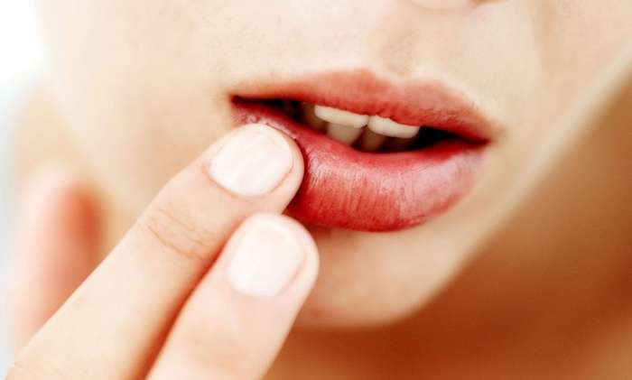
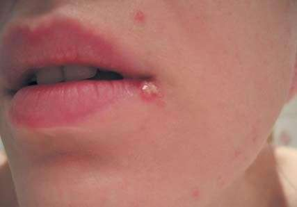

# Хомхой долоох буюу герпесийг өдөрт нь эдгээх аргууд

Энэхүү хомхой долоох буюу уруул дээр гардаг яр, хамгийн таагүй өвчлөлийн нэг билээ. Хамгийн хурдан үүнээс салахыг хүсдэггүй хүн гэж байхгүй, тиймээс дараах аргуудыг танилцуулж байна.

Сүүнд дүрсэн хөвөнгөөр, 2-3 цаг тутам норго. Сүүний тослог бага байвал сайн. Өөрөөр нь хатаах хэрэгтэй.\
Хэрэв, ус гүйгээд, цэврүүтчихсэн бол, перекисээр 2-3 цаг тутамд түлэхэд, өдөртөө зүгээр болдог.\
Сармис нухаад шархан дээрээ тавьж, шархны лентээр тогтооход хурдан эдгэнэ Зуун настын шүүс түрхэх эсвэл шархан дээрээ голоор нь зүсээд тавих хэрэгтэй Уруул хөндүүрлэн, дамбайж мэдрэгддэг. Энэ үед нь мөсөөр жигнэхэд эдгэнэ.
