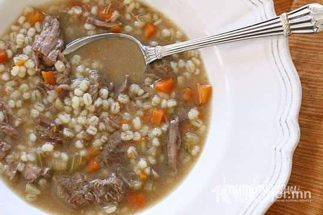
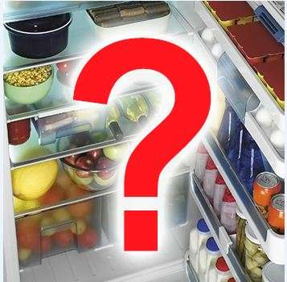

# Хоносон хоолноос татгалзах ноцтой шалтгаан

Бидний бие организм хэрэв чаддаг байсан бол, хэрэглэж буй хоол тэжээлээс маань олон зүйлийг хасч, хүлээж авахгүй, хатуу ширүүн шаардлага тавих байсан биз ээ. Яагаад гэвэл, бид өлсөхөөрөө цадахын тулд бодлогогүй идэж, өөрсдийгөө хордуулдагийн нэг жишээ нь хоол хүнсийг хадгалж, хонуулан идэх хамгийн зохисгүй үйлдэл юм.

Шинэ ногооны салат 2-хон цагийн дараа ашигт чанараа алддаг. Хоносон хоолонд, организмд ашигтай нэг ч зүйл үлдээгүй байдаг. Иймээс ашигтай, хэрэгцээт тэжээлээ авч чадаагүй организм ядарч өвдөж эхэлдэг байна. Хүний бие организмд нэн шаардлагатай амин дэмүүд /А,С,Д амин дэмүүд, В-н төрлийн амин дэмүүд/ гэрэл агаарын үйлчлэлээр маш түргэн устдаг. Тиймээс хоол тэжээлээ, өдөртөө тааруулан бэлдэж хэрэглэхийг хичээх хэрэгтэй.\
Хөргөгчинд хадгалж буй ямар ч шинэхэн хоол хүнс, аажмаар муудаж хор болж байдаг бөгөөд нян үржих гол нөхцөл энэ үед явагддаг. Хоносон хоол харахад хэдийгээр зүгээр мэт боловч хоол биш хор болсон байдаг ажээ.

Бие организмын тэжээл, хоол хүнс таны эрүүл байхын нууц.
