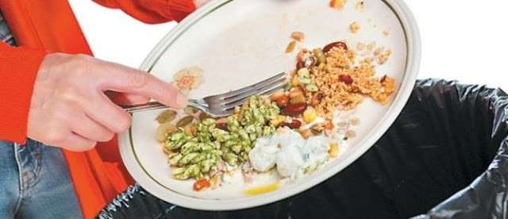

# Хоол хүнсээ хамаагүй хаяхын уршиг

Буддын шашин болоод бусад бүх шашин хоол хүнсэндээ ариг гамтай хандахыг сургасан байдаг. Хүн тус тус бүрт төрөхөд нь, тодорхой хэмжээний хоол хүнс, хувцас хэрэглэл заяагддаг гэх бөгөөд урдны улс, хамаа намаагүй аливааг хэрэглэх нь, насанд цөвтэй хэмээн “Хувцасны тоо гүйцнэ, хоолны хэмжээ дуусна” гэж цээрлэн хэмжээ хязгаартай хэрэглээг эрхэмлэдэг, Бурханаас өгсөн бэлэг хэмээн хүлээн авдаг байжээ. Түүнчилэн бүх зүйлсийг өөр өөрийн энергитэй, тус тусын бурхантай гэж үздэг, мөн хоол хүнсээ хаях нь, материаллаг зүйлсийг үнэлэхгүй, бурханыг үл хүндэлж буйн илрэл гэж үздэг байв. Тариа буудай, будааны төрлийн хүнсийг илүүдүүлж эсвэл идэхгүй муутган хаяхад, санхүү, орлого ашигаа хамт хаядаг. Жимс жимсгэнэтэй хамт хайр хаягдна, хүнсний ногоо хаяхад ойлголцол үгүй болно, хаяж буй сүүн бүтээгдэхүүнтэй аз жаргал алга болно гэдэг. Мөн аяга тавгандаа хоол үлдээхийг “амны хишгээ гөвнө” гэж цээрлэдэг байжээ. Үлдэгдэл хоол хүнсийг амьтан хооллох, газарт булах маягаар хаядаг, харин жорлон муу усны нүхэнд хаяхыг цээрлэдэг байна. Хоол хүнсэндээ аль болох шинэ сэргэг зүйлс хэргэлж, бурханд өргөх ариун идээ мэт хандах, мөн унд хоол хүнс нь бие мах бодын тэжээлээс гадна хэрэгцээт энергийн эх үүсвэр гэж ойлгох нь өөрийгөө хүндэтгэх, эрүүл мэндээ хамгаалах хамгийн сайн арга гэж үздэг байсан бөгөөд мөн зочид гийчид, ирсэн хүмүүсийг цайлж хооллохыг ихэд чухалчилдаг байсан нь гэр орны сайн сайхан байдал өсөж дэвжинэ гэж үздэгтэй нь холбоотой байдаг аж.

