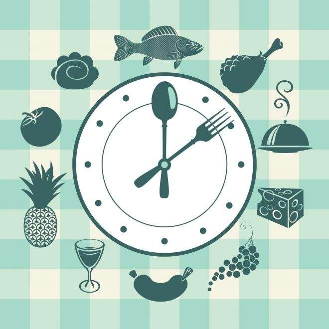
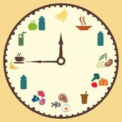

# Хоол  хүнсний, ходоодонд боловсрох хугацааг мэдсэнээр илүүдэл жинтэй холбоотой асуудлуудаа шийдэж болно

Эрүүл хооллохын ач холбогдлыг бид мэддэг боловч, хоол хүнс ямар хугацаанд хэрхэн боловсордог талаар огт мэддэггүй. Бидний хэрэглэдэг хүнсний бүтээгдэхүүнүүд тус бүр, янз бүрийн хугацаанд боловсордог байна. Олон төрлийн хүнсний бүтээгдэхүүнүүд орсон, төрөл олонтой хоол хүнсийг нэг дор хэрэглэх нь зохимжгүй, бөгөөд эрүүл мэндэд хортой байдаг байна. Үүнээс болж бие организмд ялзрах, исэлдэх процесс явагдаж, хорт бодисууд үүсэж, бие организмыг өвчлүүлэх нөхцөл бий болдог. Хоол хүнс тус бүрийн, ходоодонд боловсрох хугацааг мэдсэнээр, идэж хэрэглэсэн хоол ундаа боловсроогүй байхад нэмж хэрэглэхгүй байх, унтахаасаа өмнө доод тал нь 4 цагийн өмнө хооллож занших, ходоодоо амраах, ходоодны өвчнөөс урьдчилан сэргийлэх зэрэг наад захын мэдэгдэхүүнтэй болох боломжтой.

| | | |
| --- | --- | --- |
| Хүнсний бүтээгдэхүүнүүд | | Ходоодонд, боловсрох хугацаа |
| Ус | | Шууд гэдсэнд орно |
| Жимсний шүүс | | 15-20 минут |
| Хүнсний ногооны шүүс | | 15-20 минут |
| Ногоотой шөл | | 15-20 минут |
| Усархаг жимс жимсгэнэ | | 20 минут |
| Апельсин, усан үзэм, грейфрут | | 30 минут |
| Түүхий хүнсний ногооны салат | | 30-40 минут |
| Алим, персик, интоор | | 40 минут |
| Болгосон хүнсний ногоо | | 40 минут |
| Өндөг | | 45 минут |
| Бүх төрлийн байцаа,хулуу,эрдэнэ шиш | | 45 минут |
| Манжин, лууван, пастернак | | 50 минут |
| Ургамлын тос, сүмсээр амталсан ногооны салат | | 1 цаг хүртэл |
| Крахмалтай хүнсний ногоонууд, төмс, топинамбур | | 1.5-2 цаг |
| Бүх төрлийн будааны чанамал, каша | | 2 цаг |
| Бүх төрлийн буурцаг | | 2 цаг |
| Сүүн бүтээгдэхүүн | | 2 цаг |
| Тахиа, шувууны мах | | 2.5-3 цаг |
| Наран цэцэг, хулууны үр | | 3 цаг |
| Бүх төрлийн самар | | 3 цаг |
| Үхрийн мах | | 4 цаг |
| Хонины мах | | 4 цаг |
| Гахайн мах | 5.5-6 цаг | |

Эдгээр хугацаануудыг мэдэх нь хоолны жор бэлтгэх, тооцох, хооллолтын дэглэм мөрдөхөд тустай.
