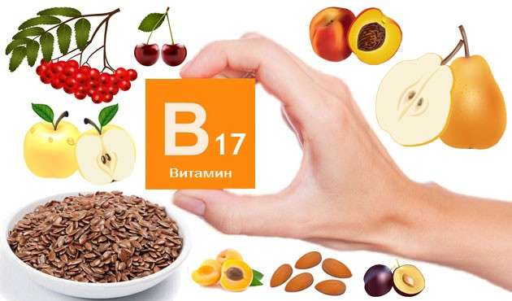
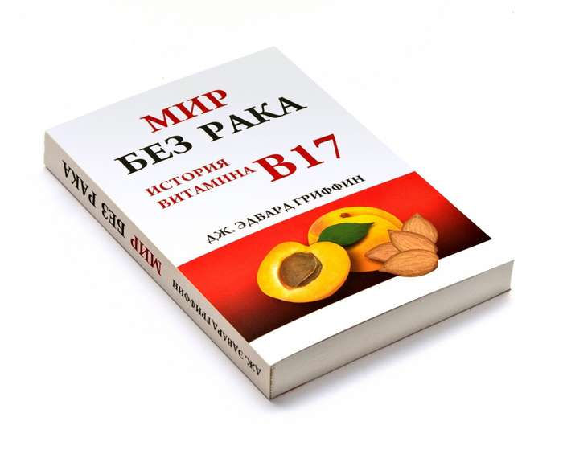

# Хорт хавдарыг устгах чадвартай витамин

Бидний өвөг дээдэс, байгалиараа байгаа, үйлдвэрийн аргаар боловсруулагдаагүй хоол хүнс хэрэглэдэг байснаас хорт хавдарын өвчлөл бараг байгаагүй гэдэг. Харин бид, бараг байгалиараа байгаа бүтээгдэхүүн хэрэглэдэггүй гэж хэлж болох, үйлдвэрийн аргаар боловсруулагдсан, удаанаар хадгалагдах нэмэлтүүдтэй, элдэв бордоо, бодист өртсөн жимс ногоо, мах хоол хүнсэндээ хэрэглэдэг орчин үеийн хөгжингүй нийгэмд амьдарч байгаагаараа бахархан, үүний зэрэгцээ төрөл бүрийн өвчинд нэрвэгдэцгээн, тэр дундаа, хорт хавдар хэмээх өвчинийг үхлийн цааз мэт хүлээн авч айж түгшин амьдардаг.

Эрүүл мэндээ, эмнэлэг, эмийн үйлдвэрлэлд даатган соёлтой амьдарцгаан өвдсөөр, мөнгө төгрөгөө эм танд барсаар... Гэтэл, зарим зүйлийг, эм үйлдвэрлэгчид, эмнэл зүйн салбарынхан юунд нуудаг юм бол? Ашиг орлого, мөнгөний сонирхол гэж сүүлийн үед олон судлаач мэргэжилтэнүүд, үүнийг тайлбарладаг болоод байгаа билээ. Хамгийн аюулт өвчин болох бүх төрлийн хорт хавдарыг лаэтрил, амигдалин гэж нэрлэгддэг В17 хэмээх витаминаар эмчилж болно гэж 35 жилийн өмнө зарласан бөгөөд энэ витамин хорт хавдарыг маш хурдан устгадаг, харин яагаад, эмчилгээний чанар нь нууцлагдсаныг, эмийн үйлдвэрлэлтэй холбон үздэг. Энэхүү В17 витамины үр дүнгийн нотолгоо нь, дэлхийн хоёрдугаар дайны дараа доктор Макс Герсон гэх эмч олон хүнийг В17 витамины өндөр агууламж бүхий абрикосын ясан доторх идээ буюу самрыг ашиглан амжилттай эмчилж эдгээж байжээ. В17 витамин нь, чангаанз /абрикос/, бүйлс /миндаль/, гашуун бүйлс, интоор, тоор, чавга зэрэг жимснүүдийн ясанд, алимны үр, шар будаа /просо/, сорго, маалингын үр, сэвэг зарам /чечевица/, шош, усан үзэм зэрэг үр, жимсэнд ихээр агуулагддаг байна. Эцэст нь хэлэхэд, эмийн вант улсыг буруутгахаа хойш тавин, өөрсдийн боломжийг ашиглан дээрх жимс жимсгэнийн ясны идээ, үр ургамлыг хэрэглэж занших нь бидний эрүүл мэндэд тустай биз ээ. Уг витамин нь, абрикосны ясны дотор байдаг идээ буюу самранд их хэмжээгээр агуулагддаг бөгөөд эрүүл хүн хорт хавдараас сэргийлэхийн тулд өдөрт 8 ширхэг, өвчтэй хүн 15-20 ширхэгийг хэргэлэхэд уг витаминыг хангалттай авдаг байна. Энэ талаар илүү дэлгэрэнгүй, Эдвард Грифин “Мир без рака” номноос уншиж болох юм байна.
