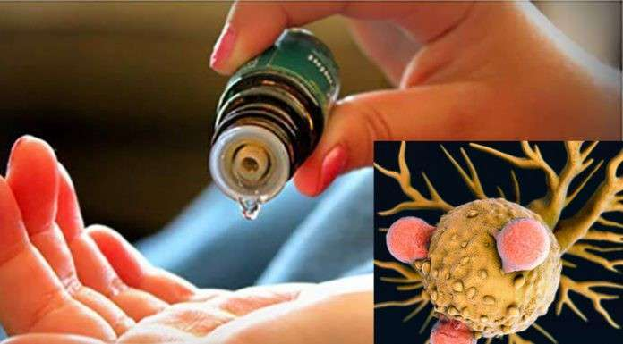
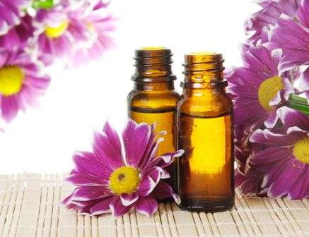

# Хорт хавдарын эд эсийг устгах чадвартай эфирийн тоснууд

Байгалийн гаралтай бүээгдэхүүнүүдийн эрүүл мэндийн ашиг тусыг, шинжлэх ухааны эрдэмтэн судлаачид, өнөө үед, улам ихээр хүлээн зөвшөөрсөөр байна. “Хорт хавдар нь, хүний биеийн эсийн цөм дөх ДНК-ийн код гэмтэхэд үүсдэг”, гэтэл зарим эфирийн тоснууд эд эсийг шинэчилж, эсэд “зөв код” өгөх чадвартай байдаг нь гайхалтай, гэж нэрт дархлаа судлаач эрдэмтэн Махмуд Сухаил судалгааны явцад тогтоосноо гайхширан хэлсэн байдаг.

Төрөл бүрийн ургамлуудын эфирийн тоснууд хорт хавдар тархахаас сэргийлээд зогсохгүй, өсөлтийг нь зогсоох, хавдарын эд эсүүдийг устгах чадвартай байдаг байна. Энэ судалгаануудын үр дүн ямар ч эргэлзээгүй болохыг, эрүүл хүний бие 62-78 Мгц үелзэл давтамж бүхий диапазонд байх ёстой байдаг ч, төрөл бүрийн хоол хүнсний хэрэглээ, бусад нөлөөллийн улмаас маш амархан өөрчилөгдөж хэлбэлзэж байдаг, ердийн нэг аяга кофе л гэхэд, 3 секундын дотор 66 Мгц-ийг 58 Мгц болгох чадалтай, буцааж хэвэнд нь оруулахад 3 хоног шаардлагатай болдог, мөн сөрөг муу бодлууд хүний МГц-ийг 12 МГц-ээр бууруулах, эерэг сэтгэл санаа 10 МГц-ээр өсгөдөг зэргийг судалсан урт хугацааны туршилтуудын үр дүнд тогтоосон дүгнэлтүүдтэй холбон тайлбарлажээ. Эрдэмтэд, нийт эфирийн тоснууд дундаас, гаа, цагаан гаа, грейфрут, лимон, жасмин, лаванда, сарнай, корица, ганга, ромашкын эфирийн тоснуудыг хорт хавдарыг эмчилэх чадвартай болохыг тогтоосон бөгөөд Вашингтоны Их сургууль, Джон Хопкинсын их сургуулийн судлаачид, “Танио” компанитай хамтран үелзэлийн хэмжээс шалгах төхөөрөмжийн тусламжтай эфирийн тосны давтамж болон тэдгээрийн хүний биеийн давтамжид нөлөөлөх чадварт хэмжилт хийжээ. Анагаах ухааны доктор, Роберт О. Беккер, хүний бие цахилгаан үелзэлтэй болохыг нотолсон бол, Никола Тесла, хүмүүсийн биед гаднаас нөлөөлөх үелзэл давтамжуудыг устгаж зогсоож болдог бол хүн өвчилөхгүй, мөн хорт хавдарын судалгааны ажлуудаар хоёр удаагийн Нобелийн шагнал хүртсэн доктор Отто Вартбург, хүний биеийн эд эс цахилгаан хүчдэлтэй болохыг тус тус тогтоож, нотолсон бөгөөд өндөр давтамж бүхий бодис нь, бага давтамжит өвчилөл үүсгэгчийг устгадаг гэж баталсан байна. Эфирийн тоснуудын давтамж 52-320 МГц байдаг нь өндөрт тооцогддог ба зарим тоснуудын МГц-ийг жагсаалтаар харуулвал:\
-Сарнайн эфирийн тос – 320 МГц\
-Безсмертник – 181 МГц\
-Ладан 147 МГц\
-Лаванда 118 МГц\
-Мирра – 105 МГц\
-Ромашка – 105 МГц\
-Можжевельник – 98 МГц\
-Сандал – 96 МГц\
-Дягиль – 85 МГц\
-Гаа 78 МГц \
Судалгаагаар, дараах: лаванда, ганга, розмарин, шалфей, франц эстрагон, тимьян, укроп, гаа, ромашкийн эфирийн тоснуудыг хорт хавдарыг устгах чадвартай гэж онцлон тодорхойлжээ. Тимьян 97%, ромашкийн эфирийн тос 93%, хөхний хавдарыг усгадаг. Ладан, хавдарын үе шатаас шалтгаалахгүйгээр, хавдарын эд эсийн гол цөмийг бие, цитоплазмаас салгах, ДНК-ийн гэмтсэн кодыг өсч тархахыг зогсоох, зөвхөн хавдарт нөлөөлж устгах үйлчилгээтэй. Элэгний хорт хавдарын хүнд шатны өвчтэй хүнд, элэг хавьцаа нь ладаны эфирийн тосоор иллэг хийж хэлэн дор нь дусаах маягаар эмчилсэн, мөн тархины хорт хавдарт, хөлийн уланд уг тосыг шингээсэн бигнүүр тавьж, ладаны эфирийн тосыг нэг дуслаар хэлэн дор нь сандалын тостой ээлжлэн нэг удаа дусааж, гарын бугуйн дотор талд мөн уг тосыг шингээсэн даавуу тавих маягаар тус тус эмчилж гайхалтай үр дүнг нь нотолсон байна. Ладан, лимоны эфирийн тосыг хольж алчуурт шингээн хөхний хавдартай хэсэгт өдөр бүр тавьсаар 3 сарын хугацаанд эмчилсэн, умайн хүзүүний хавдарыг, уг тосыг шингээсэн алчуурыг 4 цагийн давтамжтай хөлийн уланд, хэвлий хэсэгт тавьсаар эдгээсэн, нойр булчирхайн хавдарт, 3 дусал ладан, лимон, лаванда, гаа, сандалын эфирийн тоснуудаас тус бүр 1 дуслыг хольж, харалдаа хэсэгт хөнгөн иллэг хийж, хэлэн доороо дусааснаар эдгэсэн, арьсны хорт хавдарт, өдөрт 3 удаа түрхэж, 2 дуслыг хэлэн доороо дусааж хэргэлсээр эдгэсэн, меланомд лаванда, ладан түрхсээр эмчилэгдсэн гэх мэт маш олон жишээ баримтууд байдаг байна. Эрдэмтэд, эфирийн тосны найрлагыг, хорт хавдрын эд эсийг үндсээр нь устгах чадвартай байгалийн нэгдэл гэж юм гэсэн дүгнэлтэд хүрчээ.
