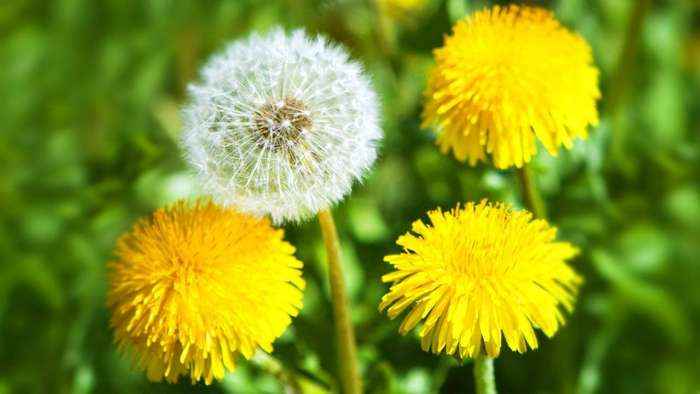
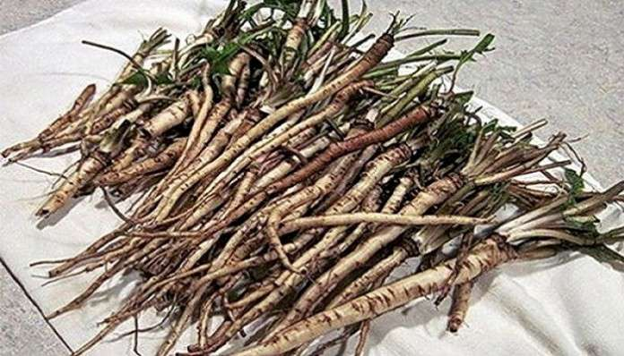

# Хорт хавдарын химийн эмчилгээнээс 100 дахин хүчтэй ургамал.

Бидний сайн мэдэх багваахай цэцгийн үндэсний ханд, цай хорт хавдарын эд эсийг 48 цагийн дотор устгах чадвартай юм байна.

. Маш өндөр эмчилгээний чанартай бөгөөд бэлтгэхэд маш хялбар байдаг аж. Канадын Виндзорын Их Сургуулийн судалгааны баг, багваахай цэцгийн үндэс нь, бусад эрүүл эд эсийг халдварлахаас сэргийлдэг, мөн хорт хавдарын эд эсийг бүрэн устгадаг гэсэн дүгнэлт хийжээ. 48 цагийн дотор хавдарын эд эсийг устгахдаа, бусад эд эсд нөлөөлөхгүй устгадаг болохыг тогтоосон байна. Мөн, Джон Ди Карло гэх өвчтөн 3 жил хорт хавдарын эмчилгээ хийлгээд засал авахгүй байсан атал, уг ургамлын цайг байнга хэрэглэснээр 4 сарын дотор энэхүү аймшигт өвчнөөс бүрэн ангижирсан амьд жишээ болсон байна.\
Багваахайн үндсээр бэлтгэх цайны жор:\
Хатаасан багваахай ба хатаасан үндэс тус бүрээс 30 грамыг авч холиод 75 мл орчим усанд хийж, чимх давс нэмээд буцалтал халаагаад таглаж, 20 минут орчим таглаатай нь зөөлөн буцалгана. Дараа нь хандаа шүүж аваад өдөрт 3 аяга цай болгон хэрэглэнэ.
