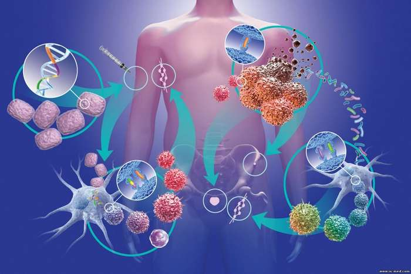
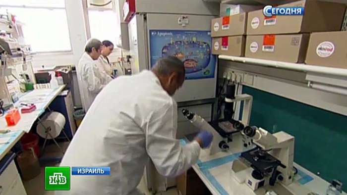

# Хорт хавдрыг эмчлэх Израйлийн вакцин

Израйлийн биотехникийн компани, хорт хавдрыг 90% эмчлэх шинэ вакцин бүтээжээ.

Одоогийн байдлаар уг вакцин, Иерусалим хотын “Хадасса” эмнэлэг дээр туршигдаж байгаа бөгөөд 2017 онд нийт өвчтөнүүдэд зориулагдан үйлдвэрлэгдэх юм байна. Энэ вакцин хорт хавдрыг эмчлээд зогсохгүй уг өвчний дахилтаас сэргийлдэг аж. Цусны ракыг эмчлэх түвшинд боловсруулагдсан боловч одоогийн үзүүлэлтээр бусад бүх төрлийн хавдарыг эмчлэх бололцоотой гэж үзэж байна. Хорт хавдар өвчний үед, хүний бие организм тухайн өвчилсөн эд, эрхтэн буруу ажиллаж буйг мэддэг боловч дархлааны систем үүнийг нь огт ойлгодоггүй учраас хамгаалах чадвараа алддаг. Учир нь хавдарын эд эсүүд нь хүний өөрийнх нь, буруу хөгжиж өсч буй эд эс байдаг бөгөөд дархлаа дарамтлагдан мөн хийгдэж буй эмчилгээнд давхар дарамтлагддаг. Тиймээс энэхүү вакцин нь дархлааг өсгөн дархлааны хамгаалах чадварыг сэргээхэд зориулагдсан аж. Урдны уламжлалт вакцинууд нь өвчлөөгүй хүмүүст зориулагдсан байсан бол энэ вакцин нь, эмчилгээний зориулалтаар, өвчилсөн хүмүүст хийж болдогоороо онцлог юм. Мөн энэ вакцин нь дархлааны системийг идэвхжүүлэх замаар хорт хавдарт байдаг MUC1 молекулууд бүхий эд эсийг эрж хайх, олох, устгахад Т-эд эсийг “сургадаг” зарчмаар боловсруулагдсан байна. Хүнд шатны хорт хавдарыг эмчилэхэд, хавдрын эмчилгээний уламжлалт аргуудтай хослуулан ашиглах ажээ. Хавдрын хэмжээ багасхад организмын өөрийнх нь өвчинтэй тэмцэх чадвар өндөрснө гээд өвчний дахилтыг гаргахгүйн тулд урт хугацааны үйлчлэлийг тооцсон гэж мэдэгдэж байна.
