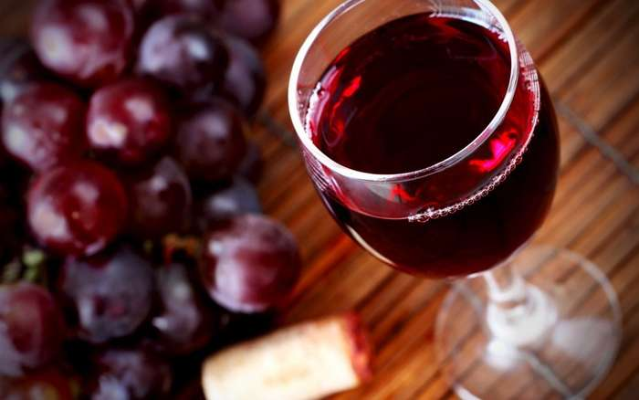
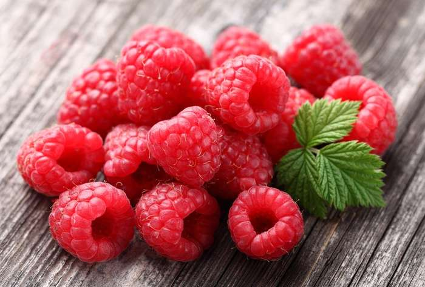

# Хорт хавдрын эд эсийг устгах чадвартай хүнснүүд

Эдгээрт ногоон цай, хар шоколад, бөөрөлзгөнө, нэрс, куркума, улаан лооль, улаан дарс ордог. Энэ хүнснүүдийг тогтмол хэрэглэх нь хавдарын эд эсийн цусан хангамжийг зогсоож, мөн тархахаас хамгаалдаг. Хавдрын эд эсийг устгах чадвартай гэж үздэг.

-**Улаан дарсанд**, ресвератрол хэмээх усан үзэмний хальсанд илүүтэй байдаг хүчтэй антиоксидант байдаг бөгөөд бактери, вирус мөөгөнцрийг амжилттай устгадаг болох нь олон шинжилгээ судалгаагаар нотлогдсон байна. 225мл дарс, 640 мкг ресвератролыг хангадаг.\
-**Куркума** нь, биеийн эрүүл мэндэд ашигтай олон төрлийн үйлчлэлээс гадна хавдарын эд эсийг устгах чадвартай ба жин хасхад үр нөлөөтэй, гайхалтай үндэс юм. \
-**Бөөрөлзгөнө**, нэрс, энэ жимсүүд хавдарыг зогсоох, устгах гайхалтай үр дүнтэй.\
-**Улаан лооль**, Харвардын судалгаагаар, сард 4-с доошгүй удаа улаан лооль, улаан лоолийн шүүс хэргэлдэг хүмүүс түрүү булчирхайн хавдар тусдаггүй гэсэн дүгнэлт гарчээ. \
-**Хар шоколад**, зүрхний үйл ажиллагааг дэмжин сэтгэл санааг өргөж хавдрын эд эстэй амжилттай тэмцдэг.\
-**Ногоон цай, кофе**, бүх төрлийн хавдартай тэмцэх чадвартай.
