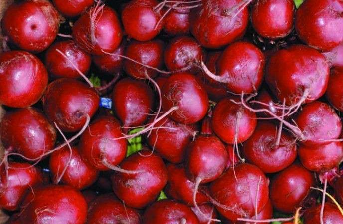
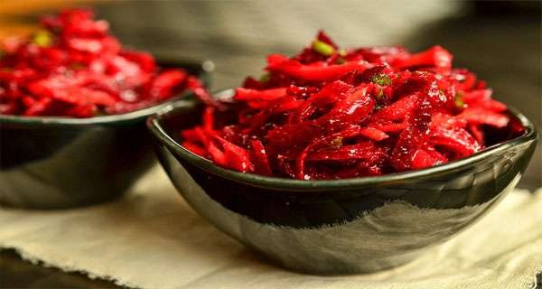

# Хүрэн манжин бие организмыг эрүүлжүүлнэ

Хүрэн манжин нь, түүхийгээр болон болгож хоол хүнсэнд хэргэлж болдог, эрүүл мэндэд гайхалтай тустай хүнсний ногоо бөгөөд элэгний өөхлөлтөөс сэргийлэх, бүдүүн гэдэсний цэвэрлэгээ хийх, хараа сайжруулах, цусны эргэлт, зүрх судасны системийг сайжруулах, бие организмд эрч хүч өгөх үйлчилэлтэй байдаг байна. Энэ хүнсний ногооны найрлагад, бетаин, триптофан хэмээх ховор бодисууд ордогоос ядаргаа тайлж стресс дардаг. Эрүүл мэндийн энэхүү салатыг байнга хэрэглэснээр гэдэс цэвэрлэгдэж, хараа сайжирахаас гадна тэжээллэг, ашигт чанартай тул өдөр тутмын хооллолтоо зууш болгон хэрэглэхийг зөвлөдөг.

Орц:\
2-3 хүрэн манжин\
2 сонгоино\
Оливын тос\
Уксус /хийхгүй байж болно/\
Давс\
Хүрэн манжингаа чанаж болгоод жижиглэн хэрчиж хэрчсэн сонгинотой хольж, оливын тосоор хутгаж давс, уксусаар амтлан тагтай саванд цаг орчим байлгаад хэрэглэнэ.
