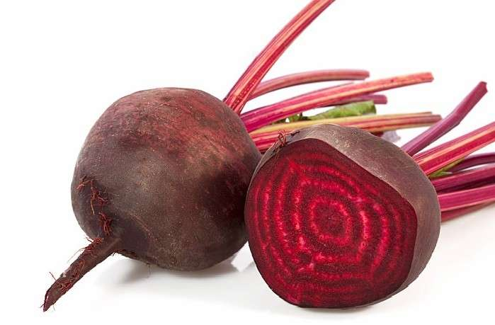
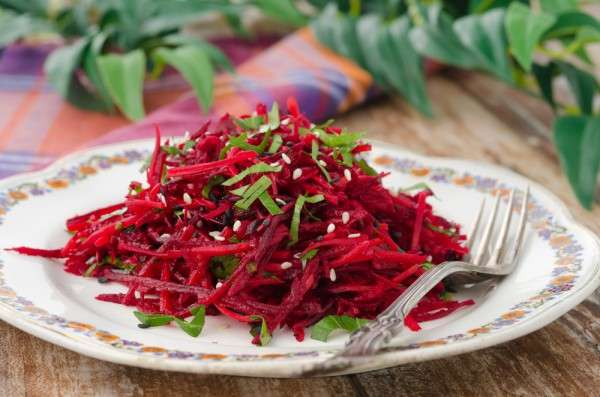

# Хүрэн манжингаар хийх хялбар салатууд ба хүрэн манжингийн ашиг тус

Хүрэн манжинг, Газар дундын тэнгисийн нэгэн арлаас гаралтай гэж үздэг. Эхний үед зөвхөн эмчилгээнд хэрэглэдэг байсан бөгөөд нилээд хожим хүнсэнд хэрэглэдэг болжээ. Маш өндөр эслэгийн агууламжтай ба төрөл бүрийн бичил элементүүд /магни, кальци, кали, төмөр, цинк, йод, фосфор/, органик хүчлүүд, В, РР, С, Р-н төрлийн амин дэмүүдээр баялаг, фолийн хүчил, бетаины орцтой учраас олон төрлийн өвчнийг анагаах, ялангуяа хорт хавдарыг зогсоох чадвартай гэж үздэг. Хүнсний ногоо болон байгалийн бүтээгдээхүүнүүд, халууны үйлчлэлд ороход шинж чанараа алддагаас, аль болох түүхийгээр хэрэглэх хандлага руу чиглэж буй тул чанаж болгоогүй хүрэн манжин, ногоо, жимсээр салат, хачир хийж хэрэглэх хялбар аргыг хүргэе. Хүрэн манжинг хэрэглэх нь, бодисын солилцоог сайжруулж, хоол шингэлтийг түргэсгэж, бие организмыг цэвэрлэж, биеэс хор гадагшлуулдаг. Мацаг барьж буй үед, хэрэглэхэд хэрэгцээт бичил элементүүдээр хангах хамгийн тохиромжтой ногоо юм.

#### **Хүрэн манжин, лууван, алимны салат**

Энэ салатыг “Амин дэмийн тэсрэх бөмбөг” гэж нэрлэдэг. Хөөрхөн нэртэй энэхүү салатыг, чанаж болгоогүй түүхий ногоогоор хийдэг. **Орц:**\
• Дунд зэргийн хэмжээтэй түүхий хүрэн манжин 1ширхэг\
• Дунд зэргийн лууван 1 ширхэг\
• Алим 1 ширхэг\
• Лимоны хүчил ¼ цайны халбага /ууттай/\
• Ургамлын тос 2 хоолны халбага\
**Хийх арга:** Ногоо, жимсээ сайтар угааж, ногооны том нүхтэй үрүүлээр үрж, нэг саванд холиод, лимоны хүчлээ нэмж хутгаад ургамлын тосоо хийж бэлэн болно. Ногоон сонгино, салатны навч, яншуй, цоохор майлз зэргээр чимэхэд улам сайхан харагдна.

#### **Хүрэн манжин, байцаа, лууван, алимны салат**

• Байцаа 200 грамм\
• Хүрэн манжин 1 ширхэг\
• Лууван 1 ширхэг\
• Алим 1 ширхэг\
• Лимоны хүчил 1/3 цайны халбага\
• Ургамлын тос 3 хоолны халбага\
• Давс бага зэрэг, мөн ногоон хүнсний ургамлууд. Бэлтгэх арга дээрхийн адил.

Хүрэн манжинг хүнсэндээ аль болох түлхүү хэрэглэхийг хичээцгээгээрэй. Миний сайн танил орос эмэгтэй, элэгний эмчилгээгүй гэж оношлогдсон хорт хавдар өвчнөөс хүрэн манжинг түүхийгээр нь идсээр байгаад салсан, одоо эрүүл саруул амьдардаг, 1,5 шуудайг хэрэглэсэн гэж ярьж байсан юм. Өвчтэй зовлонтой хүмүүс өвчнөөсөө салах, эрүүл хүмүүс, аливаа өвчнөөс урьдчилан сэргийлэх сайхан боломж гэж хүлээж авах нь зүйтэй биз ээ. Сүүлийн үед, хүрэн манжин хорт хавдартай тэмцэх чадвартай, өвчний явцыг зогсоодог талаар олон зөвлөгөө, нийтлэлүүд гарч буй нь, энэ ногооны үр ашигтай чанарыг харуулдаг гэж ойлгож болох юм.
