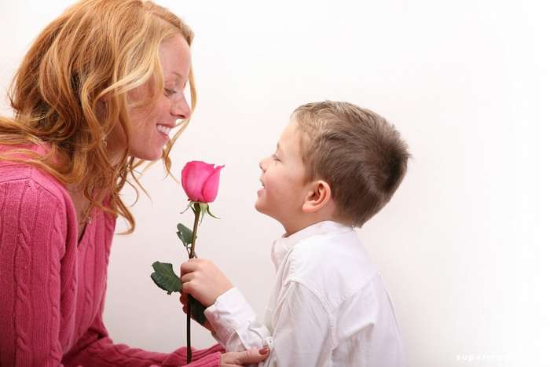

# Хүүтэй ээжүүдийн мөрдөх 6 дүрэм

Хөвгүүдээ, биеэ даасан, жинхэнэ эр хүн болгон өсгөхөд тустай гэж үздэг дүрмүүдийг хүргэе.

1. Сэтгэгдэл болон хэлж ярьж буйг нь тоохгүй, үл ойшоох байдал гаргаж хэрхэвч болохгүй. Үргэлж түүнтэй зөвлөлдөж байх нь, түүнийг санаачлагатай, хариуцлагатай хүн болон төлөвших гараа нь болж өгдөг. Энэ нь, ирээдүйн өрхийн тэргүүний хамгийн чухал чанар юм. \
2. Хөвгүүд ер нь илүү хөдөлгөөнтэй байдаг. Харин та, энэ чанарыг нь дарах оролдлого хийх ёсгүй. Уулын спорт сонирхвол сонирхог, боксоор хичээллэвэл ч хичээллэг, тэдэнд, олон зүйл дээр хүчээ сорих боломжийг олгож бай. Тогтворгүй нэгэн болохвий гэж бүү санаа зов. Тэд удахгүй ойлгож сонголт хийж эхэлдэг. Ганцхан зүйл дээ хатуу бай. Хэрэв ууланд авираад шалбарчихсан ирвэл, -“Би чамд хэлээ биз дээ” гэх маягийн үг огт бүү хэрэглээрэй. Харин, түүгээрээ бахархаж, -“Чи ямар ч гэсэн авиралтад оролцлоо шүү дээ” гэсэн урмын үг хэлж, дараа болгоомжтой байхыг сануулаад өнгөрүүл.\
3. Инээхээс өөр аргагүй үйлдэл хийсэн ч, бүү инээж шооолоорой. Аргагүй инээсэн тохиолдолд, -“Ийм жаахан байж, сүрхий юм хийх юм. Би чамаараа бахархдаг шүү” гэх маягийн үгс хэлж, шоолж инээгээгүй гэсэн ойлголт өгөх хэрэгтэй.\
4. Хүүгийнхээ аман дээр үнсэхийг хориглоно. Хүүхдийнхээ хаана нь эрхлүүлэн үнсэх нь, бидний эрх хэмээн бүү эсэргүүцээрэй. Уруул яалт ч үгүй, сэрэл, дур хүслийн өдөөгч эрхтэн. Энэ үнсэлт ээжийн эрхлүүлэлттэй нийцэхгүй. Зөндөө өхөөрдөн үнсэх, хөөрхөн хацар, дух, хамар гээд байгаа шүү дээ.\
5. Хөвгүүдийнхээ дэргэд хувцасаа тайлж, солихоос зайлсхий. Хүүхэд, өөрөө хувцасаа өмсөж чаддаг болохоос нь эхлэн энэ байдлыг үзүүлж хэрэггүй.\
6. Алдаа дутагдлыг нь өөр бусад хүмүүст ярьж хөөрөх хэрэггүй. Ялангуяа, 4-7 насандаа хүүхэд их эмзэг байдаг. Ийм яриа хөвгүүдийг, нэг бол эмэгтэй хүнд итгэхээ болих, эсвэл алдаагаа олноор хэлэлцэх байдалд орохгүйн тулд, идэвхигүй болох нөхцөлд хүргэнэ.
